# Dossier — FitZone Sports — Equipo 03

Universidad Nacional de Entre Ríos — Facultad de Ciencias de la Administración

Licenciatura en Sistemas — Programación V — Año 2026

Trabajo Integrador Final — Caso «FitZone Sports»

**Equipo 03**

| Integrante | Legajo | Rol | Autor en Git | Usuario de GitHub |
|------------|--------|-----|--------------|-------------------|
| Patricio Ramos | legajo a completar | P1. Arquitectura, documentación y backend | Patricio Ramos | PatricioRamos04032000 |
| Bruno Nicolás Conti | legajo a completar | P2. Backend | bruno y Bruno Nicolás Conti | brunoc11 |
| Lucas Coquet | legajo a completar | P3. Frontend | LucasCoquet | LucasCoquet |
| Matias Goncevat | legajo a completar | P4. Planificación, CI, seed y Docker | MatiGoncevat | MatiGoncevat |

- **Fecha de armado:** 17 de noviembre de 2026.
- **Fecha de entrega prevista:** 19 de noviembre de 2026, 18:00 (hora de Argentina).
- **Repositorio:** https://github.com/PatricioRamos04032000/FitZoneSports
- **Tag:** {{TAG}}
- **Hash:** {{HASH}}

{{HASH_LEYENDA}}

El legajo de cada integrante no está en el repositorio. El campo queda escrito para completarlo antes de la subida a Moodle.

### Índice

1. Resumen ejecutivo del sistema
2. Arquitectura: diagramas C4 de los niveles 1, 2 y 3
3. Registros de decisión arquitectónica
4. Modelado
5. Patrones de diseño aplicados y su justificación
6. Estrategia de pruebas y reporte de cobertura
7. Cumplimiento de los requisitos no funcionales
8. Planificación
9. Bitácoras individuales
10. Índice de los manuales
11. Anexo: tablero del proyecto

## 1. Resumen ejecutivo del sistema

FitZone Sports es el portal web de una cadena de gimnasios. El socio consulta su membresía, se anota a clases, reserva una cancha y muestra un código que rota para entrar a la sede. La recepción registra la entrada y la salida, y lee el aforo de su sede. El gerente crea sedes, arma la agenda de clases y administra las canchas y sus precios. El cliente externo reserva canchas pagando la tarifa de externo.

La entrega es una sola aplicación. El navegador corre React. La API es NestJS. Los datos y el login viven en Supabase, con PostgreSQL y Auth. Nest hace de pasarela: el navegador no habla con Auth ni escribe en la base. Los pagos de esta entrega pasan por una pasarela simulada. El comprobante que se descarga después de pagar es un PDF de FitZone, con la cancha, el horario y el monto. No es una factura fiscal.

El precio de una reserva sale de una cadena de decoradores. Adentro está la tarifa de la cancha. Encima, el recargo si el turno cae en la franja pico de la sede. Afuera, el descuento si el cliente es socio activo. Un socio con la cuota vencida no entra en ese descuento y paga como externo. Dos pedidos del mismo turno dejan una sola reserva: la base bloquea la cancha y un índice único impide la segunda fila. Si la recepción pierde la red, el ingreso y la salida quedan en el navegador y se confirman cuando la conexión vuelve.

Este dossier junta la arquitectura, las decisiones, los diagramas, los patrones, las pruebas, los requisitos no funcionales, la planificación leída al 17 de noviembre de 2026, las cuatro bitácoras y el índice de los manuales. El código todavía no está congelado.

## 2. Arquitectura: diagramas C4 de los niveles 1, 2 y 3

El nivel 4, el de código, queda fuera de este dossier. Los lineamientos lo marcan opcional. La estructura del precio con Decorator se lee en el diagrama de clases de la sección 4 y en el manual técnico.

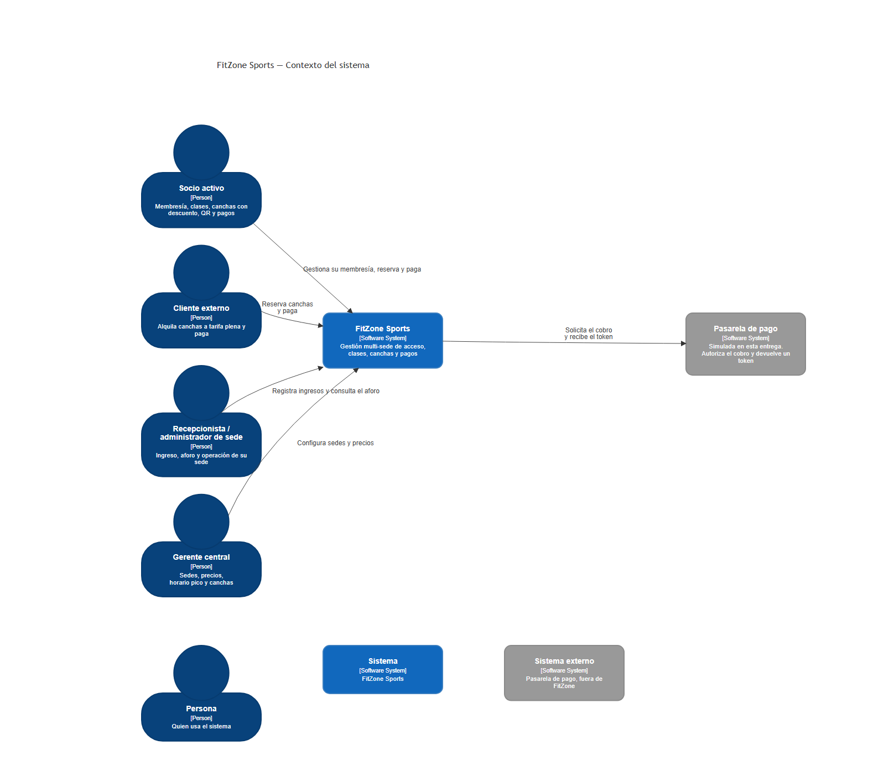

*C4-1. Contexto.* Fuente editable: `docs/diagramas/fuentes/c4-1-contexto.mmd`. Exportación: `docs/diagramas/img/c4-1-contexto.svg`.

El contexto muestra al socio activo, al cliente externo, a la recepción o administración de sede y al gerente, y a la pasarela de pago como sistema externo.

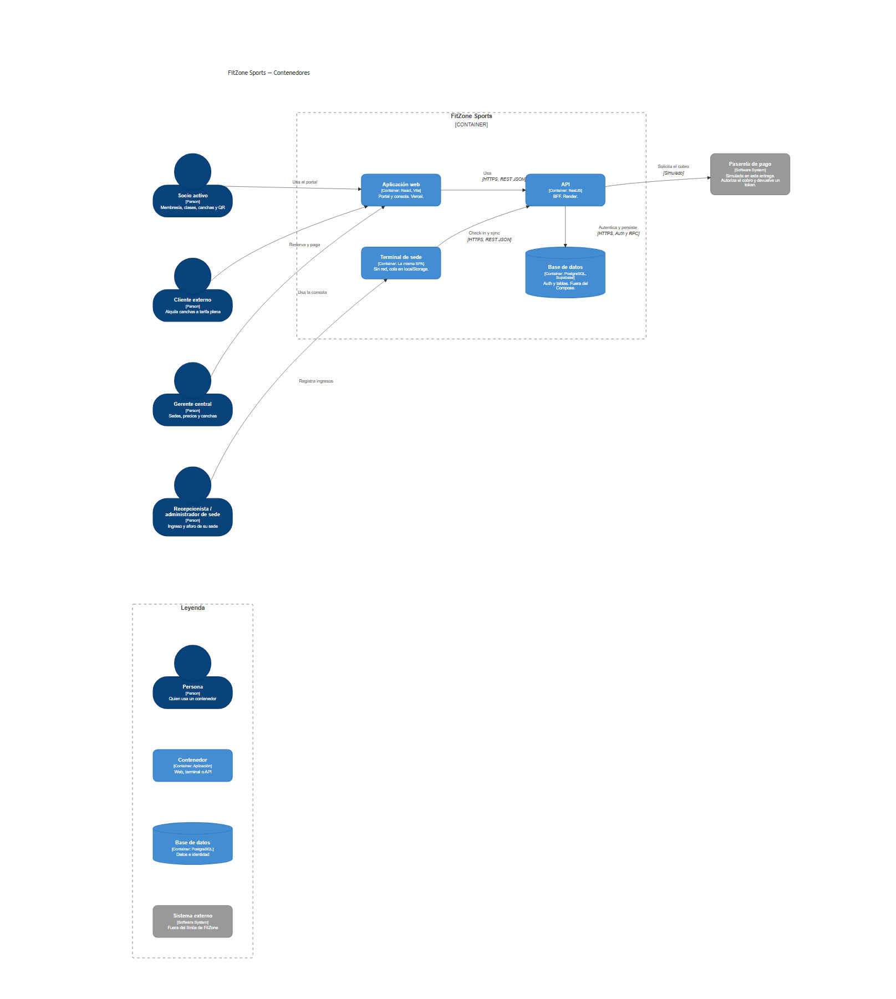

*C4-2. Contenedores.* Fuente editable: `docs/diagramas/fuentes/c4-2-contenedores.mmd`. Exportación: `docs/diagramas/img/c4-2-contenedores.svg`.

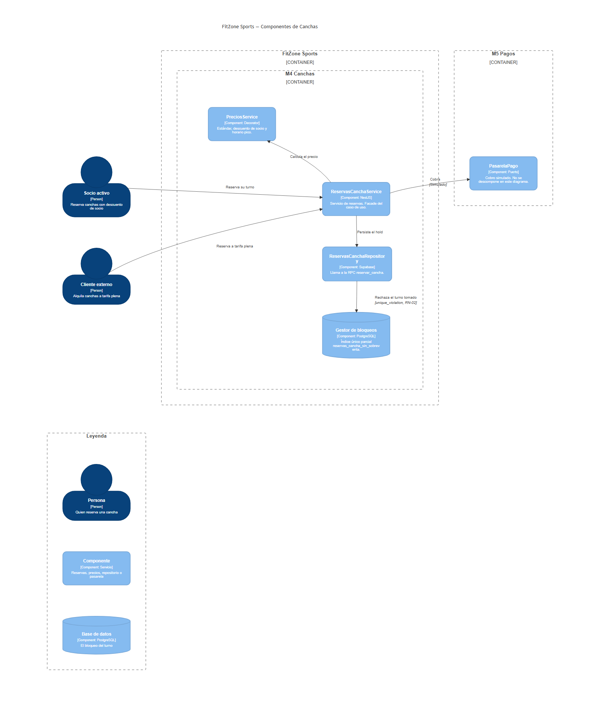

*C4-3. Componentes del módulo de canchas.* Fuente editable: `docs/diagramas/fuentes/c4-3-canchas.mmd`. Exportación: `docs/diagramas/img/c4-3-canchas.svg`.

El módulo de canchas separa la reserva, el cálculo de precio, el repositorio y el bloqueo del turno.

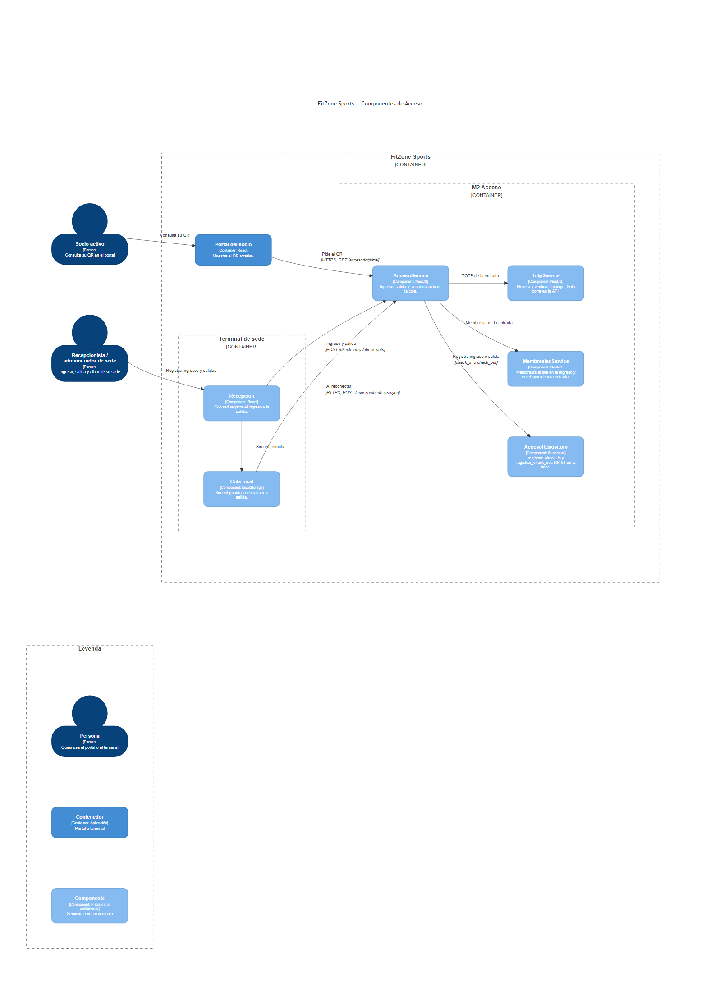

*C4-3. Componentes del módulo de acceso.* Fuente editable: `docs/diagramas/fuentes/c4-3-acceso.mmd`. Exportación: `docs/diagramas/img/c4-3-acceso.svg`.

El módulo de acceso incluye el camino del QR cuando la sede está sin conexión con el servidor central.

## 3. Registros de decisión arquitectónica

Van los diez ADR obligatorios y ADR-011, que el desarrollo necesitó para dejar Supabase Auth detrás de Nest. Todos están en estado Aceptado. La numeración anterior al 9 de noviembre de 2026 quedó en `docs/adr/historial/` y no se reimprime acá.

Archivo de origen: `docs/adr/ADR-001-monolito-modular.md`.

### ADR-001 — Monolito modular frente a microservicios, SOA y serverless

- **Estado:** Aceptado
- **Fecha:** 2026-08-25
- **Autor:** Equipo FitZone Sports (P1–P4). Alineación al Anexo B: Patricio Ramos (P1), 2026-11-09
- **Sprint:** 1
- **Lineamientos:** §5.2.1 ADR-001

La decisión no cambió el 2026-11-09. Se completaron los campos del Anexo B y se explicitaron SOA y serverless, que el registro anterior no nombraba. El texto previo está en `historial/ADR-001-monolito-modular.md`.

#### Contexto

FitZone Sports tenía que gestionar membresías, acceso por QR, clases y alquiler de canchas en más de 25 sedes. Dos reglas no admitían un resultado intermedio: si dos personas reservan la misma cancha en el mismo horario, solo una reserva vale (RN-02), y un socio no puede figurar dentro de dos sedes a la vez (RN-01). Los pagos tenían que quedar ligados a la reserva.

El equipo eran cuatro personas, con un cuatrimestre y entregables acumulativos de backend, patrones, frontend, integración continua y una app móvil al final. La cátedra pedía justificar el estilo arquitectónico frente a microservicios y dejaba abierta la tensión entre transacciones locales y un sistema distribuido. Sumar una sede tenía que ser configuración, no un deploy nuevo (RNF-04).

#### Alternativas consideradas

| Alternativa | A favor | En contra | Por qué se descartó |
|---|---|---|---|
| Microservicios (reservas, pagos y usuarios por separado) | Escalar y desplegar un módulo sin tocar el resto | RN-02 pasa a ser una saga o un 2PC; hacen falta varios deploys, red y observabilidad | El costo de operación no cierra con cuatro personas y el plazo del cuatrimestre |
| SOA, con servicios de dominio detrás de un bus | Reutiliza capacidades si ya hay sistemas para integrar | La transacción del turno sigue distribuida, y aparece un bus que nadie más va a consumir | No había legados que integrar. El problema de la sobreventa no se simplifica |
| Serverless y BaaS (funciones sueltas, lógica en el proveedor de la base) | Menos servidores propios y escala a cero | El límite transaccional de RN-02 queda partido entre funciones; el arranque en frío molesta en la demo; los patrones del curso no tienen un proceso donde vivir | Se descartó como estilo del sistema. Supabase queda como base e identidad, no como reemplazo del backend |
| Monolito sin módulos | Un solo deploy y menos carpetas | No hay límite para Repository, Strategy y Observer, ni una forma clara de repartir el trabajo | Se descartó por el riesgo de acoplar todo el dominio en un solo paquete |

#### Decisión

Se adopta un monolito modular: una sola API REST desplegable, con módulos internos por dominio (usuarios, acceso, clases, canchas, pagos y sedes) y una base de datos compartida (ADR-002).

El criterio determinante fue poder cerrar RN-02 en una transacción local, con un equipo chico y un solo contrato HTTP.

La app móvil, si entra, es otro cliente de esa API. No es otro estilo arquitectónico.

#### Consecuencias

- **Positivas:** las transacciones locales alcanzan para la reserva y para la presencia en sede; hay un solo deploy de API y un Swagger; los módulos permiten repartir el trabajo sin partir el runtime; una sede nueva es una fila, no un servicio (RNF-04).
- **Negativas:** no se escala un módulo aislado; hace falta disciplina para no cruzar dominios por imports oportunos; un fallo grave del proceso afecta a todos los módulos.
- **Deuda asumida:** extraer un módulo a otro proceso, si el sistema creciera, es una decisión nueva y otro ADR. No está previsto en esta entrega.

#### Requisitos relacionados

RN-02, RN-01, RNF-04

Archivo de origen: `docs/adr/ADR-002-postgresql.md`.

### ADR-002 — PostgreSQL como motor relacional

- **Estado:** Aceptado
- **Fecha:** 2026-08-25
- **Autor:** Equipo FitZone Sports (P1–P4). Alineación al Anexo B: Patricio Ramos (P1), 2026-11-09
- **Sprint:** 1
- **Lineamientos:** §5.2.1 ADR-002

Este registro cubre solo el motor. Cómo Nest lee y escribe está en ADR-005. Dónde está hospedado está en ADR-009.

Hasta el 2026-11-09 el motor vigente estaba numerado como ADR-008. Un registro anterior mezclaba PostgreSQL con un ORM pendiente; ese texto está en `historial/ADR-002-postgresql.md` y el motor separado, en `historial/ADR-008-postgresql.md`.

#### Contexto

El dominio cruza sedes, turnos de cancha, membresías, clases y pagos. Había que impedir la sobreventa (RN-02), responder la disponibilidad con un esquema indexable (RNF-03), sumar sedes como datos (RNF-04) y guardar comprobantes y estados de pago sin guardar la tarjeta (RNF-02). El monolito (ADR-001) asume un almacén primario compartido por todos los módulos.

El enunciado orientaba a una base relacional, con transacciones y restricciones, y con migraciones versionadas en el repositorio. El equipo no administraba un servidor de bases propio.

#### Alternativas consideradas

| Alternativa | A favor | En contra | Por qué se descartó |
|---|---|---|---|
| MongoDB u otro documental | Flexible si el esquema cambia seguido | La unicidad cancha + horario y la presencia de una sola sede son restricciones relacionales; la transacción entre documentos es más frágil | El modelo ya era tablas, claves y unicidad |
| MySQL o MariaDB | También son SQL y alcanzan para este dominio | No aportan nada que PostgreSQL no cubra, y el enunciado y el hosting elegido (Supabase) son PostgreSQL | No había un requisito que los hiciera preferibles |
| SQLite | Cero operación en una laptop | Débil para varios usuarios concurrentes y para el hosting compartido del equipo | No sirve como base de la demo ni de RN-02 bajo concurrencia |
| Solo Auth y Storage, sin SQL de dominio | Menos modelo que diseñar | No hay dónde poner turnos, membresías ni pagos, ni un Repository sobre tablas | No cubre el dominio |

#### Decisión

El único almacén primario de datos de negocio es PostgreSQL. En desarrollo y en la demo lo administra Supabase (ADR-009). El major no está fijado en el repositorio: es el que ofrece el proyecto de Supabase.

El criterio determinante fue la integridad transaccional: restricciones e índices que la API no puede saltear, en particular la unicidad del turno y la de la presencia.

#### Consecuencias

- **Positivas:** RN-02 y RN-01 se apoyan en constraints, no solo en código; el esquema de sedes, perfiles, membresías, clases, canchas y pagos es explícito; las migraciones viven en `supabase/migrations/`; se pueden indexar las consultas de disponibilidad (RNF-03).
- **Negativas:** el esquema y las migraciones hay que diseñarlos desde el principio; la cadena de conexión y la `service_role` no pueden commitearse; reportes analíticos pesados no son el foco, aunque el SQL alcanza para el consolidado del gerente en este alcance.
- **Deuda asumida:** no hay migraciones hacia atrás (el procedimiento está en ADR-009). No se evalúa un motor analítico aparte. Cambiar de PostgreSQL implicaría reescribir las funciones `reservar_cancha` y `registrar_check_in`.

#### Requisitos relacionados

RNF-03, RN-02, RN-01, RNF-02, RNF-04

Archivo de origen: `docs/adr/ADR-003-estrategia-offline-acceso.md`.

### ADR-003 — Estrategia offline del control de acceso

- **Estado:** Aceptado
- **Fecha:** 2026-11-03
- **Autor:** Equipo FitZone Sports. Redacción al Anexo B: Patricio Ramos (P1)
- **Sprint:** 8
- **Lineamientos:** §5.2.1 ADR-003

#### Contexto

El ingreso al gimnasio tenía que seguir el QR rotativo del socio (RF-04) y el control de acceso en sede tenía que seguir operando cuando se caía la conexión con el servidor central (RNF-01). Había dos cortes de red distintos: el de recepción, que debe registrar el ingreso, y el del socio, que solo necesita mostrar su QR.

El equipo era de cuatro personas. El camino crítico de la demo eran las canchas, y un nodo por sede con copia de secretos TOTP todavía no tenía validación de la cátedra. La regla de una sola sede a la vez (RN-01) se puede imponer en la base mientras hay conexión; sin conexión, el terminal no ve el estado del resto de la cadena.

Hasta el 2026-11-09 esta decisión y el protocolo de sincronización vivían en un mismo registro. El texto combinado quedó en `historial/ADR-007-acceso-totp-cola-offline.md`. El protocolo está en ADR-007.

#### Alternativas consideradas

| Alternativa | A favor | En contra | Por qué se descartó |
|---|---|---|---|
| Check-in solo online, sin cola | Un solo camino, la validación ocurre siempre en la API | Con la red caída la recepción no registra nada | No cubre RNF-01 |
| Nodo local por sede con paquete de seeds TOTP | La recepción valida el QR sin API y puede rechazar en el momento | Hay que distribuir y rotar secretos, revocarlos sin red y operar un servicio por sede | Plausible más adelante; fuera del alcance y del plazo de esta entrega |
| Cubrir RNF-01 solo con la app móvil del socio | El QR se puede mostrar sin red | No registra el ingreso ni el aforo en recepción | No sustituye al terminal de sede |

#### Decisión

Ante la caída de la conexión principal, la web de recepción acumula el check-in en el navegador y lo confirma contra la API al reconectar. Mientras no hay red no se validan membresía, TOTP ni RN-01: esa validación ocurre en el servidor, que sigue siendo la fuente de verdad.

Queda fuera de esta decisión el paquete de seeds en la sede, el servicio local por sede, los tornos y la app móvil instalable.

El criterio determinante fue poder demostrar RNF-01 en la demo sin operar infraestructura por sede.

#### Consecuencias

- **Positivas:** la recepción sigue tomando ingresos sin internet; al volver la red cada evento se acepta o se rechaza con un error de negocio; RN-01 online queda en la base, igual que la no sobreventa de canchas.
- **Negativas:** un ingreso encolado puede rechazarse después (membresía vencida, código TOTP fuera de ventana, socio ya dentro de otra sede). La recepción no se entera hasta el sync.
- **Deuda asumida:** la validación TOTP 100 % offline y el cierre de presencia por tiempo de permanencia no forman parte de esta entrega. Si la cátedra exige validar el QR sin API, hace falta otro ADR y el nodo que acá se dejó afuera.

#### Requisitos relacionados

RNF-01, RF-04, RN-01

Archivo de origen: `docs/adr/ADR-004-concurrencia-reservas-canchas.md`.

### ADR-004 — Concurrencia en la reserva de canchas

- **Estado:** Aceptado
- **Fecha:** 2026-10-27
- **Autor:** Equipo FitZone Sports. Redacción: Patricio Ramos (P1)
- **Sprint:** 7
- **Lineamientos:** §5.2.1 ADR-004

#### Contexto

Dos socios pueden pedir el mismo turno de la misma cancha al mismo tiempo. La regla de negocio es que exactamente uno queda con la reserva (RN-02). Un control previo en la API (leer si el turno está libre y después insertar) pierde la carrera: las dos lecturas ven el turno libre y las dos escrituras confirman.

El precio lo calcula Nest con una cadena Decorator (Nest manda el precio ya resuelto). La base tiene que garantizar el cupo del turno, no el cálculo del precio. Una reserva `pendiente` de pago también ocupa el turno durante una ventana corta: si no lo hiciera, otro socio compraría el mismo horario mientras el primero está en el checkout.

La función y el índice quedaron en la migración `supabase/migrations/20261027200000_canchas_m4.sql`. El hold de la pendiente, en `20261101200000_hold_reserva_pendiente.sql`.

#### Alternativas consideradas

| Alternativa | A favor | En contra | Por qué se descartó |
|---|---|---|---|
| Chequeo solo en Nest (`SELECT` y después `INSERT`) | Fácil de leer en el servicio | Las dos transacciones ven el turno libre | La condición de carrera queda entre la lectura y la escritura. El índice único la cierra igual, pero el perdedor no debe depender de que el servicio haya leído bien |
| Bloqueo optimista (columna `version` o `updated_at`) | No retiene un lock de fila | Los dos leen la misma versión; igual hace falta una restricción para que el segundo `UPDATE` falle, y el error no es el código de negocio del turno | No agrega una garantía que el índice único no dé ya, y suma un ida y vuelta |
| Aislamiento `SERIALIZABLE` como única medida, sin índice de unicidad | Postgres aborta una de las dos transacciones | El fallo llega como error de serialización, no como `TURNO_OCUPADO`, y un reintento ciego puede volver a chocar | No alcanza como contrato del perdedor |
| Mutex en memoria de Nest, un trabajador por cancha | Ordena los pedidos de un solo proceso | No cruza dos instancias de la API ni sobrevive a un reinicio | El despliegue no promete un solo proceso |

#### Decisión

La reserva entra por la función `reservar_cancha`, en una sola transacción de PostgreSQL. Esa función toma un bloqueo pesimista de la fila de la cancha (`SELECT … FROM canchas WHERE id = p_cancha_id FOR UPDATE`), valida horario, mantenimiento y horizonte, y recién ahí inserta.

La garantía que sobrevive aunque el lock no alcanzara es el índice único parcial `reservas_cancha_sin_sobreventa` sobre `(cancha_id, inicio)` donde el estado es `pendiente` o `confirmada`. Una violación de unicidad se traduce a `TURNO_OCUPADO`. Nest no decide el cupo con un `if` previo: llama al RPC y mapea ese error.

Una reserva `pendiente` ocupa el mismo índice. A los 10 minutos (`minutos_hold_reserva`) la limpia `cancelar_reservas_pendientes_vencidas`, que la función corre sobre ese turno antes de insertar.

El criterio determinante fue que el perdedor reciba un rechazo de la base, no una segunda confirmación.

#### Consecuencias

- **Positivas:** dos reservas simultáneas del mismo turno terminan en una sola fila vigente; el perdedor obtiene `TURNO_OCUPADO`; el hold evita vender el turno mientras el pago sigue abierto; el mismo esquema (restricción en la base, la API traduce el error) se reutiliza en RN-01.
- **Negativas:** quien llega segundo espera el commit del primero sobre esa cancha; la lógica del cupo está en SQL y hay que leerla junto con el servicio Nest; el hold depende de que la función de limpieza corra antes del insert (y de `pg_cron` si se quiere limpiar sin tráfico).
- **Deuda asumida:** no hay prueba de dos sesiones en paralelo dentro del CI. `supabase/tests/canchas_m4.test.sql` rechaza una segunda reserva secuencial con `TURNO_OCUPADO`; se corre a mano contra un PostgreSQL local y no se ejecuta en GitHub Actions.

#### Requisitos relacionados

RN-02, RF-09, RF-10, RF-13

Archivo de origen: `docs/adr/ADR-005-backend-nestjs-ioc-datos.md`.

### ADR-005 — Framework backend, inyección de dependencias y acceso a datos

- **Estado:** Aceptado
- **Fecha:** 2026-11-02
- **Autor:** Equipo FitZone Sports. Redacción al Anexo B: Patricio Ramos (P1)
- **Sprint:** 1
- **Lineamientos:** §5.2.1 ADR-005

#### Contexto

El monolito modular (ADR-001) necesitaba un framework de API con módulos, un contenedor de inyección de dependencias y un modo de leer y escribir PostgreSQL (ADR-002). La cátedra admitía Spring Boot o NestJS. El equipo ya había elegido TypeScript también para la web, y el entregable de la Unidad II pedía Swagger y una estructura por módulos.

La base está en Supabase. Desde Nest se podía conectar con un ORM sobre `DATABASE_URL` o usar el cliente de Supabase. En la exposición del 28/08/2026 el docente recomendó la API de Supabase. Un ADR anterior mezclaba el motor de la base con un ORM todavía no elegido; ese texto está en `historial/ADR-002-postgresql.md`. El registro que separaba «sin ORM» está en `historial/ADR-006-supabase-api-sin-orm.md`.

Hacía falta, además, un lugar donde vivir Repository, Decorator (precios) y Observer, sin mover la lógica de negocio al navegador ni a un BaaS.

#### Alternativas consideradas

| Alternativa | A favor | En contra | Por qué se descartó |
|---|---|---|---|
| Spring Boot | Encaja en el enunciado, ecosistema Java maduro | Otro lenguaje respecto de React; el equipo no lo tenía como base de trabajo | Se prefirió un solo lenguaje en API y web |
| Express sin contenedor de módulos | Menos marco, arranque corto | Módulos, guards y Swagger quedan armados a mano | No ordena el monolito que pide ADR-001 |
| TypeORM o Prisma sobre `DATABASE_URL` | Entidades, migraciones y relaciones en el proceso Node | Duplica el acceso que ya ofrece la API de Supabase; el docente recomendó no usarlo como camino principal | El acceso de runtime no es un ORM |
| Driver `pg` con SQL crudo en cada servicio | Control total de la sentencia | Cada módulo abre su propio SQL y se diluye Repository | Sirve para un script puntual, no como estrategia de la API |
| Contenedor propio (Inversify u otro) además del de Nest | Familiar si el equipo ya lo usaba | Dos contenedores para el mismo proceso | Nest ya inyecta repositorios, guards y la pasarela de pago |

#### Decisión

El backend es NestJS 12 con TypeScript (licencia MIT; el proyecto lo mantiene el equipo de NestJS sobre Node.js). El contenedor de inyección es el de Nest: módulos por dominio registran controladores, servicios y repositorios.

No hay ORM en runtime. Los repositorios usan `@supabase/supabase-js` con `SUPABASE_URL` y `SUPABASE_SERVICE_ROLE_KEY`, solo en el backend. El tipado es con interfaces y DTO de Nest. El SQL que tiene que ser atómico (reserva de cancha, check-in, inscripción a clase) está en funciones de PostgreSQL versionadas en `supabase/migrations/` y se invoca por RPC.

La identidad no forma parte de este ADR: el frontend habla solo con Nest y Nest delega el login en Supabase Auth (ADR-011).

El criterio determinante fue unificar el lenguaje con la web y dejar las transacciones en PostgreSQL, sin una segunda capa de mapeo.

#### Consecuencias

- **Positivas:** un solo lenguaje en API y web; módulos alineados al monolito; Repository encapsula PostgREST; las reglas de cupo y de presencia quedan en funciones SQL con un error de negocio traducible; Swagger sale del mismo proceso.
- **Negativas:** no hay Identity Map ni dirty checking de un ORM; las relaciones anidadas se escriben en el `select` del cliente; en local la API depende de la red hacia Supabase; hay que cuidar que la `service_role` no llegue al bundle del frontend.
- **Deuda asumida:** no hay calendario de salto de major de NestJS ni de Node. Row Level Security está habilitado en tablas sensibles como red de contención, y la autorización de negocio sigue en los guards de Nest. La dependencia de un ORM no se reabre salvo un ADR nuevo.

#### Requisitos relacionados

Unidad II. Apoya RN-02 y RN-01 (RPC), RNF-03 (consultas sobre el esquema relacional) y RNF-04 (sedes como datos, no como servicios).

Archivo de origen: `docs/adr/ADR-006-frontend-react-estado.md`.

### ADR-006 — Framework frontend, componentes y estado global

- **Estado:** Aceptado
- **Fecha:** 2026-11-09
- **Autor:** Patricio Ramos (P1), sobre la elección de React del equipo (2026-08-25)
- **Sprint:** 8
- **Lineamientos:** §5.2.1 ADR-006

#### Contexto

Los cuatro roles (socio, cliente externo, recepcionista y gerente) tenían que operar desde la web. La Unidad IV pedía una interfaz con componentes y un estado de sesión compartido entre pantallas: token, usuario y rol. La cátedra admitía React o Vue.

Al cerrar el stack, en noviembre de 2026, el registro del framework dejaba abiertos los estilos y la librería de estado global. En el código el portal ya tenía sesión, rutas por rol y componentes propios. Había que registrar qué se usa de verdad, no la lista de candidatos.

La app móvil seguía diferida. El frontend no llama a Supabase: habla con la API Nest (ADR-011).

#### Alternativas consideradas

| Alternativa | A favor | En contra | Por qué se descartó |
|---|---|---|---|
| Vue | Equivale a React para esta UI | El equipo ya construía las pantallas en React | No había un problema que Vue resolviera mejor |
| Next.js con API routes | Un solo proyecto y render en servidor | Mezcla el contenedor de la web con el de la API y empuja lógica al frontend | La API queda en Nest (ADR-005) para mantener el C4 en dos contenedores |
| Librería de componentes (MUI, Chakra u otra) | Pantallas más rápidas al inicio | Otro sistema visual encima de Atomic Design y más peso en el bundle | Los átomos necesarios (botón, input, spinner) son pocos y ya estaban en el repo |
| Tailwind | Utilidades consistentes | El CSS ya estaba por componente | Cambiar de sistema de estilos no acerca la demo |
| Zustand o Redux | Sirven si el estado de cliente crece | La sesión es un solo árbol chico; el resto de las pantallas pide datos a la API y los guarda en estado local | Un store global de dominio duplicaría la API |

#### Decisión

La aplicación web es una SPA React 19 con TypeScript, Vite 8 y React Router 7. React se publica bajo licencia MIT y lo gobierna Meta. Los componentes son propios, ordenados con Atomic Design (`frontend/src/components`: átomos `Button`, `Input`, `Select` y `Spinner`, la molécula `Alerta`, y el layout como organismo). El catálogo está en `frontend/src/components/README.md`. Los estilos son CSS por componente, sin librería de UI.

El estado global es la sesión: `AuthProvider` expone token, usuario, rol y el cierre de sesión por React Context. El access token se guarda en `sessionStorage`. Cada pantalla carga sus datos con el cliente HTTP de `frontend/src/services` y los mantiene en estado local.

El criterio determinante fue cubrir los cuatro roles con el código que ya estaba en marcha, sin sumar una librería de estado ni un kit visual.

#### Consecuencias

- **Positivas:** una sola SPA para el portal y la consola; la sesión llega a las rutas protegidas sin prop drilling; no hay un segundo modelo de datos en el cliente; el bundle no arrastra un kit de UI.
- **Negativas:** cada pantalla repite el ciclo de carga y error; no hay caché de servidor ni reintentos automáticos de lecturas; el CSS propio pide disciplina para no divergir entre pantallas.
- **Deuda asumida:** no hay tests de componentes ni E2E de navegador (ADR-008). Si el estado de cliente deja de ser solo la sesión (por ejemplo un carrito o una cola distinta de la de acceso), se evalúa Zustand en un ADR nuevo. La dependencia `@supabase/supabase-js` figura en `frontend/package.json` y el código de `src/` no la importa.

#### Requisitos relacionados

Unidad IV. Apoya RF-04 (portal del QR), RF-09 (reserva desde la web) y el acceso de recepción de RNF-01.

Archivo de origen: `docs/adr/ADR-007-acceso-totp-cola-offline.md`.

### ADR-007 — Sincronización del terminal de sede

- **Estado:** Aceptado
- **Fecha:** 2026-11-03
- **Autor:** Equipo FitZone Sports. Redacción al Anexo B: Patricio Ramos (P1), 2026-11-09
- **Sprint:** 8
- **Lineamientos:** §5.2.1 ADR-007

La estrategia (qué se hace cuando cae la red) está en ADR-003. Este registro dice qué queda en el navegador de recepción, cada cuánto se manda y cómo se resuelve un choque al reconectar. El texto que mezclaba las dos decisiones está en `historial/ADR-007-acceso-totp-cola-offline.md`.

#### Contexto

Con la estrategia de cola ya elegida, faltaba definir el contenido del terminal. Replicar seeds TOTP, membresías y presencias hubiera permitido validar el QR sin API, y también hubiera dejado secretos en el navegador de la sede. El equipo no iba a operar esa réplica.

El check-in online ya entraba por `POST /acceso/check-ins`. Hacía falta un camino para los eventos acumulados, sin doble ingreso si el recepcionista reintenta, y sin cerrar solo la presencia de otra sede cuando el segundo ingreso pierde.

RN-01 se impone con la clave primaria de `presencias` (`perfil_id`) dentro de `registrar_check_in`. La migración es `supabase/migrations/20261101210000_acceso_m2.sql`.

#### Alternativas consideradas

| Alternativa | A favor | En contra | Por qué se descartó |
|---|---|---|---|
| Réplica local de seeds, membresías y presencias, refresca cada N minutos | La sede valida y rechaza sin red | Secretos en el navegador, revocación atrasada y conflictos de dos copias de la presencia | Es el nodo que ADR-003 dejó fuera |
| Timer fijo (por ejemplo cada 30 s) aunque nadie esté mirando la pantalla | Vacía la cola sin un clic | Despierta la API en el free tier y reintenta errores de negocio en loop | El evento de red y el botón alcanzan para la demo |
| Last-write-wins: el sync pisa la presencia anterior | El ingreso encolado «gana» siempre | Un socio quedaría dentro de la sede equivocada, o en dos, según el orden de llegada | RN-01 no se negocia en el cliente |
| Borrar la presencia vieja y aceptar el ingreso nuevo | La cola no muestra errores | Cierra una visita que quizá sigue abierta en la otra sede, sin cajero de por medio | El conflicto se anota y lo resuelve una persona |

#### Decisión

El terminal no replica catálogo, seeds ni membresías. En `localStorage`, clave `fitzone.acceso.cola`, solo persiste la cola de ingresos todavía no confirmados. Cada ítem lleva `clientEventId`, `perfilId`, `code`, `sedeId` y `ocurrioEn`.

No hay frecuencia periódica. La cola se envía en dos momentos: cuando el navegador dispara el evento `online`, y cuando recepción pulsa sincronizar. El POST es `/acceso/check-ins/sync`, de a lo sumo 50 ítems.

El servidor es la fuente de verdad:

- El mismo `clientEventId` (`check_ins.client_event_id`, único) es idempotente: el reintento responde ok y no vuelve a validar el TOTP.
- Cada ítem nuevo pasa por membresía activa, TOTP y `registrar_check_in`.
- Si la presencia ya existe, la base responde `YA_DENTRO` o `YA_EN_OTRA_SEDE`. Nest traduce ese error. El ítem queda en la cola con estado `error`. No se cierra sola la presencia anterior.
- Los ítems aceptados se quitan de la cola. Los que fallan por red siguen `pendiente`.

El criterio determinante fue no tener dos copias de la presencia: lo que no confirmó la API no es un ingreso.

#### Consecuencias

- **Positivas:** no hay secretos TOTP en el puesto de recepción; un reintento no duplica el check-in; el recepcionista ve el ok y el error por ítem; RN-01 se resuelve con la misma clave primaria que en el check-in online.
- **Negativas:** hasta el sync, el aforo de la sede no incluye a quien está solo en la cola; un código TOTP de 60 s puede vencer mientras el puesto sigue offline y el sync lo va a rechazar; la cola es de ese navegador, no de la sede, y se pierde si se limpia el storage.
- **Deuda asumida:** no hay cierre de presencia por tiempo (el registro viejo mencionaba unas 3 horas como ejemplo; no está en la base). No hay copia de la cola en otro medio. El puesto no avisa a otras sedes hasta que la API acepta el ingreso.

#### Requisitos relacionados

RNF-01, RN-01, RF-04, RF-05

Archivo de origen: `docs/adr/ADR-008-pruebas-cobertura.md`.

### ADR-008 — Estrategia de pruebas y umbral de cobertura

- **Estado:** Aceptado
- **Fecha:** 2026-11-09
- **Autor:** Patricio Ramos (P1)
- **Sprint:** 8
- **Lineamientos:** §5.2.1 ADR-008

#### Contexto

La Unidad V pide una estrategia de pruebas, una pirámide y un umbral mínimo de cobertura. El reporte tiene que superar ese umbral. Hasta este registro el backend ya corría Jest y Supertest, había un script SQL de la no sobreventa, y el documento de cobertura de octubre de 2026 decía de forma explícita que no había umbral: el entregable de esa unidad era el reporte, no un porcentaje.

El CI (`.github/workflows/ci-backend.yml`) ejecuta lint, tests unitarios y build del backend en pull requests hacia `desarrollo`. No publica cobertura y no corre los tests HTTP ni el script SQL. El frontend no tiene script de tests. Una parte de los controladores y repositorios sigue sin spec propio; los servicios de canchas, acceso, precios, clases, auth y la pasarela simulada sí tienen.

C-10 queda a cargo de dejar la suite en verde, publicar el reporte y hacer fallar el CI si no se llega al número de este ADR.

#### Alternativas consideradas

| Alternativa | A favor | En contra | Por qué se descartó |
|---|---|---|---|
| Solo pruebas manuales en Swagger | Rápidas para mostrar un endpoint | No se repiten y no dejan evidencia en el pull request | No hay umbral posible |
| Pirámide invertida: casi todo E2E de navegador | Se parece a la demo de cinco minutos | Lento, frágil, y no aísla RN-02 ni el TOTP | La base de la pirámide tiene que ser unitaria |
| Umbral global del 80 % desde esta entrega | Margen cómodo frente a una lectura exigente | Controladores, repositorios y el checkout simulado bajarían el número; el CI quedaría rojo sin un sprint dedicado solo a cubrir wiring | El piso de admisibilidad es más bajo y está medido sobre el conjunto que Jest ya recolecta |
| Sin número, «mientras haya tests» | Evita discutir el porcentaje | La cátedra pide un umbral y que el reporte lo supere | No cierra §5.2.1 |

#### Decisión

La pirámide de esta entrega es:

1. **Base.** Tests unitarios Jest + `ts-jest` sobre `backend/src/**/*.spec.ts` (servicios, guards, decoradores de precio, TOTP, pasarela simulada).
2. **Medio.** Tests HTTP con Supertest (`backend/test/**/*.e2e-spec.ts`) y el script SQL `supabase/tests/canchas_m4.test.sql`, que rechaza una segunda reserva del mismo turno. El script es secuencial, manual, contra un PostgreSQL local, y no se corre en CI.
3. **Cima.** E2E de navegador, fuera de esta entrega.

El umbral mínimo es **60 % de sentencias** en el conjunto de `collectCoverageFrom` de `backend/jest.config.ts` (código de `src/`, sin módulos, DTO, modelos, decoradores, `main.ts` ni `swagger.ts`), medido con `npm run test:cov`. Por debajo de 60 % la entrega no cumple este ADR.

El criterio determinante fue fijar un número que obligue a cubrir lógica de negocio y que C-10 pueda hacer cumplir en CI, sin exigir tests de navegador que el equipo no va a escribir antes del tag.

#### Consecuencias

- **Positivas:** el porcentaje deja de ser opcional; la no sobreventa tiene una prueba en la base, aparte de los unitarios del servicio; el CI ya frena un pull request si los unitarios fallan.
- **Negativas:** el 60 % no mira el frontend ni los tests HTTP; un módulo nuevo sin tests diluye el número; el script SQL queda fuera del pipeline y alguien tiene que acordarse de correrlo.
- **Deuda asumida (cerrada en C-10):** `coverageThreshold` está declarado en `backend/jest.config.ts` (60 % de sentencias global) y el workflow `.github/workflows/ci-backend.yml` corre `npm run test:cov`, sube el reporte de cobertura como artifact y hace fallar el pull request si la medición cae bajo 60 %. No hay Vitest, Testing Library ni Playwright. El reporte HTML de cobertura no se versiona (`backend/coverage/` está ignorado por `.gitignore`).

#### Requisitos relacionados

Unidad V. La prueba de carrera sostiene RN-02. Los unitarios de acceso sostienen RF-04 y RN-01 en la capa Nest.

Archivo de origen: `docs/adr/ADR-009-despliegue-contenedores-reversion.md`.

### ADR-009 — Despliegue, contenerización y reversión

- **Estado:** Aceptado
- **Fecha:** 2026-11-09
- **Autor:** Equipo FitZone Sports (mapa PaaS, 2026-08-25). Redacción de Compose y reversión: Patricio Ramos (P1)
- **Sprint:** 8
- **Lineamientos:** §5.2.1 ADR-009
- **Actualización:** 2026-11-17, C-07-3. Los archivos de Compose ya estaban en el repositorio; esta redacción lo refleja. La decisión no cambia.

#### Contexto

Había que publicar una SPA, un proceso NestJS y un PostgreSQL sin administrar un servidor propio, con presupuesto de cursada. El mapa de hosting (frontend, API y base) ya estaba elegido. La cátedra, además, verifica la entrega con `docker compose up --build` en una máquina limpia y pide un procedimiento de reversión.

Al aceptar este ADR, el 2026-11-09, el repositorio no tenía `docker-compose.yml` ni Dockerfiles. Esos archivos ya están: [`docker-compose.yml`](../../docker-compose.yml) en la raíz, [`backend/Dockerfile`](../../backend/Dockerfile) y [`frontend/Dockerfile`](../../frontend/Dockerfile) (C-07 y C-07-2). El CI construye y testea el backend; no despliega. Las migraciones en `supabase/migrations/` son solo hacia adelante. El registro de hosting anterior está en `historial/ADR-010-hosting-vercel-render-supabase.md`.

#### Alternativas consideradas

| Alternativa | A favor | En contra | Por qué se descartó |
|---|---|---|---|
| Un VPS con Nginx, TLS y backups propios | Control total y un solo proveedor | Operación que el equipo no puede sostener en el cuatrimestre | El tiempo se iría en el servidor y no en el dominio |
| AWS o GCP completos | Encajan en un sistema real | Cuentas, redes y costos fuera de escala | Demasiado para cuatro personas y una demo |
| PostgreSQL y Auth dentro de Compose, sin Supabase | La máquina de la cátedra no depende de un proyecto en la nube | Hay que rehacer login, JWT y las funciones RPC que hoy viven en Supabase | Rompe ADR-002, ADR-005 y ADR-011 a días del tag |
| Solo README de cinco pasos, sin imagen Docker | Es lo que hoy ya se puede escribir | La verificación de admisibilidad del código es `docker compose up --build` | No alcanza como estrategia de la entrega |

#### Decisión

El despliegue de demo queda en tres servicios gestionados:

| Capa | Dónde | Qué corre |
|---|---|---|
| Web | Vercel | Build de la SPA React |
| API | Render | Proceso NestJS |
| Datos e identidad | Supabase | PostgreSQL y Supabase Auth |

La contenerización de la entrega es Docker Compose. Los servicios que atienden la aplicación son la API Nest, en el puerto 3000, y el frontend (el build de Vite servido con nginx), en el puerto 80. Un perfil aparte, `seed`, ejecuta `npm run seed:entrega` con `docker compose --profile seed run --rm seed`. El servicio `db` (Postgres 15) está en el mismo archivo como referencia del esquema: la API no se conecta a él. Los datos y el login siguen en el proyecto Supabase de desarrollo, con variables de entorno que no se versionan. El alcance de este ADR es ese: el Compose no reemplaza la base.

La reversión, en este orden:

1. **Código.** Revertir el commit en GitHub. No se reescribe historia ya publicada.
2. **Web.** En Vercel, promover el deployment anterior.
3. **API.** En Render, volver al deploy anterior del servicio.
4. **Base.** No hay migraciones `down` en el repo. Si una migración corrompe datos, se restaura el backup de Supabase (point-in-time si el plan del proyecto lo tiene; si no, un backup lógico tomado antes de migrar). Las migraciones se aplican primero en el proyecto de desarrollo.
5. **Máquina local.** Bajar el Compose del tag roto y levantar el tag anterior (`docker compose up --build`).

El criterio determinante fue separar el hosting de la demo, ya elegido, del comando único que la cátedra usa para levantar la entrega, sin duplicar la base.

#### Consecuencias

- **Positivas:** cada contenedor del C4 tiene un destino; los secretos quedan fuera del git; volver atrás en web y API es promover un deploy viejo, sin redeploy de la base; Compose no tiene que clonar Auth.
- **Negativas:** una máquina sin red hacia Supabase no levanta la API aunque las imágenes construyan; el free tier de Render puede dormir el proceso antes de una demo; hay tres consolas además de GitHub; revertir una migración es restaurar un backup, no un script.
- **Deuda asumida:** los archivos de Compose ya están. C-07 sigue abierta hasta una corrida registrada de `docker compose up --build` en una máquina limpia. El workflow no despliega solo ni ejecuta la reversión. No hay entorno de staging distinto del proyecto Supabase de desarrollo. Sin `SUPABASE_URL`, `SUPABASE_SERVICE_ROLE_KEY` y `SUPABASE_ANON_KEY` las imágenes pueden construir y el login no funciona.

#### Requisitos relacionados

Unidad V. RNF-04 (una sede nueva es un dato en Supabase, no un deploy). ADR-010 para el tratamiento de los pagos en ese mismo proceso.

Archivo de origen: `docs/adr/ADR-010-tokenizacion-medios-de-pago.md`.

### ADR-010 — Medios de pago: tokenización y no persistencia de la tarjeta

- **Estado:** Aceptado
- **Fecha:** 2026-11-09
- **Autor:** Patricio Ramos (P1)
- **Sprint:** 8
- **Lineamientos:** §5.2.1 ADR-010

#### Contexto

Reservar una cancha termina en un pago (RF-13) y en un comprobante (RF-14). El requisito no funcional pide no guardar datos de tarjeta: el sistema se queda con un token de la pasarela (RNF-02). Procesar y almacenar el PAN y el CVV obliga a PCI DSS (cifrado, red segmentada, gestión de claves, auditoría). El equipo es de cuatro personas y el alcance de la materia es un checkout simulado, no una certificación de pagos.

En el código ya existía un puerto `PasarelaPago` y una pasarela simulada. El formulario de prueba vive en el propio backend (`checkout-simulado.controller.ts`). Mercado Pago real estaba fuera del corte de la entrega. Había que dejar por escrito qué se persiste y qué no, porque el simulacro sí recibe un número de tarjeta de prueba en el POST.

La tabla `pagos` está en `supabase/migrations/20261028210000_pagos_m5.sql`.

#### Alternativas consideradas

| Alternativa | A favor | En contra | Por qué se descartó |
|---|---|---|---|
| Guardar PAN y CVV en `pagos` | El comprobante podría reimprimir «la tarjeta usada» | PCI DSS, y un volcado de la base filtra tarjetas | Inaceptable para RNF-02, aunque el número sea de prueba |
| Mercado Pago (o equivalente) ya en esta entrega, con checkout alojado en el proveedor | El PAN no llega a Nest; el token lo emite el proveedor; es la tokenización de verdad | Cuenta, credenciales, webhooks y un circuito que el corte de la entrega dejó afuera | El requisito de la demo es el cobro simulado, no la pasarela real |
| Solo transferencia o pago en mostrador, sin medio electrónico | No hay datos de tarjeta en ningún lado | No hay RF-13 demostrable ni token que mostrar en la defensa | No cubre el pago de la reserva |

#### Decisión

El cobro pasa por el puerto `PasarelaPago`, inyectado en Nest. La implementación de esta entrega es `PasarelaSimulada`.

El formulario de checkout compara el número contra dos tarjetas de prueba fijas (`4111111111111111` aprueba, `4000000000000002` rechaza). Nombre, vencimiento y CVV solo se miran para ver que el formulario vino completo: no se escriben en la base ni en el log. El número se usa en memoria para elegir aprobado o rechazado y se descarta.

Si el cobro sale aprobado, en `pagos.token_pasarela` se guarda un token opaco (`sim-` más un UUID). Si sale rechazado, esa columna queda en null. No hay columna de PAN ni de CVV.

El criterio determinante fue cumplir RNF-02 con el simulacro que la demo ya usa: la base solo conoce el token, el monto, el estado y la reserva.

#### Consecuencias

- **Positivas:** un volcado de `pagos` no contiene tarjetas; el dominio depende de un puerto y se puede cambiar la pasarela sin tocar la reserva; el rechazo de prueba no deja un token falso.
- **Negativas:** el simulacro no es tokenización PCI. El POST del checkout sí trae el PAN de prueba hasta Nest, aunque después se descarta. Quien mire el log de acceso del proceso podría ver ese body si en el futuro alguien lo registra.
- **Deuda asumida:** al conectar una pasarela real, el formulario tiene que ser el del proveedor (campos alojados o SDK) para que el PAN no entre a Nest, y `token_pasarela` tiene que ser el token que devuelva esa pasarela. Hasta entonces el prefijo `sim-` marca que el token no sirve para un cobro externo. El Circuit Breaker de la pasarela queda fuera de esta entrega.

#### Requisitos relacionados

RNF-02, RF-13, RF-14

Archivo de origen: `docs/adr/ADR-011-bff-supabase-auth.md`.

### ADR-011 — Supabase Auth con NestJS como pasarela (BFF)

- **Estado:** Aceptado
- **Fecha:** 2026-08-31
- **Autor:** Equipo FitZone Sports. Redacción al Anexo B: Patricio Ramos (P1)
- **Sprint:** 1

Decisión adicional. No reemplaza a ninguno de los diez obligatorios. Hasta el 2026-11-09 estaba numerada como ADR-005; el texto de entonces está en `historial/ADR-005-bff-supabase-auth.md`. El framework y el acceso a datos quedaron en el ADR-005 de los lineamientos.

#### Contexto

Había que autenticar a cuatro roles y restringir cada módulo. Supabase, ya elegido como hosting de la base, también emite la identidad (registro, login, tokens). Implementar hashing, refresh y emisión de JWT en Nest duplica ese servicio y suma riesgo.

En la exposición del 28/08/2026 se discutió si el navegador habla con Supabase o si toda llamada pasa por Nest. La lógica de negocio tenía que seguir en el monolito. Un registro de hosting anterior prohibía usar Supabase Auth; ese límite quedó archivado en `historial/ADR-004-hosting-vercel-render-supabase.md`.

#### Alternativas consideradas

| Alternativa | A favor | En contra | Por qué se descartó |
|---|---|---|---|
| Auth casera en Nest (JWT propio, tabla de credenciales, bcrypt) | Ninguna dependencia de identidad | Duplica registro, login y refresh, y concentra secretos de contraseñas | El docente indicó usar Supabase Auth con Nest como pasarela |
| SDK de Supabase Auth en React | Menos código en Nest | El navegador conoce al proveedor, el contrato de la API se parte y la `anon key` queda en el bundle | Rompe el BFF |
| Supabase como BaaS, sin Nest | Menos procesos | La lógica de M1–M5 y los patrones del curso no tienen dónde vivir | Choca con ADR-001 y ADR-005 |

#### Decisión

Supabase Auth es el servicio de identidad. Nest es la pasarela: el frontend envía login, registro y refresh a la API, y `AuthModule` los delega en Supabase. El navegador no usa el SDK de Supabase.

Nest valida el JWT de Supabase en cada pedido protegido y aplica los guards de rol. El rol FitZone sale de PostgreSQL (`perfiles`), después de validar el token. Nest no guarda la contraseña.

Flujo: React → Nest (BFF) → Supabase Auth. Los datos de dominio siguen React → Nest → API de Supabase (ADR-005).

El criterio determinante fue un solo contrato HTTP para el frontend y no reimplementar la identidad.

#### Consecuencias

- **Positivas:** registro y refresh salen del servicio de Supabase; los guards de rol quedan en el monolito; el diagrama C4 muestra la identidad detrás de la API.
- **Negativas:** sin red a Supabase no hay login ni refresh; hay que configurar bien emisor, clave y expiración del JWT; el alta del rol es una tabla más, no un claim mágico.
- **Deuda asumida:** la dependencia `@supabase/supabase-js` está declarada en el `package.json` del frontend y `frontend/src` no la importa. Hay que sacarla para que el árbol de dependencias no sugiera un segundo camino.

#### Requisitos relacionados

RF-01 (identidad y perfil). Habilita la autorización del resto de los módulos.

## 4. Modelado

Cada figura es la captura del SVG que está en `docs/diagramas/img/`. La fuente editable sigue en `docs/diagramas/fuentes/`.

El diagrama muestra el Decorator de precio, el State de la reserva, el Observer de la lista de espera y el Repository.

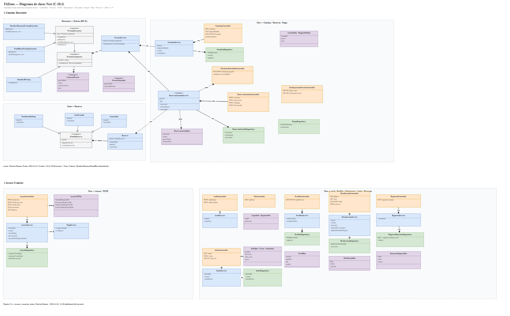

*Clases del dominio y de Nest.* Fuente editable: `docs/diagramas/fuentes/uml-clases-dominio.drawio`. Exportación: `docs/diagramas/img/uml-clases-dominio.svg`.

El camino va de la grilla al comprobante. El precio lo resuelve la cadena de decoradores antes de entrar a la base.

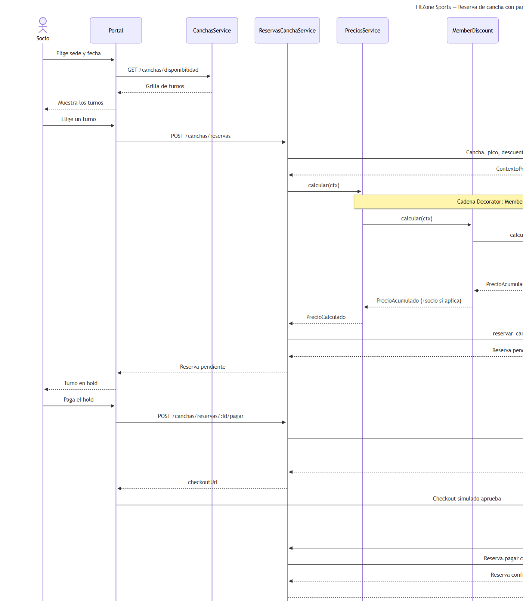

*Secuencia. Reserva de cancha con pago.* Fuente editable: `docs/diagramas/fuentes/sec-reserva-pago.mmd`. Exportación: `docs/diagramas/img/sec-reserva-pago.svg`.

Dos actores piden el mismo turno. El bloqueo deja una sola confirmación y el otro recibe el rechazo.

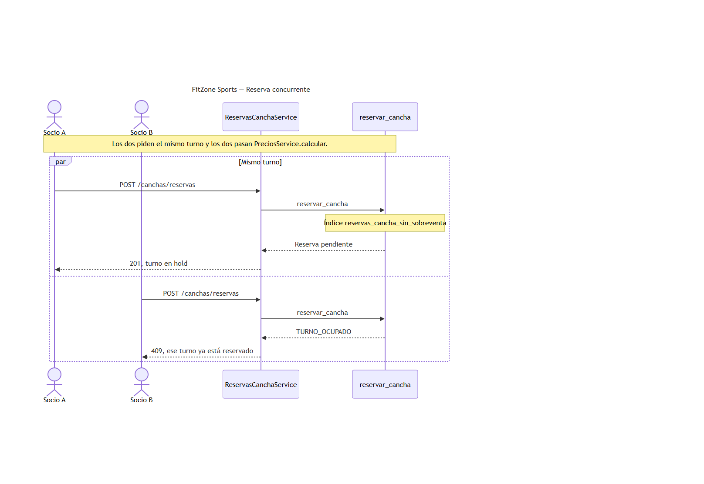

*Secuencia. Reserva concurrente.* Fuente editable: `docs/diagramas/fuentes/sec-reserva-concurrente.mmd`. Exportación: `docs/diagramas/img/sec-reserva-concurrente.svg`.

El socio muestra el QR. Si la sede no llega al servidor, el movimiento queda en la cola y se sincroniza al reconectar.

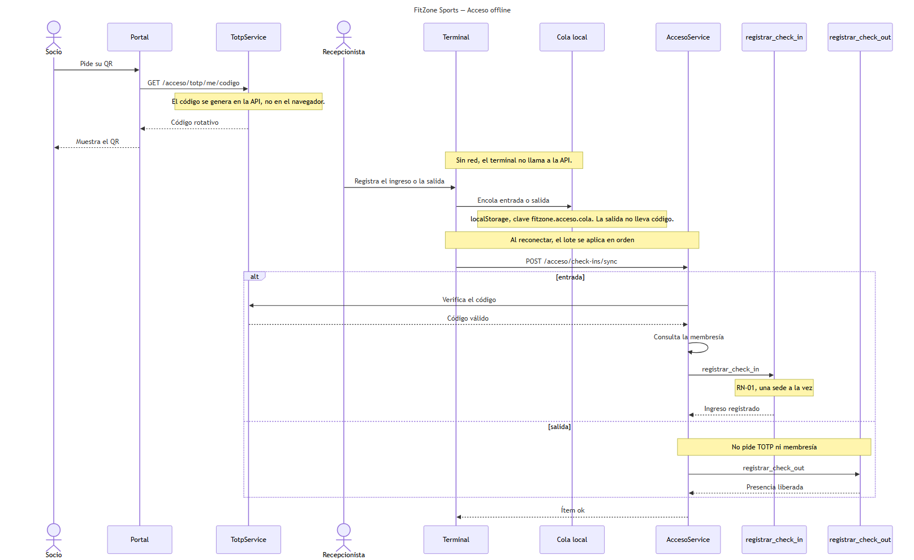

*Secuencia. Validación de acceso con la sede sin red.* Fuente editable: `docs/diagramas/fuentes/sec-acceso-offline.mmd`. Exportación: `docs/diagramas/img/sec-acceso-offline.svg`.

Activo, Vencido y Suspendido. Suspendido está en el enum y esta entrega no lo asigna.

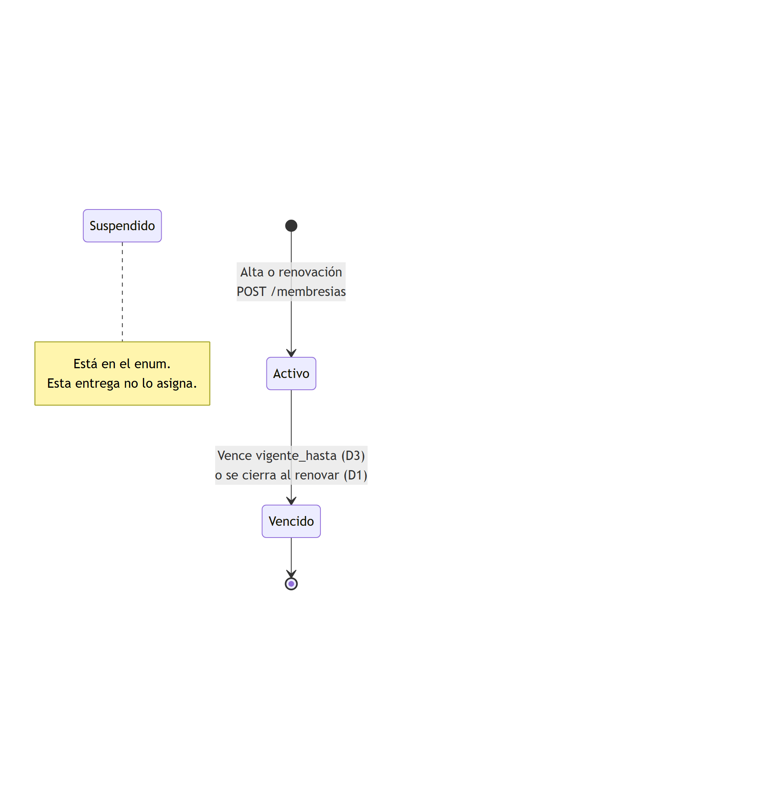

*Estados de la membresía.* Fuente editable: `docs/diagramas/fuentes/est-membresia.mmd`. Exportación: `docs/diagramas/img/est-membresia.svg`.

Pendiente de pago, confirmada y cancelada. Cancelar no devuelve el pago.

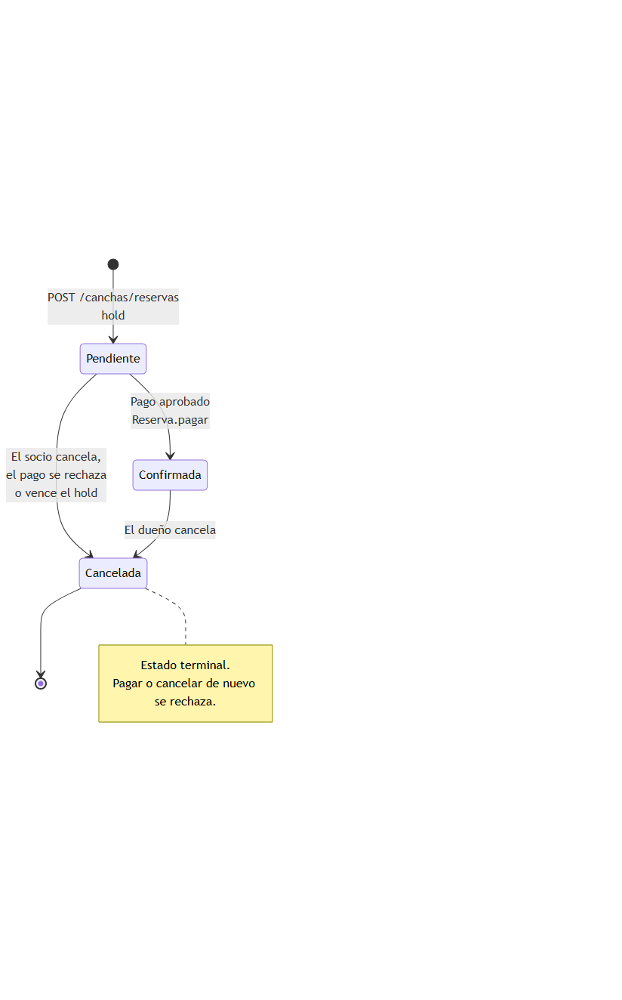

*Estados de la reserva.* Fuente editable: `docs/diagramas/fuentes/est-reserva.mmd`. Exportación: `docs/diagramas/img/est-reserva.svg`.

Al liberarse un lugar, el publicador avisa a los observadores en el orden de la lista.

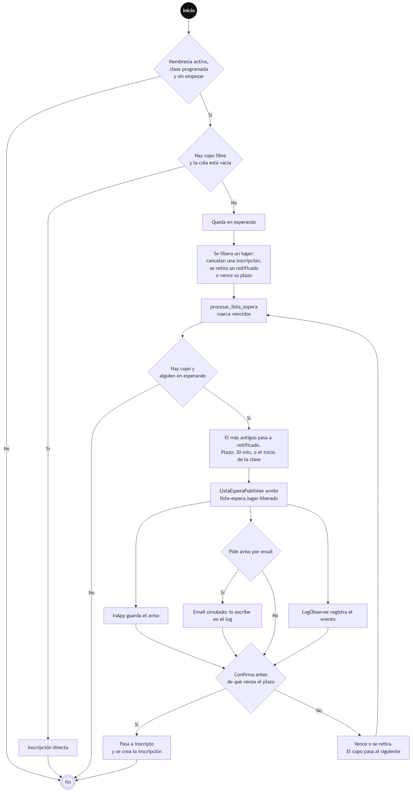

*Actividad. Lista de espera.* Fuente editable: `docs/diagramas/fuentes/act-lista-espera.mmd`. Exportación: `docs/diagramas/img/act-lista-espera.svg`.

El índice único de reservas impide dos filas pendientes o confirmadas para la misma cancha y el mismo inicio.

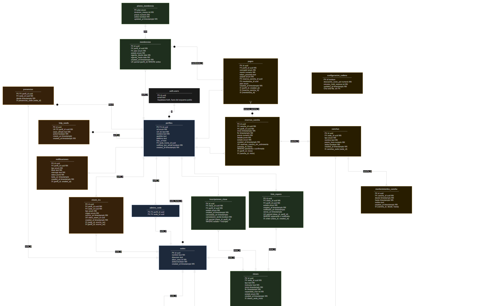

*DER físico.* Fuente editable: `docs/diagramas/fuentes/er-fisico.drawio`. Exportación: `docs/diagramas/img/er-fisico.svg`.

El navegador de la sede sigue encolando ingresos cuando no llega a la API. La base sigue siendo la fuente de verdad al reconectar.

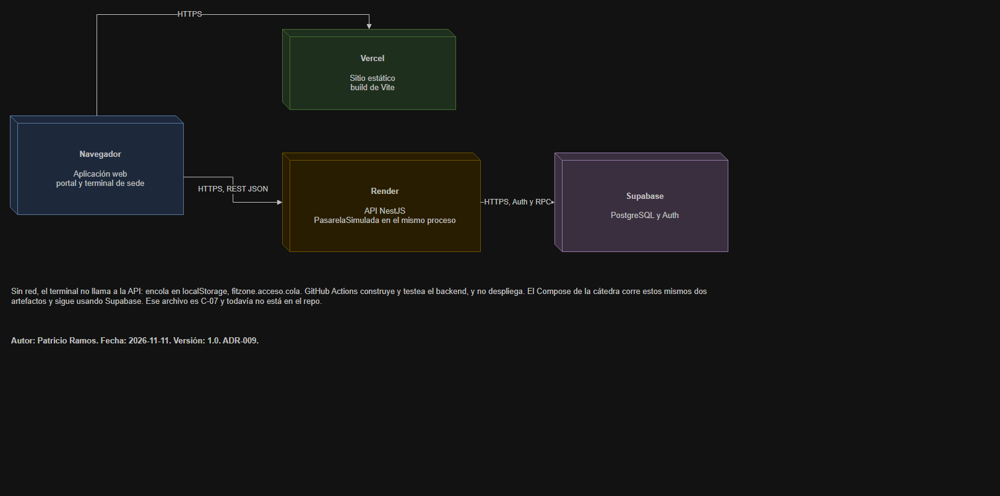

*Despliegue.* Fuente editable: `docs/diagramas/fuentes/dep-despliegue.drawio`. Exportación: `docs/diagramas/img/dep-despliegue.svg`.

El workflow de GitHub Actions corre sobre el backend en el pull request hacia `desarrollo`: checkout, Node 24, npm ci, oxlint, Jest y el build de Nest.

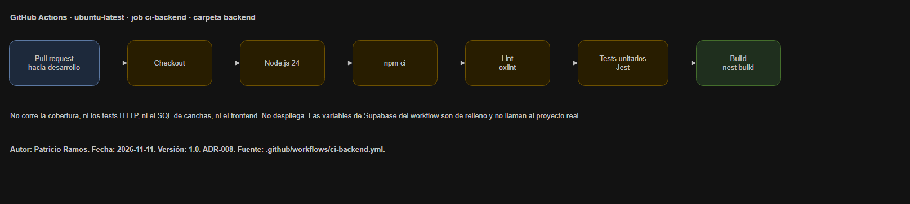

*Pipeline de integración.* Fuente editable: `docs/diagramas/fuentes/pipe-ci.drawio`. Exportación: `docs/diagramas/img/pipe-ci.svg`.

## 5. Patrones de diseño aplicados y su justificación

El detalle, con las rutas del código, está en el manual técnico, sección 4. Acá queda la justificación que esa sección sostiene. Los dos casos de extensión —sumar canchas de tenis y un recargo de fin de semana— se resuelven en ese mismo manual y se listan en la sección 10.

### Decorator — precio de la cancha

El enunciado pedía estrategias intercambiables para la tarifa, el descuento de socio y el recargo de hora pico. Esas tres reglas se acumulan sobre el mismo turno, así que el código las compone en lugar de elegir una sola con un `switch`.

`PricingComponent` declara `calcular`. `StandardPricing` arranca con el precio por hora de la cancha. `PricingDecorator` envuelve otro componente, delega el cálculo y, si la regla aplica, modifica el resultado. La cadena de esta entrega es `MemberDiscount(PeakHour(Standard))`: el recargo pisa la tarifa base y el descuento de socio activo se aplica sobre ese resultado. `PreciosService` redondea hacia arriba al peso.

Un socio con la cuota vencida no entra en el decorador de descuento y paga la tarifa de externo. Eso es RN-03. El deporte no participa: la misma cadena vale para paddle, fútbol 5 o un tipo que se sume después.

### Observer — lista de espera

Cuando se libera un cupo, `ListaEsperaPublisher` emite el evento y no conoce a quien escucha. Tres observadores se anotan al mismo evento: uno persiste el aviso para el portal, otro registra el mail simulado si el perfil lo tiene activado, y otro deja el evento en el log. El envío real de correo queda fuera de esta entrega. La pantalla de notificaciones muestra el aviso.

### Repository — persistencia

`SupabaseRepository` es la plantilla. Cada repositorio de dominio nombra su tabla y usa el cliente de Supabase desde esa capa. Lo que tiene que ser atómico —reservar una cancha, registrar un ingreso, inscribir a una clase— no es un `select` seguido de un `insert` en Nest: es una función SQL llamada por RPC.

### Facade y State

`ReservasCanchaService.reservar` es el caso de uso. Valida, pide el precio al servicio de precios, llama al RPC y devuelve la reserva en pendiente de pago. Quien reserva no habla por separado con el repositorio, con la cadena de precio y con la pasarela.

El ciclo de esa reserva es un State. `EstadoReserva` declara `pagar` y `cancelar`. Los estados concretos son pendiente de pago, confirmada y cancelada. Una reserva se reconstruye desde el valor guardado en la base. Un estado terminal rechaza la acción que no le corresponde.

El cobro entra por el puerto `PasarelaPago`. En esta entrega la implementación es el simulacro. La tarjeta no se guarda. Esa decisión está en ADR-010.

## 6. Estrategia de pruebas y reporte de cobertura

La decisión está en ADR-008, copiado en la sección 3. El umbral de esta entrega es el 60 % de sentencias del backend, medido con `npm run test:cov` sobre el conjunto que declara `backend/jest.config.ts`.

La pirámide que ese ADR fija tiene tres pisos. La base son los tests unitarios de servicios, guards, decoradores de precio, TOTP y la pasarela simulada. El medio son los tests HTTP con Supertest y el script SQL `supabase/tests/canchas_m4.test.sql`, que rechaza una segunda reserva del mismo turno. La cima, el E2E de navegador, queda fuera de este umbral. La tarjeta C-40 la retoma y todavía está por hacer.

Cifra citada en el README, corrida del 17 de noviembre de 2026 en `backend/`:

| Dato | Resultado |
|------|-----------|
| Suites | 29, todas en verde |
| Tests | 179, todos en verde |
| Sentencias | 65,15 % |

Esa corrida cubre los unitarios. `npm run test:e2e` ejecuta los tests HTTP y no entra en el 65,15 %. El frontend no tiene script de tests.

C-35 vuelve a medir build y cobertura, y C-10 hace que el CI falle por debajo del umbral. Esas dos tarjetas siguen por hacer. Si el README cambia antes de volver a imprimir este dossier, esta tabla se actualiza con la cifra nueva. Esta tarea no volvió a correr la suite.

## 7. Cumplimiento de los requisitos no funcionales

### RNF-01 — El ingreso sigue cuando cae la conexión principal

ADR-003 fija la estrategia y ADR-007 fija qué guarda el navegador de la sede, cuándo lo envía y cómo se resuelve el choque al reconectar. La recepción acumula el check-in y el check-out en `localStorage` y los confirma contra la API cuando vuelve la red. Mientras no hay red no se validan la membresía, el código rotativo ni la regla de una sola sede. Esa validación ocurre en el servidor.

La lectura que pedía una app del socio capaz de mostrar un QR válido sin señal queda fuera de esta entrega, junto con el nodo local por sede y los tornos. C-05 cerró esa decisión por escrito. La evidencia de uso está en el manual de usuario, en la pantalla Acceso, y en la secuencia de la sección 4.

### RNF-02 — La tarjeta no se guarda

ADR-010 deja un token opaco de la pasarela simulada. La fila de pago guarda ese token, el monto y el vínculo con la reserva o la membresía. El comprobante PDF no imprime datos de tarjeta. MercadoPago real queda fuera de esta entrega.

### RNF-03 — La grilla de canchas se apoya en índices

`GET /canchas/disponibilidad` usa los índices de la migración de canchas: `canchas_sede`, `mantenimientos_cancha_rango`, `reservas_cancha_cancha_inicio` y `reservas_cancha_perfil`. La no sobreventa es otro índice, `reservas_cancha_sin_sobreventa`, y corresponde a RN-02. Esta entrega no publica una medición en milisegundos.

### RNF-04 — Una sede nueva es un dato

El gerente crea y edita sedes con `POST /sedes` y `PATCH /sedes/:id` sin detener la API. La baja es `activa = false`. C-29 cerró esa pantalla y los tests de rol. ADR-001, ADR-002 y ADR-009 ya habían dejado la sede como una fila, no como un despliegue nuevo. El alta no abre un servicio por sucursal.

## 8. Planificación

Este capítulo está leído al 17 de noviembre de 2026, para el dossier. No reemplaza a `docs/planificacion/Planificacion_Completa_C20.md`. Ese archivo sigue siendo el borrador de C-20: su diagrama de Gantt deja en pendiente el manual de usuario y el README, los dos ya cerrados, y su matriz no recorre RF-01 a RF-14. La reescritura de ese archivo, con la matriz única y los ocho sprints en el formato de C-38, sigue en por hacer y la tiene Matias. El PDF de planificación que se sube a Moodle es otro archivo.

Las fuentes de lo que sigue son el plan de cierre del 6 al 19 de noviembre, el plan de las semanas 1 y 2 (28 de agosto, estados alineados al tablero el 11 de noviembre), el plan de S5 a S7 y las actas del 2 de septiembre, del 13 de octubre y del 21 de octubre. Las horas de cada sesión están en las bitácoras de la sección 9.

### 8.1 Alcance

Entra el portal web con cuatro roles: gerente, administrador de sede, socio y cliente externo. Entran el registro y el perfil, la membresía con catálogo y renovación cobrada, el acceso multi-sede con QR rotativo, el aforo de la sede, la agenda de clases, la inscripción, la lista de espera, la grilla de canchas, el precio compuesto, el mantenimiento, la pasarela simulada y el PDF de comprobante. Entran también los ADR, los catorce diagramas, los tres manuales, las cuatro bitácoras y este dossier.

Queda afuera la app móvil, la cámara y el DNI en el acceso, MercadoPago real, el alta de administradores de sede, Storybook, los reportes consolidados de toda la cadena y la reescritura de la historia del repositorio. El dashboard del gerente es la tarjeta C-39 y sigue por hacer. La foto de perfil está en el enunciado de RF-01 y quedó fuera de este corte: el alta pide los datos de la persona y no la imagen.

### 8.2 Supuestos y restricciones

Se da por existente un proyecto de Supabase con las claves fuera del repositorio. La pasarela de RF-13 es un simulacro. El comprobante de RF-14 es un PDF de la cadena, no un comprobante fiscal.

La entrega cierra el 19 de noviembre de 2026 a las 18:00. El equipo es de cuatro personas. El tag anotado de esa entrega se llama `v1.0-entrega` y se crea en C-26. Hasta esa hora el hash de la portada es el del commit sobre el que se imprime este PDF.

### 8.3 Equipo y horas comprometidas

| Integrante | Rol | Piso del plan del 28/08 | Techo del cierre, 6 al 19/11 |
|------------|-----|-------------------------|------------------------------|
| Patricio Ramos | P1. Arquitectura, documentación y backend | 4 h por semana | 8 a 10 h por semana |
| Bruno Nicolás Conti | P2. Backend | 4 h por semana. La semana 2 estimó 7 h | 4 a 6 h por semana |
| Lucas Coquet | P3. Frontend | 4 h por semana. La semana 2 estimó 4,5 h | 8 a 10 h por semana |
| Matias Goncevat | P4. Planificación, CI, seed y Docker | 4 h por semana | 4 a 6 h por semana |

El plan del 28 de agosto compromete 16 h semanales de equipo, a 4 h por persona. El plan de cierre estima 48 a 64 h de equipo en las dos semanas finales. Las horas de la semana 2 son las que ese plan estimó junto a las tareas, y esas tareas figuran finalizadas. Las horas sesión por sesión están en cada bitácora. Varias de las primeras semanas están marcadas ahí como estimación reconstruida.

### 8.4 Estructura de desglose

El trabajo quedó partido en las unidades del cursado y, desde el 6 de noviembre, en los tres tramos del plan de cierre. Cada tarea de esos planes tiene responsable y una estimación en horas. Los identificadores S1 a S7 viven en los planes de semanas. Los identificadores C-01 a C-41 viven en el plan de cierre. La sección 11 lista el estado de esas tarjetas C.

| Épica | Qué cubre | Dónde está el desglose |
|-------|-----------|------------------------|
| Unidad I | C4, ADR, roles, monorepo | Plan de semanas 1 y 2, tareas S1 |
| Unidad II | Nest, React, Supabase, membresías y clases iniciales | Tareas S2 y S3 de esos planes |
| Unidad III | Precio, Observer, Repository, reglas y API de canchas | Actas del 13 y del 21 de octubre, tareas S4 y S5 |
| Unidad IV | Portal conectado a la API | Plan S5–S7 y tarjetas C-01, C-03, C-11 |
| Unidad V | Pruebas, CI, Docker, seed | ADR-008, ADR-009 y tarjetas C-07, C-08, C-10, C-35 |
| Cierre | Manuales, dossier, tag, lo que sigue abierto | Plan de cierre, tramos T1, T2 y T3 |

### 8.5 Cronograma

Las bitácoras a veces rotulan la misma semana con dos números de sprint, porque el registro se armó por sesión. La tabla toma el foco que domina cada número y la semana que esas entradas citan.

| Sprint | Semanas citadas | Objetivo que las entradas registran | Entregable que quedó |
|--------|-----------------|-------------------------------------|----------------------|
| 1 | 24/08 y 31/08 | Unidad I: enunciado, C4, ADR, roles, reunión del 02/09 | Plan del 28/08 y acta del 02/09 |
| 2 | 31/08 al 28/09 | Scaffold de Nest y React, Auth, `GET /sedes`, Swagger | Tareas S2 en finalizado |
| 3 | 28/09 al 05/10 | Membresías y clases iniciales | Módulos y migraciones de ese tramo |
| 4 | 05/10 al 19/10 | Precio, Observer y pantallas con datos fijos | Acta del 13/10 |
| 5 | 19/10 al 05/11 | Reglas de canchas y API de reservas | Acta del 21/10. Período S5–S7: 27/10 al 16/11 |
| 6 | 26/10 al 17/11 | Login, perfil, canchas, clases, QR y acceso en la UI | Plan S5–S7, actualizado el 11/11 y el 13/11 |
| 7 | 02/11 al 09/11 | Cola de la sede y demo de canchas | C-01 cerrado el 13/11 |
| 8 | 09/11 al 16/11 | ADR alineados, diagramas, manuales, Decorator y gestión en pantalla | C-14 el 09/11, C-28 a C-34, README el 17/11 |

Dentro de los sprints 7 y 8, el plan de cierre parte el tramo final así:

| Tramo | Fechas | Foco |
|-------|--------|------|
| T1 | 6 al 8/11 | Demo operable: grilla, pago, membresía, teléfono, decisión de RNF-01 |
| T2 | 9 al 15/11 | ADR, diagramas, manuales, bitácoras, Docker y seed |
| T3 | 16 al 19/11 | Defectos del guion, tag, dossier y Moodle |

La capacidad comprometida del tramo final es la de la tabla 8.3. Antes de eso, el piso es 4 h por persona por semana.

### 8.6 Trazabilidad

La descripción de cada requisito es la del enunciado del trabajo integrador. El estado es el del repositorio al 17 de noviembre de 2026.

| Requisito | Qué pide | Dónde está | Prueba o evidencia | Estado |
|-----------|----------|------------|--------------------|--------|
| RF-01 | Registro y perfil | `POST /auth/register`, perfil propio | `auth.service.spec` del registro. El panorama del 13/10 lo da por demostrable | Demostrable. La foto queda fuera de este corte |
| RF-02 | Planes, estados y renovación | Catálogo, `renovar_membresia`, pasarela simulada. Tarjeta C-30 | Cierre de C-30 en el plan de cierre | Alta y renovación cobrada cerradas. C-02, la membresía visible en el perfil, sigue en desarrollo en ese plan |
| RF-03 | Acceso en otra sede de la cadena | El check-in no ata al socio a su sede de origen | Manual de usuario, sección de acceso | Demostrable con membresía activa |
| RF-04 | QR que rota y validación de la membresía | Código de un minuto y check-in en la API | ADR-007 y manual de usuario | Demostrable |
| RF-05 | Aforo de la sede | Pantalla Acceso, ocupación sobre el máximo | Captura del manual de usuario | Demostrable |
| RF-06 | Agenda de clases | `POST /clases` y `PATCH /clases/:id`, pantalla del gerente. Tarjeta C-31 | Tests de rol citados en el cierre de C-31 | Cerrado |
| RF-07 | Inscripción hasta 48 h antes | Pantalla `/clases`. Tarjeta C-11 | Manual de usuario y bitácora de la tarjeta | Cerrado |
| RF-08 | Lista de espera y aviso | Observer al liberar un cupo | Diagrama de actividad y tests de clases | Cerrado |
| RF-09 | Alta de canchas y precio por hora | `/canchas/gestionar`. Tarjeta C-32 | E2E de alta citado en el cierre de C-32 | Cerrado |
| RF-10 | Grilla y bloqueo del turno | Reserva desde la UI. Tarjeta C-01 | Guion de demo y manual de usuario | Cerrado |
| RF-11 | Precio con descuento y hora pico | Cadena Decorator. Tarjeta C-28 | Tests unitarios de precios | Cerrado. El enunciado nombraba Strategy. El código compone las reglas con Decorator |
| RF-12 | Mantenimiento | Períodos que bloquean turnos futuros | Manual técnico | Cerrado. No cancela la reserva ya tomada |
| RF-13 | Pasarela simulada | Puerto `PasarelaPago` y el simulacro | ADR-010 | Cerrado como simulacro |
| RF-14 | Comprobante en PDF | PDF con cancha, horario y monto. Tarjeta C-04 | C-04 finalizada el 17/11 | Cerrado. No es factura fiscal |
| RN-01 | Una sola sede a la vez | Clave de `presencias` y check-out. Tarjeta C-33 | Manual de usuario y ADR-007 | Cerrado con conexión. Sin red, la cola se valida al sincronizar |
| RN-02 | Una sola reserva del turno | `FOR UPDATE` e índice único. ADR-004 | Unitario que traduce el choque a HTTP 409 | La garantía está en la base. Correr el SQL en el CI es C-41 y sigue por hacer |
| RN-03 | El socio en mora paga como externo | El decorador de descuento exige socio activo | Manual técnico, sección 4.1 | Cerrado en el cálculo del precio |
| RNF-01 | Acceso con la conexión caída | Cola de la sede. ADR-003 y ADR-007. Tarjeta C-05 | Manual de usuario, pantalla Acceso | Cerrado para la sede. La app móvil queda fuera |
| RNF-02 | Token y nada de tarjeta | ADR-010 | El ADR y el comprobante sin datos de tarjeta | Cerrado |
| RNF-03 | Grilla apoyada en índices | Cuatro índices de la migración de canchas | Manual técnico | Índices presentes. No hay una cifra de milisegundos |
| RNF-04 | Sede nueva sin detener el sistema | `POST /sedes` y `PATCH /sedes/:id`. Tarjeta C-29 | Tests de rol citados en el cierre de C-29 | Cerrado |

### 8.7 Seguimiento

No hay, en un solo cuadro, la velocidad de los ocho sprints con horas trabajadas sumadas. Esa consolidación es C-38 y sigue por hacer. Lo que sí está escrito, y ya ocurrió, es esto:

| Tramo | Qué se había estimado | Qué ocurrió |
|-------|----------------------|-------------|
| Semanas 1 y 2 | 4 h por persona, con un estimado puntual en la semana 2 | Las tareas S1 y S2 del plan figuran finalizadas, salvo S1-T16, que el plan deja en por hacer y con la tarjeta archivada |
| Octubre | Pantallas y API de canchas en el mismo tramo | El 13/10 las pantallas seguían con datos fijos y la API de canchas estaba en curso. El 21/10 se cerraron las reglas de precio y de reserva |
| 6 al 13/11 | Demo de canchas en la UI | C-01 cerró el 13/11. C-02 sigue en desarrollo |
| 9 al 17/11 | ADR, diagramas y tres manuales en T2 | ADR, diagramas, manual de usuario y manual técnico están cerrados. El manual de instalación sigue por hacer |
| 16 al 17/11 | Congelamiento | El README de cinco pasos cerró el 17/11. El tag no existe. Docker, seed, cobertura en CI, registro del tablero y C-35 a C-41 siguen abiertos |

### 8.8 Desvíos

La documentación de cierre y el cambio de Strategy a Decorator ocuparon el tramo del 9 al 17 de noviembre, encima de las pantallas de gestión. Varias tarjetas que el plan asignaba a Lucas las cerró Patricio: la pantalla de clases, el manual de usuario y la bitácora de Lucas. El estimado de 4 h semanales de agosto no alcanza para describir esa concentración de noviembre.

El riesgo de leer RNF-01 como una app del socio sin señal se materializó como discusión de alcance. Se absorbió el 6 de noviembre, con C-05: la demo muestra la cola de la sede, y la app móvil queda fuera. El mismo corte sacó MercadoPago real, la cámara del acceso y los reportes de toda la cadena.

Si el cuatrimestre empezara de nuevo, Docker, el seed de 25 sedes y el manual de operación entrarían junto con el primer arranque reproducible, y la matriz de requisitos se escribiría sobre el enunciado completo en lugar de esperar a C-38. El archivo `Planificacion_Completa_C20.md` no es esa matriz.

### 8.9 Riesgos

| Riesgo | Qué ocurrió al 17/11/2026 |
|--------|---------------------------|
| La UI de canchas se queda en datos fijos | C-01 cerró el 13/11 con reserva y pago desde la pantalla |
| RNF-01 se interpreta como app móvil | La app quedó fuera. La sede encola el ingreso y la salida |
| La documentación llega tarde | ADR, diagramas, manual de usuario y manual técnico están cerrados. Siguen el manual de instalación y la reescritura de la planificación |
| Una sola persona concentra Docker, seed y pruebas de cierre | C-07, C-08, C-10, C-17, C-20, C-21, C-35 y C-37 siguen por hacer, a cargo de Matias |
| La no sobreventa se prueba tarde | ADR-004 y el índice único están. Falta correr el script SQL en el CI, que es C-41 |
| El tag sale después de las 18:00 del 19/11 | El tag todavía no se creó. El límite sigue siendo esa hora |

## 9. Bitácoras individuales

Cada integrante tiene su archivo. `docs/bitacoras/LOG.md` es la bitácora de equipo y no entra en esta sección. Al 17 de noviembre el plan de cierre marca C-19a, C-19b y C-19c finalizadas, y C-19d en desarrollo. Los cuatro archivos están en el repositorio y se copian acá enteros.

Archivo de origen: `docs/bitacoras/LOG-ramos.md`.

### Bitácora — Ramos Patricio — Rol P1

Registro individual de Patricio Ramos (P1, arquitectura, documentación y backend crítico). Cada entrada es una sesión de trabajo. En **Commits** van los commits de esa sesión y el merge del pull request que los integró a la rama. Un merge de sincronización se cita solo cuando trajo un cambio concreto.

Las horas anteriores al 6/11 son una estimación reconstruida por el tamaño de la sesión. Las del 9 y el 11/11 salen del plan de cierre: C-13 3 h, C-14 6 h, C-15 6 h (parte propia del estimado de 8–10 h compartido con Bruno) y C-18 4 h.

---

#### Sprint 1 — Unidad I — Semana del 2026-08-24

##### 2026-08-27  ·  6 h

**Actividad**

Entre el 22 y el 27/08 dejé el repositorio en marcha y la base de arquitectura de Unidad I. El 22 subí el enunciado del trabajo integrador (`815179a`) y moví la documentación a `documentacion/`, con los permisos por actor (`e96a34d`). El 25 cerré el stack, el C4, los primeros ADR y el documento de decisiones pendientes (`c8836ba`). El 26 registré la reunión de equipo en la bitácora grupal (`466901e`). El 27 escribí la propuesta de acceso con TOTP y cola offline (`9ba5276`).

**Decisión**

El ingreso a sede se resuelve con un código rotativo (TOTP) y una cola que la sede drena cuando vuelve la red. Esa propuesta es el origen de la estrategia offline vigente en [ADR-003](../adr/ADR-003-estrategia-offline-acceso.md) y del detalle de sincronización en [ADR-007](../adr/ADR-007-acceso-totp-cola-offline.md).

**Problema o bloqueo**

En el C4 de esa semana el offline del socio (mostrar el QR en el teléfono) y el offline de la sede (validar el check-in sin la conexión principal) quedaron en el mismo recuadro. El alcance correcto lo separé el 4/09, en `92c3705`.

**Commits**

- `815179a` Initial commit: add FitZone Sports integrator work document.
- `e96a34d` Add actor permissions docs and move docs into documentacion/.
- `c8836ba` Add stack, C4, ADRs and pending decisions docs.
- `466901e` Add team log entry for Aug 26 sync meeting.
- `9ba5276` Document offline access and TOTP check-in proposal.

---

#### Sprint 1 — Unidad I — Semana del 2026-08-31

##### 2026-08-31  ·  5 h

**Actividad**

El 28/08 bajé a documentos el feedback del docente y armé el plan de trabajo de dos semanas (`789657b`). El 31 escribí los ADR de la pasarela de auth y del acceso a datos sin ORM, y unifiqué el formato de los ADR que ya existían (`09eff84`). El mismo día generé el Excel de importación a Trello (`a063feb`).

**Decisión**

NestJS queda como BFF: el frontend solo habla con la API Nest, y Nest delega la identidad en Supabase Auth. Los datos se leen por la API de Supabase, sin ORM. Hoy eso está en [ADR-011](../adr/ADR-011-bff-supabase-auth.md) y en [ADR-005](../adr/ADR-005-backend-nestjs-ioc-datos.md). En la numeración de agosto eran ADR-005 y ADR-006.

**Problema o bloqueo**

En una lectura previa anoté que el docente pedía la autenticación armada por completo dentro de Nest. El 28/08 corrigió el alcance: la identidad es Supabase Auth, y lo que no se puede saltear es el BFF. Reescribí los ADR ese día para que el texto coincidiera con esa corrección.

**Commits**

- `789657b` Add 2-week work plan and doc updates from professor feedback.
- `09eff84` Document BFF/Auth and Supabase API as ADR-005/006 and unify ADR format.
- `a063feb` Create Plan_Trabajo_Trello_Import.xlsx

---

#### Sprint 2 — Unidad I — Semana del 2026-08-31

##### 2026-09-04  ·  3 h

**Actividad**

Registré el cierre de la reunión de la semana 1 y la aclaración del docente sobre la entrega de C4 y ADR (`eb8150d`). Actualicé el C4 (`da9e335`) y separé el alcance offline: el RNF-01 de esta entrega es el check-in de sede, y el QR offline del teléfono queda para la app móvil (`92c3705`).

**Decisión**

C4 y ADR se entregan con el Demo Day y se actualizan mientras se desarrolla. No bloquean el código de Unidad II. El diagrama relacional y el de clases entran al paquete cuando el código los justifica.

**Problema o bloqueo**

El diagrama de contexto todavía describía el offline del teléfono del socio como parte del alcance inmediato. Lo alineé al check-in de sede en `92c3705`.

**Commits**

- `eb8150d` Record Semana 1 meeting outcomes and teacher guidance on C4/ADR delivery.
- `da9e335` Update C4_Arquitectura_FitZone.md
- `92c3705` Align C4 offline scope with sede check-in (RNF-01) vs mobile QR.

---

#### Sprint 2 — Unidad I — Semana del 2026-09-14

##### 2026-09-19  ·  4 h

**Actividad**

Escribí la propuesta de modelo entidad-relación (`documentacion/Propuesta_ER_FitZone.md`, 341 líneas en el diff) y ajusté el inventario de diagramas. El relacional queda como documento vivo, en la misma línea que la aclaración del 4/09: entra al paquete de arquitectura a medida que el código lo sostiene, y la entrega formal es al final del curso.

**Decisión**

El DER de esta fecha es una propuesta para seguir trabajando, no el PDF cerrado de Unidad I.

**Problema o bloqueo**

El commit quedó con mensaje `a`. El contenido está en el diff: la propuesta de ER y el retoque del inventario. El mensaje no describe ese trabajo.

**Commits**

- `8bb8586` a

---

#### Sprint 2 — Unidad II — Semana del 2026-09-21

##### 2026-09-26  ·  5 h

**Actividad**

Dejé el backend con un primer contrato verificable. `GET /health` y Swagger en `/api/docs` (`ae98766`, integrado en el PR #2). El guard JWT valida el access token de Supabase Auth y protege las rutas que lo declaran (`1e69752`, PR #3). El guard no emite sesión propia: acepta o rechaza el token que ya emitió Supabase.

**Decisión**

La sesión de identidad sale de Supabase Auth. Nest solo verifica el JWT y, más adelante, el rol de negocio. Quedó registrado en [ADR-011](../adr/ADR-011-bff-supabase-auth.md).

**Problema o bloqueo**

Entre el C4 del 4/09 y este primer endpoint pasaron tres semanas. La documentación de arquitectura avanzó sola y el monolito todavía no levantaba un módulo. A partir de esta sesión el criterio fue tener un endpoint mergeado por cada bloque de docs.

**Commits**

- `ae98766` S2-T08: endpoint GET /health y Swagger en /api/docs
- `b8507eb` Merge pull request #2 from PatricioRamos04032000/S2-T08
- `1e69752` S2-T07: Guard JWT que valida tokens de Supabase Auth
- `fdf5df6` Merge pull request #3 from PatricioRamos04032000/S2-T07

---

#### Sprint 3 — Unidad II — Semana del 2026-10-05

##### 2026-10-05  ·  8 h

**Actividad**

El 1/10 actualicé el plan de dos semanas contra el tablero (`c544f93`, PR #7), archivé el plan de las semanas 1 y 2 con los estados de Trello (`fef3dbf`, PR #8) y mergeé `master` en `desarrollo` para adoptar el plan de las semanas 3 y 4 (`2c2a542`).

El 5/10 documenté login, health y sedes en Swagger (`6138a83`, PR #9). Diseñé el SQL de membresías y clases (`975e367`) y registré la ejecución de esa migración y el seed en Supabase (`7344be3`, PR #10). Pasé `GET /sedes` por una plantilla de Repository (`a431a94`, PR #11), marqué S3-T06, S3-T11, S3-T01 y S2-T13 como finalizadas (`f97e484`, PR #12) y configuré CORS con `CORS_ORIGIN` (`f0b847b`, PR #13).

**Decisión**

`GET /sedes` deja de armar la consulta en el controlador y pasa por Repository. Esa plantilla es la que después usaron los otros módulos. El acceso sigue siendo la API de Supabase, como en [ADR-005](../adr/ADR-005-backend-nestjs-ioc-datos.md).

**Problema o bloqueo**

El SQL de membresías y clases no alcanzaba con commitear el archivo. La cuenta de Supabase estaba a cargo de Lucas, y la migración seguía sin ejecutarse en el proyecto remoto. La cerré el mismo día, cuando registré la corrida y el seed en `7344be3`.

**Commits**

- `c544f93` Actualiza estado del plan de 2 semanas segun tablero Trello (2026-10-01)
- `059c2ea` Merge pull request #7 from PatricioRamos04032000/actualiza-estado-plan
- `fef3dbf` Agrega plan historico de semanas 1 y 2 con estados de Trello (2026-10-01)
- `2bf612d` Merge pull request #8 from PatricioRamos04032000/plan-estado-a-master
- `2c2a542` Merge master en desarrollo: adopta plan de semanas 3 y 4
- `6138a83` S2-T13: documenta login, health y sedes en Swagger
- `741cb1a` Merge pull request #9 from PatricioRamos04032000/S2-T13
- `975e367` S3-T06: diseno de BD para membresias y clases con migracion SQL
- `7344be3` S3-T06: registra ejecucion de la migracion y seed en Supabase
- `bab924c` Merge pull request #10 from PatricioRamos04032000/S3-T06
- `a431a94` S3-T11: plantilla del patron Repository y refactor de GET /sedes
- `aea840f` Merge pull request #11 from PatricioRamos04032000/S3-T11
- `f97e484` Actualiza estados del plan: S3-T06, S3-T11, S3-T01 y S2-T13 finalizadas (2026-10-05)
- `7236b8c` Merge pull request #12 from PatricioRamos04032000/actualiza-plan-s3
- `f0b847b` S3-T01: configura CORS con CORS_ORIGIN
- `0bbeb6f` Merge pull request #13 from PatricioRamos04032000/S3-T01

---

#### Sprint 4 — Unidad III — Semana del 2026-10-05

##### 2026-10-06  ·  8 h

**Actividad**

Día de patrones y de reglas de precio. Implementé el Observer de la lista de espera para avisar lugares liberados (`7510143`, PR #14) y, en un commit aparte, lo pasé a `@nestjs/event-emitter` (`762a14c`, PR #19). Justifiqué esa elección contra la diapositiva 37 (`eb6e82c`, PR #21) y dejé la justificación general de patrones de la unidad (`71b869c`) más las notas de la clase 1 (`34ae6d1`, PR #20).

En precios dejé la propuesta de reglas (`e6bd7ae`), el horario pico por sede (`0cfa7c7`), el descuento de socio para toda la cadena (`3334fa0`), el límite de que el gerente edita el pico solo de sus sedes (`2f543d3`) y el alta del descuento por el administrador (`2e4085a`, PR #16). Alineé los roles con la consigna: A3 `admin_sede` y A4 gerente (`f471790`, PR #17). El guard `@RequiereRol` valida `perfiles.rol` y `/auth/me` devuelve ese rol (`3cab665`, PR #18).

El login dejó de usar el cliente Supabase compartido (`50de31c`, PR #15).

**Decisión**

La lista de espera publica el evento con `@nestjs/event-emitter` y los suscriptores viven en el módulo de notificaciones. Descarté un `Subject` propio: el emisor de Nest ya da el desacople y se testea con el módulo de testing del framework.

**Problema o bloqueo**

El login escribía la sesión sobre el mismo cliente Supabase que usaban el resto de las consultas. Una sesión de socio contaminaba la llamada siguiente. Lo separé con un cliente dedicado al login en `50de31c`.

**Commits**

- `7510143` S4-T02: patron Observer para notificar lugares liberados de la lista de espera
- `70e8c4b` Merge pull request #14 from PatricioRamos04032000/S4-T02
- `50de31c` Fix: el login usa un cliente Supabase propio y no contamina el cliente compartido
- `7bd0918` Merge pull request #15 from PatricioRamos04032000/fix-login-cliente-compartido
- `e6bd7ae` S4-T09: propuesta de reglas de precio de canchas y decisiones pendientes
- `0cfa7c7` S4-T09: horario pico configurable por sede (recargo, horario y dias)
- `3334fa0` S4-T09: descuento de socio configurable para toda la cadena
- `2f543d3` S4-T09: el gerente edita la configuracion pico solo de sus sedes
- `2e4085a` S4-T09: rol administrador edita el descuento de socio de la cadena
- `07a480a` Merge pull request #16 from PatricioRamos04032000/S4-T09
- `f471790` S4-T09: alinea roles con la consigna (A3 admin_sede, A4 gerente)
- `4956de5` Merge pull request #17 from PatricioRamos04032000/S4-T09
- `3cab665` Guard de roles: @RequiereRol valida perfiles.rol y /auth/me devuelve el rol
- `b45297f` Merge pull request #18 from PatricioRamos04032000/guard-roles
- `71b869c` S4-T05: justificacion de patrones de la Unidad III
- `762a14c` Observer de lista de espera con @nestjs/event-emitter en lugar del Subject propio
- `63984cd` Merge pull request #19 from PatricioRamos04032000/S4-T02-event-emitter
- `34ae6d1` Agrega la clase 1 de patrones (Unidad III) y notas frente a FitZone
- `cf361fb` Merge pull request #20 from PatricioRamos04032000/S4-T05
- `eb6e82c` S4-T05: justificacion del Observer con @nestjs/event-emitter y decisiones de la diapositiva 37
- `379fd62` Merge pull request #21 from PatricioRamos04032000/S4-T05-observer-event-emitter

---

#### Sprint 4 — Unidad III — Semana del 2026-10-12

##### 2026-10-15  ·  4 h

**Actividad**

El 13/10 escribí el panorama del desarrollo, la estructura del backend y las correcciones de Membresías y Clases (`7745601`, PR #23), y el acta de la reunión de seguimiento (`8eef901`, PR #24). El 15 cerré la confección final de la justificación de patrones (`7cf3115`, PR #25), con el Observer ya apoyado en la diapositiva 37 desde el 6/10.

**Decisión**

La justificación de Unidad III queda cerrada en el documento de patrones, con el Observer sobre `@nestjs/event-emitter` y la referencia a la diapositiva 37. No reabro el Subject propio.

**Problema o bloqueo**

El backend ya tenía Repository, Observer y las reglas de precio, y el frontend seguía en scaffolding. El panorama del 13/10 lo deja asentado: la demo de patrones se podía mostrar por API, y la pantalla todavía no.

**Commits**

- `7745601` Docs: panorama del desarrollo, estructura del backend y correcciones de Membresias y Clases
- `53a912b` Merge pull request #23 from PatricioRamos04032000/docs-panorama-y-correcciones
- `8eef901` Acta de la reunion de seguimiento del 2026-10-13
- `67ab971` Merge pull request #24 from PatricioRamos04032000/acta-reunion-2026-10-13
- `7cf3115` S4-T05: confeccion final de la justificacion de patrones
- `1f25a41` Merge pull request #25 from PatricioRamos04032000/S4-T05-confeccion-final

---

#### Sprint 5 — Unidad III — Semana del 2026-10-19

##### 2026-10-21  ·  4 h

**Actividad**

Extendí la edición de precios: gerente y recepcionista editan la configuración, y una reserva de cancha se puede tomar hasta un mes hacia adelante (`9fb6aa7`, PR #26). Dejé el acta de la reunión de seguimiento de ese día (`3cf3658`, PR #27).

**Decisión**

El pico se configura por sede y lo edita el gerente de esas sedes. El descuento de socio es uno solo para la cadena. La ventana de reserva de cancha queda en un mes.

**Problema o bloqueo**

La ventana de reserva que había quedado implementada era corta para el ensayo del guion: no alcanzaba para mostrar una reserva hacia adelante sin chocar con el cierre del día. La llevé a un mes en `9fb6aa7`.

**Commits**

- `9fb6aa7` S4-T09: gerente y recepcionista editan precios, y las reservas de cancha llegan hasta un mes.
- `0256a64` Merge pull request #26 from PatricioRamos04032000/S4-T09
- `3cf3658` Acta de la reunion de seguimiento del 2026-10-21.
- `6a026e8` Merge pull request #27 from PatricioRamos04032000/acta-reunion-2026-10-21

---

#### Sprint 5 — Unidad III — Semana del 2026-10-26

##### 2026-10-27  ·  7 h

**Actividad**

El 26 dejé la propuesta de plan de tres semanas para llegar al demo y a la rúbrica (`ca0c3d6`, PR #28). El 27 versioné en el repo la migración Fase A de sedes, perfiles y membresías (`bac116f`, PR #29) y la de canchas, reservas y config de precios (`482d5ae`, PR #30), y agregué el seed mínimo de demo con `npm run seed` (`2d8b4f8`, PR #31).

El mismo día cerré el laboratorio de Unidad III: caracterización de precios, planilla de olores y la nota de que la consigna de refactor en seis commits no aplica (`a1b5223`, PR #32). Los tests de caracterización quedaron en `backend/src/canchas/precios/precios.service.spec.ts`.

**Decisión**

El SQL de sedes, perfiles, membresías, canchas y precios vive en migraciones del repositorio, no solo en el historial de Supabase. El laboratorio de olores no reescribe el cálculo de precio: Strategy ya era el diseño.

**Problema o bloqueo**

La consigna 3 pedía un replay de seis commits para reemplazar un condicional por polimorfismo. En el repo no había un `if`/`switch` de precios del cual partir. Bruno ya había dejado el patrón en `71c993d` (S4-T01). Reconstruir un «antes» falso para cumplir la consigna hubiera inventado historia. Lo documenté en `a1b5223` y la evidencia del cálculo quedó en los tests de caracterización.

**Commits**

- `ca0c3d6` Propuesta de plan de 3 semanas para llegar al demo y a la rubrica.
- `97e4056` Merge pull request #28 from PatricioRamos04032000/propuesta-3-semanas
- `bac116f` S5-T01: versiona la migracion Fase A (sedes, perfiles, membresias).
- `10fa5a2` Merge pull request #29 from PatricioRamos04032000/S5-T01
- `482d5ae` S5-T02: migracion M4 de canchas, reservas y config de precios.
- `6a4050b` Merge pull request #30 from PatricioRamos04032000/S5-T02
- `2d8b4f8` S5: seed mínimo de demo con npm run seed.
- `c92eb30` Merge pull request #31 from PatricioRamos04032000/S3-T03
- `a1b5223` Lab Unidad III: olores, caracterizacion de precios y docs pendientes.
- `482e8c8` Merge pull request #32 from PatricioRamos04032000/lab-iii-olores-caracterizacion-docs

---

#### Sprint 6 — Unidad IV — Semana del 2026-10-26

##### 2026-10-29  ·  6 h

**Actividad**

El 28 expuse `GET /perfiles/me` y `PATCH /perfiles/me` leyendo la identidad del JWT (`599e207`, PR #33) y versioné la migración del módulo de pagos, con la nota del Adapter (`0622c52`, PR #34). El 29 escribí la guía de tests, la sección de demo del README y las exclusiones de Jest para el reporte de cobertura (`49cacd8`, PR #35).

**Decisión**

El perfil del socio no recibe el id por query ni por body. Sale del token que ya validó el guard. El pago simulado entra como módulo propio (M5), con la migración en el repo.

**Problema o bloqueo**

El estado global de sesión del frontend seguía sin un dueño cerrado: el perfil ya se podía leer desde el JWT en la API, y el cliente todavía no tenía un lugar único para guardarlo ni para reaccionar a un 401. Ese hueco lo tomé el 7/11 (`06c0287`).

**Commits**

- `599e207` S6-T01: GET/PATCH /perfiles/me desde el JWT.
- `843c668` Merge pull request #33 from PatricioRamos04032000/S6-T01
- `0622c52` S6-T03: migracion M5 de pagos y nota Adapter.
- `bcc20f1` Merge pull request #34 from PatricioRamos04032000/S6-T03
- `49cacd8` Docs y coverage: guía de tests, demo en README y exclusiones de Jest.
- `bef300b` Merge pull request #35 from PatricioRamos04032000/docs-guia-tests-readme

---

#### Sprint 6 — Unidad V — Semana del 2026-10-26

##### 2026-11-01  ·  8 h

**Actividad**

El 31/10 cerré el alta de socio con `POST /auth/register` y confirmación de email (`1c76b98`, PR #36). Saqué el probe de signup duplicado que Sonar marcaba (`87329f6`, PR #37). La reserva de cancha pasó a Facade y State, con Strategy ya en uso para el precio (`7d1a4c0`); después bajé la duplicación de los tests de State y alineé el HTTP y el Swagger de cancelar (`9c8df29`, PR #38).

El 1/11 dejé la pasarela simulada: checkout con forma de Mercado Pago y la reserva en hold mientras el pago está pendiente (`d3f1985`). La CI pasó a Node 24 (`5ee4c9d`). Los dos entran en el PR #40. El token de la pasarela no guarda la tarjeta; el criterio vigente está en [ADR-010](../adr/ADR-010-tokenizacion-medios-de-pago.md).

**Decisión**

Reservar cancha entra por un Facade y el estado de la reserva lo maneja State. El precio lo sigue calculando Strategy. La CI corre en Node 24 porque Jest con los módulos ESM de Nest no levantaba la suite en la versión anterior.

**Problema o bloqueo**

Sonar marcaba un probe de signup duplicado en los tests de registro. Lo eliminé en `87329f6` para que el análisis dejara de señalar el mismo alta dos veces. El otro freno fue la CI: la suite fallaba por la combinación Jest y ESM, y se resolvió fijando Node 24 en `5ee4c9d`.

**Commits**

- `1c76b98` S6-T02: POST /auth/register con confirmación de email.
- `3ecfb06` Merge pull request #36 from PatricioRamos04032000/S6-T02
- `87329f6` Remove probe de signup duplicado marcado por Sonar.
- `b8366ea` Merge pull request #37 from PatricioRamos04032000/s6t2-sonarfix
- `7d1a4c0` S7-T01: Facade y State para reservar cancha; Strategy en uso.
- `9c8df29` S7-T01: baja duplicacion en tests de State y alinea HTTP/Swagger de cancelar.
- `5bfad14` Merge pull request #38 from PatricioRamos04032000/S7-T01
- `d3f1985` S7-T02: pasarela simulada con checkout estilo MercadoPago y hold de pendiente.
- `5ee4c9d` fix(ci): usar Node 24 para tests Jest con Nest ESM.
- `132ee73` Merge pull request #40 from PatricioRamos04032000/S7-T02

---

#### Sprint 7 — Unidad V y VI — Semana del 2026-11-02

##### 2026-11-03  ·  5 h

**Actividad**

El 2/11 restauré los ADR 002 a 004 como reemplazados y sumé 008 a 010 en la numeración que el equipo usaba hasta entonces (`e8ff826`, PR #41). El 3 documenté la Fase 0 de acceso M2: TOTP, cola offline y RN-01 (`0446367`, PR #42), publiqué el changelog en la versión 0.23.0 (`9d4b977`) y cerré los avisos de Sonar de registro, perfil y sesión (`8d51afa`).

**Decisión**

La app nativa no entra en el tag del 19/11. El offline que esta entrega demuestra es la cola del terminal de sede, documentada en [ADR-003](../adr/ADR-003-estrategia-offline-acceso.md) y [ADR-007](../adr/ADR-007-acceso-totp-cola-offline.md). El QR del teléfono queda en la web responsive.

**Problema o bloqueo**

RNF-01, leído como «el socio muestra un QR válido sin señal», pide la app de Unidad VI. Esa app no está construida y no entra en los días que quedan hasta el tag. Lo que sí se puede mostrar es la sede validando con la cola local. Lo dejé escrito en la Fase 0 (`0446367`) para no prometer el teléfono offline en la defensa.

**Commits**

- `e8ff826` docs(adr): restaurar 002-004 como reemplazados y agregar 008-010
- `9048208` Merge pull request #41 from PatricioRamos04032000/fix-adrs
- `0446367` S8-T1: documenta Fase 0 de acceso M2 (TOTP, cola offline y RN-01).
- `f4d2012` Merge pull request #42 from PatricioRamos04032000/s8t1
- `9d4b977` chore: publica el changelog y fija la version 0.23.0
- `8d51afa` fix: cierra los avisos de Sonar del registro, el perfil y la sesion

---

#### Sprint 7 — Cierre — Semana del 2026-11-02

##### 2026-11-06  ·  4 h

**Actividad**

Escribí el plan de cierre del Equipo 03, del 6 al 19/11, con los tres tramos, el backlog C-01 a C-27 y el corte explícito de lo que no entra (`4ffb99b`, PR #48). El criterio de orden quedó en el propio plan: primero la admisibilidad del §6.1 y la demo de canchas en la UI.

**Decisión**

Si el tiempo no alcanza, se corta lo de la sección 7 del plan (app nativa, Mercado Pago real, reportes de gerente) y se sostiene lo que bloquea la devolución: bitácoras, ADR, diagramas, manuales, planificación y el tag.

**Problema o bloqueo**

El tablero ya tenía tarjetas S5–S7 que nombraban el mismo trabajo que las tarjetas C del cierre. Borrarlas perdía la historia del cuatrimestre. Las dejé y las crucé en el documento de observaciones, que commiteé al día siguiente (`ecb45cd`).

**Commits**

- `4ffb99b` docs: plan de cierre Equipo 03 para la entrega del 19/11.
- `4a6247b` Merge pull request #48 from PatricioRamos04032000/docs/plan-cierre-entrega-6-19-nov

---

#### Sprint 8 — Unidad IV y Cierre — Semana del 2026-11-02

##### 2026-11-08  ·  6 h

**Actividad**

El 7/11 crucé las tarjetas de Trello que se solapan con el plan de cierre (`ecb45cd`, PR #50). Tomé el estado global de sesión que estaba a cargo de Lucas (`06c0287`) y, en el commit siguiente, tipé el rol de FitZone y cerré la sesión cuando una llamada autenticada responde 401 (`d0b9cd4`, PR #51). Protegí las pantallas básicas de Clases y Notificaciones (`a843b33`, PR #52) y extraje Botón, Input y Spinner para reutilizarlos en el login (`618d48e`, PR #53).

El 8/11 cerré el ensayo corto del guion de demo (`073be5a`, PR #54). El flujo API más UI recorrió login, membresía, reserva y acceso sin un error que cortara el relato.

**Decisión**

El estado global de sesión pasa a mi cargo. El rol viaja tipado desde `/auth/me`, y un 401 limpia la sesión en el cliente. El criterio de estado del frontend queda en [ADR-006](../adr/ADR-006-frontend-react-estado.md).

**Problema o bloqueo**

El ensayo del 8/11 no encontró un corte de flujo, y sí dejó pulido visual pendiente (espaciados, estados vacíos, lectura en teléfono). Lo anoté fuera de C-06 para no reabrir el guion por css. El responsive de Login, Canchas y Mi QR sigue en C-03. **Actualización 2026-11-13:** el pulido del flujo demo (menú, Acceso, Presencias) quedó cerrado en S7-T08; ver entrada de ese día.

**Commits**

- `ecb45cd` docs: relaciona tarjetas Trello solapadas con el plan de cierre.
- `88a9a89` Merge pull request #50 from PatricioRamos04032000/docs/actualizar-estado-planes
- `06c0287` S4-T04: deja constancia de que Patricio toma el estado global, antes a cargo de Lucas.
- `d0b9cd4` S4-T04: tipa el rol de FitZone y cierra la sesión cuando una llamada autenticada responde 401.
- `0002fe3` Merge pull request #51 from PatricioRamos04032000/S4-T04
- `a843b33` S5-T08: protege las pantallas básicas de Clases y Notificaciones.
- `a897b09` Merge pull request #52 from PatricioRamos04032000/S5-T08
- `618d48e` S5-T09: extrae Botón, Input y Spinner para reutilizarlos en el login.
- `f7c9ca1` Merge pull request #53 from PatricioRamos04032000/S5-T09
- `073be5a` C-06: cierra el ensayo del guion de demo y deja el pulido visual anotado.
- `118b591` Merge pull request #54 from PatricioRamos04032000/c-06

---

#### Sprint 8 — Cierre — Semana del 2026-11-09

##### 2026-11-11  ·  19 h

**Actividad**

El 9/11 reorganicé el repositorio a la estructura del punto 4 de los lineamientos (`6f5d1c1`, PR #55, C-13, 3 h) y reescribí los diez ADR obligatorios con la numeración de la cátedra (`d6f2945`, PR #56, C-14, 6 h). El texto anterior no se reescribió: quedó en `docs/adr/historial/`, y el mapa de números viejos a números nuevos está en [docs/adr/README.md](../adr/README.md).

El 11/11 agregué los diagramas de la entrega, con fuente editable y exportación (`886c66a`, PR #57, C-15, 6 h de mi parte) y el manual técnico, con los dos casos de extensión: canchas de tenis y una estrategia de precio nueva (`6c0b540`, PR #58, C-18, 4 h).

**Decisión**

Los ADR pasan a la lista obligatoria del §5.2.1. Un número viejo no se recicla encima del texto anterior: el histórico queda congelado y la decisión vigente es la del índice nuevo. El puente para las citas de las bitácoras y las notas de unidad es [documentacion/ADR_Indice.md](../../documentacion/ADR_Indice.md).

**Problema o bloqueo**

Bitácora de equipo, C4 y notas de unidad citan ADR-005 como BFF y ADR-006 como API sin ORM. Desde el 9/11 esos temas son ADR-011 y ADR-005. Borrar las citas viejas hubiera falsificado lo que el equipo escribió en agosto. Las dejé y publiqué la tabla de equivalencias en el índice de ADR.

**Commits**

- `6f5d1c1` C-13: alinea docs, backend y frontend con la estructura del punto 4.
- `1436c8a` Merge pull request #55 from PatricioRamos04032000/c-13
- `d6f2945` C-14: registra los diez ADR obligatorios con la numeración de la cátedra.
- `7789c40` Merge pull request #56 from PatricioRamos04032000/c-14
- `886c66a` C-15: agrega los diagramas de la entrega.
- `601b986` Merge pull request #57 from PatricioRamos04032000/c-15
- `6c0b540` C-18: escribe el manual técnico con los casos de tenis y de una estrategia de precio.
- `e84e226` Merge pull request #58 from PatricioRamos04032000/c-18

---

#### Sprint 8 — Cierre — Semana del 2026-11-09

##### 2026-11-13  ·  3 h

**Actividad**

Tomé y cerré la pantalla Clases que estaba a cargo de Lucas (S7-T06 / C-11). Cableé el cliente API y la UI `/clases`: listar con cupo por sede, inscribir, cancelar, y lista de espera (anotarse, confirmar lugar notificado, retirar). Corregí el contraste del desplegable de sedes (letra invisible en modo oscuro del SO). Dejé constancia del cierre en el LOG de equipo, Relacion_Trello, Plan_Cierre, Propuesta_Continuacion y el guion C-06 (Clases disponible, fuera del recorrido de 5 min).

**Decisión**

La tarjeta sigue cruzada con C-11/S7-T06, pero el responsable de cierre pasa a ser Patricio. El alcance no se cortó al mínimo de C-11: se entregó S7-T06 completo (cancelar + lista de espera en UI) porque la API ya estaba lista.

**Problema o bloqueo**

Las clases del seed tenían fechas viejas y fallaban la ventana D5 de 48 h al inscribir. Para el smoke usé clases futuras temporales en Supabase; el listado por sede ya respondía bien con el usuario seed.

**Commits**

- `2610431` S7-T06/C-11: pantalla Clases real; Patricio toma y cierra la tarjeta de Lucas.

---

#### Sprint 8 — Cierre — Semana del 2026-11-09

##### 2026-11-13  ·  S7-T08 (~2 h)

**Actividad**

Tomé y cerré el pulido del flujo demo que estaba a cargo de Lucas (S7-T08). Alineé el menú a la sesión y al rol (Dashboard solo staff), saqué la nav duplicada del Home, humanicé Acceso (labels y errores de mostrador) y enriquecí Presencias con nombre/apellido desde el backend. En Canchas dejé el nombre de cancha en la confirmación. Subí el contraste de títulos en Inicio, Perfil y Acceso. Sin sesión, `/` redirige a `/login` y el Layout/Login/Signup ya no muestran Inicio, Iniciar sesión ni «Volver al inicio» de más. Actualicé guion C-06, README §6, LOG de equipo y planes de cierre.

**Decisión**

S7-T08 cierra el pase “solo UI” del Demo Day. El rediseño de grilla/calendario de Canchas, Mis reservas y el check-out en Acceso quedan para otra rama.

**Problema o bloqueo**

Ninguno bloqueante para el guion de 5 min. Notificaciones sigue stub (C-12). Check-out sigue por Swagger.

**Commits**

- `0e82978` S7-T08: pulido del flujo demo; Patricio toma y cierra la tarjeta de Lucas.

---

#### Sprint 8 — Cierre — Semana del 2026-11-09

##### 2026-11-13  ·  C-28 (~6 h)

**Actividad**

Cerré la serie C-28 (precios Strategy → Decorator GoF + UML Nest + docs). Código: `PricingComponent` / `PricingDecorator`, lista `PRICING_DECORATORS`, cadena `Member(Peak(Standard))`, specs con los mismos montos. Diagramas: UML Nest multipágina (incl. Repository), secuencia reserva/pago y C4-3 sin etiqueta Strategy. Docs: manual §4.1/7.2, Contexto ADR-004/005 y wording ADR-008 (sin tocar Decisiones), justificación Unidad III con Decorator implementado.

**Decisión**

Para RF-11 se elige **Decorator** y se descarta Strategy como forma del precio acumulado (las reglas se combinan). La selección queda en la justificación de patrones y en el manual técnico, no en un ADR nuevo: ninguno de los diez obligatorios decidía el patrón de precios.

**Problema o bloqueo**

Sin CLI de draw.io/mermaid local fiable: SVG de UML vía script Python; secuencia y C4-3 vía Kroki.

**Commits**

- `b40f866` C-28.1: registra C-28 (Decorator precios + UML Nest) en el plan de cierre.
- `be86094` C-28.2: reemplaza Strategy de precios por Decorator GoF.
- `bc5a56e` C-28.3: diagrama de clases Nest completo con Decorator.
- `214a167` C-28.3: agrega diagrama Repository y regenera el SVG.
- `4f41dc1` C-28.4: actualiza secuencia y C4-3 de precios a Decorator.
- `995dccc` C-28.5: alinea docs y bitácora al Decorator de precios.

##### 2026-11-14  ·  C-29 (~3 h)

**Actividad**

Alta y edición de sedes para el gerente (A4, RNF-04), en la rama `C-29`. Checks de nombre y aforo, `POST /sedes` y `PATCH /sedes/:id` solo con rol gerente, pantalla `/sedes`, unitarios y e2e de rol. El insert sigue dejando que el trigger cree `configuracion_pico`.

**Decisión**

No hay ADR nuevo. RNF-04 ya está aceptado en ADR-001, ADR-002 y ADR-009: una sede es una fila, no un deploy. La baja es `activa = false` porque borrar la sede cascada las canchas. C4-1 y C4-2 nombran al gerente como quien configura sedes; el DER no cambia.

**Problema o bloqueo**

La API no arrancó en local por un error de TypeScript ya existente en `precios.service.ts` (`PricingComponent`). `/sedes` sin sesión redirige al login. Falta el pase con `gerente@fitzone.com`.

**Commits**

- Pendiente: el trabajo está en la rama `C-29`, sin commit.

##### 2026-11-14  ·  C-30 (~5 h)

**Actividad**

Cerré tres huecos de RF-02 en la rama `C-30`: el socio ve el catálogo en el perfil, elige un plan y paga con la pasarela simulada; al aprobar, la membresía activa anterior pasa a vencida y se inserta la nueva en la misma operación de base. El alta de staff usa esa misma función y no cobra. Quedó la migración `20261114220000_renovar_membresia.sql`, `POST /membresias/renovar`, el checkout de membresía, unitarios, e2e de rol, Swagger, panorama, manual técnico y el diagrama de clases. En el DER físico sumé `plan enum` a la caja `pagos` (versión 1.1); no hay tabla nueva ni relación nueva, porque la columna es el enum y no una clave foránea.

**Decisión**

No hay ADR nuevo: el cobro sigue siendo la pasarela simulada de RF-13. El pago de membresía queda pendiente con `pagos.plan` y `membresia_id` nulo; recién al aprobar se escribe el estado y la membresía en el mismo update, porque el check no admite un pago aprobado sin membresía. El rechazo no toca la membresía vigente.

**Problema o bloqueo**

No hay `supabase db push` en este entorno (sin `config.toml` ni URL de base en `.env`). La base que usa la API local ya aceptó la columna y la función: el pago de prueba del socio demo pasó y el perfil quedó en plan trimestral hasta el 14/02/2027. El PNG de respaldo dentro de `er-fisico.svg` no se regeneró; no hay exportador de draw.io. El HTML del SVG sí muestra `plan enum`.

**Commits**

- C-30 en esta rama: catálogo en el perfil, alta que cierra la anterior y renovación cobrada por la pasarela simulada.

##### 2026-11-14  ·  C-31 (~5 h)

**Actividad**

Alta y edición de la agenda de clases para el gerente (RF-06, A4), en la rama `C-31`. Checks de tipo e instructor, `POST /clases` y `PATCH /clases/:id` solo con rol gerente, pantalla `/clases/gestionar`, unitarios y e2e de rol. El listado y la inscripción del socio en `/clases` quedaron como estaban.

**Decisión**

No hay ADR nuevo ni cambio de DER. La baja es `estado = cancelada` porque borrar la clase cascada inscripciones y lista de espera. Cancelar no emite el Observer. El `PATCH` no cambia la sede: para pasarla de sede se cancela y se crea otra. La capacidad nueva no puede quedar bajo los lugares ya ocupados.

**Problema o bloqueo**

La migración `20261114230000_clases_checks.sql` queda en el repo. Este entorno no aplica `supabase db push`. El servicio ya rechaza el texto vacío, así que el alta desde la pantalla no depende de que el check esté cargado en la base.

**Commits**

- Pendiente: el trabajo está en la rama `C-31`, sin commit.

##### 2026-11-15  ·  C-32 (~6 h)

**Actividad**

Dejé en pantalla lo que la API de canchas ya resolvía (RF-09, RF-10, RF-11, RF-12 y RNF-03), en la rama `C-32`. `/canchas/gestionar` da de alta y edita la cancha, el horario pico y el mantenimiento; el descuento de socio lo guarda el gerente. En `/canchas` el dueño cancela su reserva. El e2e afirma el alta y un mantenimiento por rol. No hay migración ni diagrama nuevo.

**Decisión**

No hay ADR nuevo. Los roles quedan como estaban: el gerente administra cualquier sede y el admin de sede solo la suya. Cancelar no cambia el State ni devuelve el pago. RNF-03 se cierra nombrando los cuatro índices que ya usa la grilla; no se mide latencia.

**Problema o bloqueo**

Ninguno de contrato. La grilla, la reserva y el pago de `/canchas` no se reescribieron.

**Commits**

- C-32 en esta rama: alta, precio, pico, descuento y mantenimiento en pantalla, y cancelación de la reserva propia.

##### 2026-11-15  ·  C-33 (~5 h)

**Actividad**

Salida desde `/acceso` (RN-01), en la rama `C-33`. Cada fila de «En la sede» tiene Salir y llama a `POST /acceso/check-outs`. Si no hay red, el servidor no responde o la base contesta 500 «Error al acceder a los datos», la salida entra en la misma cola del ingreso, con `tipo: 'salida'` y sin código. El sync aplica el lote en orden y una salida no pasa por TOTP: llama a `registrar_check_out` con origen `offline_sync`. Un 400 o un 404 muestran el mensaje del servicio y no se encolan.

**Decisión**

No hay ADR nuevo ni cambio de DER. RN-01 sigue en ADR-007. El diagrama de clases ya nombraba `POST check-outs` y `checkOut()`. En las páginas 2 y 4, `AccesoRepository` suma `registrarCheckOut()`. La secuencia offline y el C4-3 distinguen la salida: no pasa por TOTP y llama a `registrar_check_out`. Un ítem de cola sin `tipo` se lee como entrada, para no romper una cola ya guardada. El ingreso no cambia su regla de encolado: sigue siendo sin red o fetch fallido.

**Problema o bloqueo**

Ninguno de contrato. `registrar_check_out` y el endpoint ya existían; faltaba la pantalla y que el sync aceptara la salida.

**Commits**

- Pendiente: el trabajo está en la rama `C-33`, sin commit.

---

#### Sprint 8 — Cierre — Semana del 2026-11-16

##### 2026-11-16  ·  S7-T09 (~2 h)

**Actividad**

Tomé y cerré los componentes documentados que estaban a cargo de Lucas (S7-T09). Sumé el átomo `Select` y la molécula `Alerta` a `Button`, `Input`, `Spinner` y `Layout`. `Select` reemplaza los dos desplegables de Canchas; `Alerta` reemplaza el error de Login y los tres de Canchas. Dejé el catálogo en `frontend/src/components/README.md`, saqué la plantilla de Vite del README del frontend y cité las seis piezas en el manual técnico (§1.3), el ADR-006 y el panorama. El responsive de Login y Canchas ya estaba cerrado en C-03; lo revisé al cablear los componentes. No instalé Storybook.

**Decisión**

La evidencia de la Unidad IV es el catálogo en el repo, no un Storybook. Los botones de Canchas siguen con su CSS: `atom-button` es de ancho completo y chocaría con el máximo de 250 px de la tarjeta. El resto de las pantallas no migran sus `<select>` ni sus párrafos de error en esta tarjeta.

**Problema o bloqueo**

Ninguno. La tarjeta de Trello queda para moverla a mano.

**Commits**

- El cierre queda en la rama `S7-T09`.

---

##### 2026-11-16  ·  Revisión C-11

**Actividad**

Revisé el cierre de C-11 / S7-T06 sobre `desarrollo`, sin reabrir la tarjeta. En `/clases`, con el socio del seed y la sede FitZone Central, el listado muestra cupo. Cancelar la inscripción de Smoke UI (16/11, 17:00) actualiza el cupo de 1/2 a 2/2 y saca la fila de Mis inscripciones. Retirar la lista de espera de Smoke Espera (18/11) y volver a anotarse deja de nuevo «Quedaste en la lista de espera.» y el contador en 2. No había una fila `notificado`.

**Decisión**

El cierre sigue en pie. No toqué código. Inscribir en Spinning muestra en la pantalla «Solo se puede reservar una clase con al menos 48 horas de anticipación»: ninguna clase programada del seed está a 48 h o más, así que no hubo un alta nueva. Ese aviso ya estaba anotado el 2026-11-13 y se ve.

**Problema o bloqueo**

Ninguno de la pantalla. La inscripción de Smoke UI que cancelé en el recorrido no se puede rehacer desde la UI.

**Commits**

- Sin commit de código. Esta entrada es la revisión.

##### 2026-11-16  ·  C-34 (~0,5 h)

**Actividad**

Probé el aviso de lugar liberado: el externo ocupó el único cupo de la clase Aviso prueba (20/11, 18:00), el socio quedó en espera y, al cancelar el externo, el socio pasó a `notificado`. El aviso llegó a `/notificaciones` y al log del servidor. El título «Se liberó un lugar en Aviso prueba» no se leía: en modo oscuro el navegador lo pintaba de blanco sobre la tarjeta blanca. Lo dejé en azul oscuro y en negrita. La tarjeta quedó anotada en el plan de cierre.

**Decisión**

El arreglo va solo en la rama `C-34`, aparte de la revisión de C-11. No hay ADR: es contraste del título, no un cambio de la regla de la lista de espera. El mail sigue siendo un log.

**Problema o bloqueo**

Ninguno del aviso. Para la prueba el externo fue socio un momento y tuvo una membresía de staff; después volvió a externo y esa membresía quedó vencida.

**Commits**

- `ca6e6ed` el título del aviso se lee sobre la tarjeta.
- `e443fa1` C-34 queda anotada en el plan de cierre.
- Pull request: https://github.com/PatricioRamos04032000/FitZoneSports/pull/69

---

#### Cierre — Entrega TIF

##### 2026-11-17  ·  C-16

**Actividad**

Tomé la tarjeta de Lucas y escribí el manual de usuario del Anexo D en `docs/manuales/manual-usuario.md`, rama `C-16`. Recorrí el portal local con el socio, la recepción y el gerente del seed, y dejé cada captura dentro de la sección que explica. El índice de manuales y la fila C-16 del plan de cierre quedaron alineados a ese archivo.

**Decisión**

El manual describe la pantalla que está en `desarrollo`. La agenda de clases queda en la sección 4.2 del Anexo D, con la aclaración de que el enlace **Agenda** lo abre el gerente. Los reportes consolidados se declaran fuera de esta entrega: **Dashboard** no es un panel. La contraseña del seed no se copia: se remite a `SEED_PASSWORD` del README.

**Problema o bloqueo**

La API no arrancó al primer intento porque `pdfkit` no estaba en `node_modules`, aunque ya figuraba en `package.json`. Lo instalé en local para poder sacar las capturas. No cambié dependencias del repositorio.

**Commits**

- `ba82d03` C-16: agrega el manual de usuario con las capturas del sistema.

---

##### 2026-11-17  ·  C-23

**Actividad**

Reescribí el `README.md` de la raíz en el orden del punto 4.1 de los lineamientos: qué es el sistema, el equipo con el autor de Git, cinco pasos con Docker, los cuatro usuarios del seed de entrega, la tabla de ADR, diagramas, manuales y bitácoras, y el estado de la suite. Corrí `npm run test:cov` en `backend/`: 29 suites, 179 tests, 65,15 % de sentencias. El umbral del ADR-008 es 60 %. Dejé la fila C-23 del plan de cierre en finalizado.

**Decisión**

Los cinco pasos son los de Docker (`docker compose up --build` y el perfil `seed`). La contraseña que publica el README es `fitzone-demo`, el valor de `SEED_PASSWORD` en `.env.docker.example`, porque el punto 4.1 pide las credenciales de prueba. El porcentaje es el de esta corrida, no el 63,93 % de C-10.

**Problema o bloqueo**

Ninguno de la redacción. Sin las tres claves de Supabase el login no funciona: el README nombra las variables y deja las claves fuera del repositorio.

**Commits**

- `b8d14af` C-23: reescribe el README de la raíz según el punto 4.1.

Archivo de origen: `docs/bitacoras/LOG-conti.md`.

### Bitácora — Conti Bruno — Rol P2

Registro individual de Bruno Conti (P2, backend, reglas de negocio y patrones). Cada entrada es una sesión de trabajo. En **Commits** van los commits de esa sesión y el merge o pull request que los integró a la rama.

Las horas de las primeras semanas salen de los planes (`Plan_Trabajo_Semanas_1_y_2.md` y `Plan_Trabajo_2_Semanas.md`). Las de noviembre (`S4-T06`, `S4-T10`, `S4-T14`, `S4-T15`, `C-09` y `C-19b`) son una estimación basada en el alcance de cada entrega y las pruebas agregadas.

---

#### Sprint 1 — Unidad I — Semana del 2026-08-31

##### 2026-09-02  ·  4 h

**Actividad**

Participé de la puesta en común del 26/08 y de la reunión de Semana 1 del 02/09 (`S1-T05`, [Acta_Reunion_2026-09-02_Semana1.md](../planificacion/Acta_Reunion_2026-09-02_Semana1.md)). Revisé los primeros ADR (`ADR-001` a `ADR-006` en la numeración de agosto) para corregir inconsistencias y alinearlos al formato de la cátedra (`S1-T02`), preparé el borrador del esquema SQL inicial con `sedes`, `perfiles` y `membresias` (`S1-T12`) y quedé a cargo de la revisión cruzada del PDF de Unidad I (`S1-T17`, cerrada en Trello el 11/11).

**Decisión**

Acordamos con el grupo usar NestJS como monolito modular y pasarela BFF hacia Supabase Auth (hoy [ADR-011](../adr/ADR-011-bff-supabase-auth.md)), y leer datos con la API de Supabase sin ORM (hoy [ADR-005](../adr/ADR-005-backend-nestjs-ioc-datos.md)). Para roles dejamos la tabla `perfiles` con un campo simple A1–A4 en lugar de armar permisos muchos-a-muchos desde el inicio.

**Problema o bloqueo**

Al comienzo no estaba claro si el PDF de Unidad I debía incluir DER y diagrama de clases cerrados, ni cómo quería el docente la autenticación con Supabase. Con la devolución del 28/08 y la aclaración del 04/09 quedó definido que C4 y ADR quedan como documentación viva hasta el Demo Day y no frenan el arranque de código en Unidad II.

**Commits**

- _Sin commits propios en el repositorio durante esta semana: los acuerdos y tareas quedaron en [LOG.md](./LOG.md), [Acta_Reunion_2026-09-02_Semana1.md](../planificacion/Acta_Reunion_2026-09-02_Semana1.md) y [Plan_Trabajo_Semanas_1_y_2.md](../planificacion/Plan_Trabajo_Semanas_1_y_2.md)._

---

#### Sprint 2 — Unidad II — Semana del 2026-09-21

##### 2026-09-22  ·  4 h

**Actividad**

Dejé armada la base del backend en `backend/` y las tablas iniciales en Supabase. Ejecuté el SQL inicial de `sedes` y `perfiles` (`S2-T02`) y cargué un seed mínimo de prueba (`S2-T03`). En el repositorio creé el proyecto base de NestJS (`S2-T04`, `24698da`) e implementé `SupabaseModule` (`S2-T05`, `691d23e`) para exponer el cliente conectado con `SUPABASE_URL` y `SUPABASE_SERVICE_ROLE_KEY`. Todo entró con el PR #1 (`c785a94`, el 25/09).

**Decisión**

Centralizar el cliente de Supabase en `SupabaseModule` para inyectarlo en los demás módulos, usando la `service_role` key solo desde NestJS y sin subir credenciales al repositorio.

**Problema o bloqueo**

Como el proyecto de Supabase estaba en la cuenta administrada por Lucas, para probar en local hubo que compartir las variables del `.env` por canal privado y verificar que los nombres de tablas en el SQL Editor coincidieran con los esperados por el backend.

**Commits**

- `24698da` S2-T04: Scaffolding inicial de NestJS
- `691d23e` Modulo SupabaseModule
- `c785a94` Merge pull request #1

---

#### Sprint 2 — Unidad II — Semana del 2026-09-28

##### 2026-09-29  ·  5 h

**Actividad**

Implementé los dos primeros módulos del backend y corregí los tests unitarios que habían quedado rotos. El 27/09 resolví conflictos de merge con el trabajo paralelo de Patricio (`7d98b4a`), agregué `SedesModule` con `GET /sedes` (`S2-T09`, `2e0dce8`) e implementé `AuthModule` conectado a Supabase Auth (`S2-T06`, `b9bd66a`, PR #4 `02fee4e`). El 29/09 agregué `POST /login` en `AuthController` (`b2cae85` / `576f589`) y corregí los `.spec.ts` de `Auth`, `Sedes` y `Supabase` (`95bec90`, `835736e`).

**Decisión**

`AuthService` delega directo en `supabase.auth.signInWithPassword` sin generar tokens propios en NestJS; la validación del JWT queda en el `JwtAuthGuard` que implementó Patricio ([ADR-011](../adr/ADR-011-bff-supabase-auth.md)). Para que pasen los tests unitarios agregué mocks de `SupabaseService` en cada `TestingModule`.

**Problema o bloqueo**

Hubo dos problemas concretos: primero, al mergear `JwtAuthGuard` y `HealthModule` de P1 surgieron conflictos en `app.module.ts` y `auth.module.ts` (`7d98b4a`); segundo, al inyectar `SupabaseService` en `AuthService` y `SedesService`, fallaron los specs generados por la CLI de Nest porque les faltaba el provider mockeado (`95bec90`).

**Commits**

- `7d98b4a` Resuelve conflictos de merge con P1
- `2e0dce8` S2-T09: Implementa endpoint GET /sedes con patrón Repository y Supabase API
- `b9bd66a` S2-T06: Implementa AuthModule con pasarela BFF hacia Supabase Auth
- `02fee4e` Merge pull request #4 from PatricioRamos04032000/desarrollo
- `b2cae85` S2-T06: Agrega el código POST /login al AuthController
- `576f589` S2-T06: Agrega el código POST /login al AuthController
- `317a602` Merge remote-tracking branch 'origin/master' into desarrollo
- `95bec90` Arregla dependencias y mocks de Supabase en los tests unitarios
- `835736e` Arregla test

---

#### Sprint 3 — Unidad II — Semana del 2026-09-28

##### 2026-10-01  ·  2 h

**Actividad**

Actualicé `documentacion/Plan_Trabajo_2_Semanas.md` para ordenar las semanas 3 y 4 (`b09a27c`, `5a03f67`, `47bc6bb`). Corregí fechas, marqué lo terminado de Semana 2 y dejé anotadas las dependencias de `S3-T10`, `S3-T03` (Membresías) y `S3-T04` (Clases) respecto al diseño SQL de Patricio (`S3-T06`) y la plantilla de Repository (`S3-T11`).

**Decisión**

Esperar a tener cerrado el esquema SQL de membresías/clases y el Repository base antes de implementar `S3-T03` y `S3-T04`, para evitar escribir consultas directas en los servicios que luego hubiera que reescribir.

**Problema o bloqueo**

Las fechas del plan habían quedado desactualizadas y el reparto original asignaba más de 6 h por semana a backend. Ajusté las estimaciones y dependencias para equilibrar la carga con P1 y P3.

**Commits**

- `b09a27c` Nuevo plan de Trabajo
- `5a03f67` Update dates in Plan_Trabajo_2_Semanas.md
- `47bc6bb` Update Plan_Trabajo_2_Semanas.md

---

#### Sprint 3 — Unidad II — Semana del 2026-10-05

##### 2026-10-07  ·  4 h

**Actividad**

Implementé la primera versión de Membresías (`S3-T03`) y Clases (`S3-T04`) en `backend/src/membresias/` y `backend/src/clases/` siguiendo [Guia_Patron_Repository.md](../../documentacion/Guia_Patron_Repository.md) (`9ba65f4`, PR #22 `6043fcd`). Quedaron operativos los endpoints iniciales para planes, altas/consultas de membresías, listado de clases, inscripción y cancelación.

**Decisión**

Separar ambos módulos en `controller → service → repository → model`, dejando las consultas a Supabase y los RPC dentro de `MembresiasRepository` y `ClasesRepository`.

**Problema o bloqueo**

Esa primera versión dejó pendientes de seguridad y validación: endpoints sin `JwtAuthGuard` ni roles, `perfilId` e `inicioClase` leídos del body, `(this.repository as any).client` en `MembresiasService.crear` y reglas D1–D6/RN-03 sin cubrir. Patricio registró esos puntos en [Correcciones_S3-T03_S3-T04_Membresias_Clases.md](../../documentacion/Correcciones_S3-T03_S3-T04_Membresias_Clases.md) y quedaron para resolver en `S4-T10`.

**Commits**

- `9ba65f4` implementa modulos de membresias y clases con patron Repository (S3-T03, S3-T04)
- `6043fcd` Merge pull request #22 from PatricioRamos04032000/S3-T03yT04-membresias-clases

---

#### Sprint 4 — Unidad III — Semana del 2026-10-19

##### 2026-10-21  ·  4 h

**Actividad**

Participé de las reuniones del 13/10 ([Acta_Reunion_2026-10-13_Seguimiento.md](../planificacion/Acta_Reunion_2026-10-13_Seguimiento.md)) y del 21/10 ([Acta_Reunion_2026-10-21_Seguimiento.md](../planificacion/Acta_Reunion_2026-10-21_Seguimiento.md)), donde revisamos los pendientes de Membresías/Clases y cerramos las reglas de Canchas (`S4-T09`). El 21/10 implementé `S4-T01`: el patrón **Strategy** para precios de canchas en `backend/src/canchas/precios/` (`PricingStrategy`, `StandardPricing`, `PeakHourPricing`, `MemberDiscountPricing`, `PreciosService`, `PreciosModule`, más `precios.service.spec.ts`) y actualicé [Justificacion_Patrones_Unidad_III.md](../../documentacion/Justificacion_Patrones_Unidad_III.md) y [Plan_Trabajo_2_Semanas.md](../planificacion/Plan_Trabajo_2_Semanas.md) (`71c993d`, merge `d4065a0`).

**Decisión**

En lugar de elegir una sola estrategia por turno, `PreciosService` encadena todas las que aplican (`filter` + `reduce`) para combinar el recargo de horario pico y el descuento de socio (`base × (1 + recargo) × (1 − descuento)`). Las fechas ISO sin zona horaria se normalizan a `America/Argentina/Buenos_Aires`.

**Problema o bloqueo**

La API de Canchas (`S4-T06`) siguió bloqueada hasta la reunión del 21/10 porque faltaban cerrar las reglas de negocio `S4-T09` y la migración M4 en el repositorio. Además, `PreciosService` había quedado con `Math.round` cuando en la reunión se acordó redondear hacia arriba (`Math.ceil`), ajuste que quedó anotado y luego se resolvió en `S4-T15`.

**Commits**

- `71c993d` S4-T01: implementa patron Strategy para calculo de precios de canchas y actualiza documentacion
- `d4065a0` Merge branch 'S3-T03yT04-membresias-clases' into desarrollo

---

#### Sprint 5 y 6 — Unidades II, III y V — Semana del 2026-11-02

##### 2026-11-04  ·  10 h

**Actividad**

Completé e integré tres tarjetas de backend junto con sus unit tests, e2e (Supertest), Swagger, colección Postman y entradas en [LOG.md](./LOG.md). En `S4-T06` (`593d9cc`, merge `857199d`) implementé la API REST de Canchas (`CanchasModule`, `ConfiguracionPreciosController`, `CanchasService`, `CanchasRepository`): listado por sede, grilla de disponibilidad de 60 minutos (`08:00`–`22:00` hora Argentina) cruzando reservas en hold/confirmadas y mantenimientos con `PreciosService`, alta/edición validando `admins_sede`, mantenimientos y configuración de horario pico y descuento socio.

En `S4-T10` (`10a64e2`, merge `b5e81e0`) protegí Membresías y Clases con `JwtAuthGuard` y `@RequiereRol`, lectura del usuario desde `@CurrentUser()`, `GET /membresias/mia`, ventana de 48 h (`D5`), vigencia en calendario argentino (`D3`), duración desde `planes_membresia` (`D1`/`D2`), control de titularidad (`403`), cancelación tardía desde BD (`D6`) y cerré los olores #1–#5. En `S4-T14` (`7957180`, merge `f384b11`) agregué los endpoints de lista de espera (`anotarse`, `mias`, `confirmar` con `confirmar_lugar_espera`, `retirarse`) conectados a `ListaEsperaPublisher` (Observer), vencimiento *lazy*, verificación de rutas Swagger en e2e y colección Postman.

**Decisión**

En `S4-T10` eliminé `(this.repository as any).client` moviendo el alta a `MembresiasRepository.crear` con `unwrap` (olor #1), unifiqué el mapeo de errores SQL (`P0001`, `23505` → `409`, `22P02` → `400`) en `traducirErrorRepositorio` (olor #3) y reemplacé los literales sueltos por constantes de módulo (olor #5). En `S4-T14`, al no tener un cron activo para expirar lugares notificados, decidí procesar vencidos de forma *lazy* antes de inscribir, al anotarse en espera o cuando `confirmar` devuelve `PLAZO_VENCIDO`.

**Problema o bloqueo**

Al modificar `MembresiasService.crear` hubo que preservar la llamada a `ensureTotpSeed` que Patricio había agregado el 2/11 para emitir el seed TOTP al activar una membresía. También fue necesario pasar todas las comparaciones de fechas a `America/Argentina/Buenos_Aires` porque cerca de la medianoche UTC los tests cambiaban de día respecto a la hora local.

**Commits**

- `593d9cc` S4-T06: implementa API REST de canchas, grilla de disponibilidad y configuracion de precios
- `857199d` S4-T06
- `10a64e2` feat(membresias,clases): asegurar endpoints con JWT/roles y aplicar reglas D1-D6 y RN-03 (S4-T10)
- `b5e81e0` S4-T10
- `7957180` feat(clases): agregar endpoints de lista de espera, flujo Observer y Swagger (S4-T14)
- `f384b11` S4-T14

---

#### Sprint 6 — Unidad III — Semana del 2026-11-02

##### 2026-11-06  ·  2 h

**Actividad**

Cerré `S4-T15` (`1e5ce18`, PR #49 `461a096` del 07/11) para alinear el redondeo de precios de canchas (punto P7 de la reunión del 21/10 y olor #6 de la planilla). Cambié `Math.round` por redondeo hacia arriba en `PreciosService`, actualicé `precios.service.spec.ts` y actualicé [Propuesta_Reglas_Negocio_S4-T09.md](../rnf/Propuesta_Reglas_Negocio_S4-T09.md) y [Justificacion_Patrones_Unidad_III.md](../../documentacion/Justificacion_Patrones_Unidad_III.md).

**Decisión**

Pasar el redondeo final a un método privado `redondearAlPesoSuperior(monto)` usando `Math.ceil(Number(monto.toFixed(8)))` en lugar de llamar directo a `Math.ceil(monto)`.

**Problema o bloqueo**

Al pasar los tests a `Math.ceil` apareció un error de punto flotante: multiplicaciones que debían dar enteras, como `20000 * 1.14`, resultaban en `22800.000000000004` y `Math.ceil` terminaba devolviendo `$22.801` en vez de `$22.800`. Redondear a 8 decimales con `toFixed(8)` antes de aplicar `Math.ceil` corrigió el problema.

**Commits**

- `1e5ce18` feat(canchas): alinear regla de redondeo hacia arriba en precios (S4-T15)
- `461a096` Merge pull request #49 S4-T15

---

#### Sprint 8 — Cierre — Semana del 2026-11-09

##### 2026-11-11  ·  1,5 h

**Actividad**

Participé de la reunión del 11/11 para actualizar el tablero Trello y los planes de cierre. Ese día también avancé con `C-09` (`07d06a2`): extraje `createSwaggerDocument` en `backend/src/swagger.ts`, agregué `backend/scripts/export-swagger.ts` y el script `npm run swagger:export` en `backend/package.json`, generé `backend/swagger.json` y actualicé el `README.md` con el enlace al archivo y la tabla de endpoints de Clases y Membresías ya con JWT.

**Decisión**

Generar `backend/swagger.json` levantando la app Nest con `NestFactory.create(AppModule, { logger: false })` desde un script propio y reutilizando `createSwaggerDocument`, para que el JSON exportado coincida con el que expone `/api/docs`.

**Problema o bloqueo**

El `README.md` todavía mostraba endpoints de Clases y Membresías sin autenticación (estado anterior a `S4-T10`), así que aproveché para corregir la tabla. La rama quedó abierta hasta integrar los cambios de documentación que el equipo cerraba esa semana (`C-13` a `C-19a`).

**Commits**

- `07d06a2` feat(swagger): exportar especificacion OpenAPI en backend/swagger.json y enlazar en README (C-09)

---

#### Sprint 8 — Cierre — Semana del 2026-11-09

##### 2026-11-13  ·  3 h

**Actividad**

Integré `C-09` en `desarrollo` (`5546109`) y escribí esta bitácora (`C-19b`) en `docs/bitacoras/LOG-conti.md` cruzando el historial de commits, las actas y los planes. También actualicé el índice [`docs/bitacoras/README.md`](./README.md) y los estados de `C-09` y `C-19b` en los documentos de planificación.

**Decisión**

Citar todas las sesiones con los hashes reales (juntando los commits hechos como `bruno` y los merges de PR como `Bruno Nicolás Conti`) sin reescribir citas previas de ADR, que ya cuentan con la tabla de equivalencias en [docs/adr/README.md](../adr/README.md).

**Problema o bloqueo**

Al cruzar mis commits contra los planes del 11/11 noté que `C-09` seguía figurando *En desarrollo* aunque ya estaba mergeada en `5546109`, y que mis commits aparecían bajo dos nombres de autor distintos en Git. Dejé ambos puntos alineados en esta sesión.

**Commits**

- `5546109` C-09

---

#### Sprint 8 — Cierre — Semana del 2026-11-16

##### 2026-11-17  ·  4 h

**Actividad**

Implementé y subí la tarea `C-04` (`64e84b1`, rama `c-04`) para cubrir RF-14 (comprobante PDF no fiscal post-pago). Agregué `pdfkit` en el backend, armé las consultas de lectura en `PagosRepository`, generé los PDF con Template Method en `backend/src/pagos/comprobantes/` (`ComprobantePdfTemplate` para `ComprobanteReservaPdf` y `ComprobanteMembresiaPdf`), expuse `GET /pagos/mios`, `GET /pagos/:id/comprobante` y `GET /canchas/reservas/:id/comprobante` con `JwtAuthGuard`, y sumé descarga firmada por HMAC en la pantalla de pago aprobado de la pasarela simulada (`/pasarela-simulada/comprobante/:pagoId`).

En el frontend agregué `frontend/src/services/pagos.ts` y conecté los botones de descarga en `Canchas.tsx` (reserva confirmada y Mis reservas) y en `Perfil.tsx` (Mi membresía). También sumé tests unitarios (`comprobantes.service.spec.ts`), e2e (`test/comprobantes.e2e-spec.ts`), regeneré `backend/swagger.json` y actualicé la nota de Template Method en [Justificacion_Patrones_Unidad_III.md](../../documentacion/Justificacion_Patrones_Unidad_III.md) y [LOG.md](./LOG.md).

**Decisión**

Aplicar **Template Method** (`ComprobantePdfTemplate`) para compartir encabezado, titular, monto y leyenda no fiscal entre el comprobante de reserva de cancha y el de membresía, tal como estaba planteado en la justificación de Unidad III desde que `C-30` incorporó el cobro de membresías en `pagos`. Para la descarga directa desde la pantalla de resultado de la pasarela simulada usé una firma HMAC-SHA256 verificada con `timingSafeEqual`, ya que esa ruta HTML pública no lleva el JWT de la SPA.

**Problema o bloqueo**

Al agregar `cargarPagos` en `Perfil.tsx`, ESLint (`react-hooks/immutability`) falló porque la función había quedado declarada después del `useEffect` que la invocaba; se resolvió moviéndola arriba del efecto. En las pruebas locales dentro del entorno restringido, los e2e con Supertest requerían abrir sockets locales en `127.0.0.1`, por lo que se validaron fuera del aislamiento obteniendo 12/12 suites y 49/49 tests en verde (además de 29/29 suites unitarias y > 65 % de cobertura de sentencias cumpliendo ADR-008).

**Commits**

- `64e84b1` C-04: Comprobante PDF Post-Pago (RF-14)
- _Cierre de `C-19b` registrado en la rama `c-19b`._

Archivo de origen: `docs/bitacoras/LOG-coquet.md`.

### Bitácora — Coquet Lucas — Rol P3

Registro individual de Lucas Coquet (P3, frontend). Cada entrada es una sesión de trabajo. En **Commits** van los commits de esa sesión. Los de esta bitácora entraron directo a `desarrollo`, sin pull request propio.

Las horas anteriores a noviembre son una estimación reconstruida por el tamaño del diff y las reuniones del LOG de equipo. Las de noviembre salen del plan de cierre cuando la tarjeta tiene estimado (C-01, C-03 y C-19), sin contar dos veces la misma tarjeta. Patricio Ramos armó este archivo el 17/11 cruzando `git log --author=LucasCoquet` y [LOG.md](./LOG.md).

---

#### Sprint 1 — Unidad I — Semana del 2026-08-31

##### 2026-09-02  ·  2 h

**Actividad**

Participé de la reunión de Semana 1 (`S1-T05`, [Acta_Reunion_2026-09-02_Semana1.md](../planificacion/Acta_Reunion_2026-09-02_Semana1.md), también en [LOG.md](./LOG.md)). Quedé como P3, frontend. Me llevé la cuenta de Supabase del equipo y la revisión cruzada del PDF de Unidad I, junto con Bruno. Al salir, lo que tenía en curso era S1-T03: revisar funcionalidades por actor, y S2-T01, la cuenta de Supabase.

**Decisión**

La cuenta de Supabase queda en mi usuario. Las claves no entran al repositorio: van por canal del equipo y a un `.env` local. El PDF de Unidad I lo escribe Patricio; Bruno y yo lo revisamos.

**Problema o bloqueo**

El proyecto de Supabase no lo puede levantar el resto si no lo invito yo. Hasta el 23/09 no dejé commit de esa revisión: S1-T03 siguió en desarrollo en el snapshot del 04/09.

**Commits**

- _Sin commits propios en el repositorio durante esta semana: los acuerdos quedaron en [LOG.md](./LOG.md) y en [Acta_Reunion_2026-09-02_Semana1.md](../planificacion/Acta_Reunion_2026-09-02_Semana1.md)._

---

#### Sprint 2 — Unidad II — Semana del 2026-09-21

##### 2026-09-23  ·  4 h

**Actividad**

Cerré el pase de S1-T03 sobre el documento de actores y dejé el frontend creado. En `documentacion/Funcionalidades_por_Actor.md` saqué del socio la fila de validar el ingreso al gimnasio (eso es de recepción), dejé la mora bloqueando también la lista de espera, y reescribí la restricción del recepcionista: no puede saltear RN-01 ni RN-03. En el stack cambié el rótulo «Patrones GoF» por «Patrones de diseño», sin tocar la lista (Strategy, Observer, Repository). El mismo día agregué el proyecto React + Vite en `frontend/` (`f7c0fa3`): plantilla, TypeScript, ESLint y el script de Vite. Todavía no había pantallas del portal.

**Decisión**

El frontend vive en el monorepo, en `frontend/`, con Vite y TypeScript, y habla con Nest. Esta sesión solo deja el proyecto vacío. Las pantallas entran cuando haya rutas, no en el scaffold.

**Problema o bloqueo**

La corrección de actores es chica (siete líneas netas) y llegó tres semanas después de la reunión del 02/09. El `frontend/` de este commit es la plantilla de Vite: no llama a `POST /auth/login` ni tiene router.

**Commits**

- `9b914d9` docs: corrección de funcionalidades y restricciones por actor
- `da0e218` docs: corrección stack tecnológico
- `f7c0fa3` feat: agrega scaffolding React + Vite en frontend/

---

#### Sprint 3 — Unidad II — Semana del 2026-10-05

##### 2026-10-07  ·  5 h

**Actividad**

Armé el primer portal con datos fijos. `b8555e9` agrega el router, el layout y la pantalla de login. `f8b2562` agrega Mi Perfil. `94d6587` agrega Canchas con datos de prueba. Las tres pantallas quedaron en `frontend/src/pages/`. En la reunión del 21/10 el equipo las dio por cerradas como prototipos (S3-T07 y S4-T03).

**Decisión**

Primero las pantallas que se pueden recorrer, con datos fijos. Responsive, Figma y la librería de componentes quedan para cuando el equipo lo decida. Ese criterio quedó escrito en el LOG del 21/10.

**Problema o bloqueo**

El login de ese día escribía el usuario y la contraseña en la consola. Mi Perfil no leía `/perfiles/me` y Canchas no llamaba a la API: la de canchas todavía no estaba. Esas tres cosas siguen abiertas al cierre de esta sesión.

**Commits**

- `b8555e9` feat: agrega router, layout y pantalla de login
- `f8b2562` feat: agrega pantalla Mi Perfil
- `94d6587` feat: agrega pantalla de Canchas (datos mock)

---

#### Sprint 4 — Unidad III — Semana del 2026-10-05

##### 2026-10-08  ·  1 h

**Actividad**

Actualicé el log de equipo con el snapshot del 08/10. En esa fecha el archivo era `documentacion/LOG.md`. Anoté el estado de los cuatro: el frontend ya tenía pantallas y rutas, y el paso siguiente era conectarlas a Nest, en particular el login. El objetivo que dejé escrito era React → Nest → Supabase, y después canchas, estado global y Strategy/Observer.

**Decisión**

Dejar el estado visible aunque el login siguiera con datos fijos. Esperar a la API para escribir el log hubiera escondido que las pantallas ya existían.

**Problema o bloqueo**

El log de equipo vivía en `documentacion/LOG.md`. Más adelante pasó a [LOG.md](./LOG.md), en `docs/bitacoras/`. El snapshot de esta sesión es el bloque «Trabajo en curso — snapshot 2026-10-08» de ese archivo.

**Commits**

- `09ef4cf` docs: actualizar log de trabajo

---

#### Sprint 5 — Unidad III — Semana del 2026-10-19

##### 2026-10-21  ·  1,5 h

**Actividad**

Participé de la reunión de seguimiento ([Acta_Reunion_2026-10-21_Seguimiento.md](../planificacion/Acta_Reunion_2026-10-21_Seguimiento.md)). Informé los prototipos de Login, Mi Perfil y Canchas como finalizados, y S3-T05 (conectar el login a `POST /auth/login`) como lo que seguía en curso. Mi Perfil seguía con datos de prueba. Canchas esperaba la API de Bruno (S4-T06).

**Decisión**

Mientras no haya API, el frontend sigue con datos de prueba y después reemplaza esa fuente. Yo priorizo que las pantallas funcionen. El precio, el pico y el descuento de socio se acuerdan en esta reunión, pero los aplica el backend: no son un cambio de esta bitácora.

**Problema o bloqueo**

No había una tarea de backend asignada para el endpoint de perfil, así que Mi Perfil no se podía conectar ese día. Canchas tampoco: la API REST seguía en desarrollo. El login real no tiene commit hasta el 03/11.

**Commits**

- _Sin commit propio en esta reunión. El estado quedó en [LOG.md](./LOG.md) (entrada 2026-10-21) y en el acta._

---

#### Sprint 6 — Unidad IV — Semana del 2026-11-02

##### 2026-11-03  ·  6 h

**Actividad**

Conecté el portal al backend. El 03/11 cae en la ventana S6 del plan de tres semanas (3–9 nov). `3604833` saca el `console.log` del usuario y de la contraseña, manda el login a `POST /auth/login` con `VITE_API_URL` (`frontend/src/services/api.ts`) y deja `AuthProvider`. `0279fa0` guarda el access token en `sessionStorage`, lo valida con `GET /auth/me` y, si falla, lo borra. También toca `ProtectedRoute`. `f05a897` conecta el alta a `POST /auth/register` y Mi Perfil a `GET` y `PATCH /perfiles/me` (datos personales, sede habitual y preferencia de mail). En el backend ajusté el texto y la validación de ese PATCH: no cambia el rol.

**Decisión**

La sesión de esta fecha queda en `AuthProvider` y en `sessionStorage`, no en un store aparte. El cliente HTTP es uno solo, `api.ts`, y el token viaja en `Authorization`.

**Problema o bloqueo**

`ProtectedRoute` y el layout ya están en estos commits, pero el cierre de la tarjeta S5-T08 lo tomó Patricio el 07/11. Lo mismo S4-T04, el estado global. Esas dos no se cierran en esta entrada: la evidencia del cierre está en [LOG-ramos.md](./LOG-ramos.md). Mi Perfil de este día todavía no muestra la membresía.

**Commits**

- `3604833` feat: conecta login de React con NestJS y Supabase
- `0279fa0` feat: agrega validacion y persistencia de sesion
- `f05a897` feat: implementa registro de usuarios y perfil con datos reales

---

#### Sprint 7 — Cierre — Semana del 2026-11-09

##### 2026-11-10  ·  8 h

**Actividad**

Entre el 10 y el 13 dejé canchas, la membresía en el perfil, el responsive y las notificaciones. El 10, `0c578b9` reemplaza el mock de Canchas por `frontend/src/services/canchas.ts`: sedes, `GET /canchas/disponibilidad`, `POST /canchas/reservas`, `GET /canchas/reservas/me` y `POST /canchas/reservas/:id/pagar`. El mismo día, `1a20cfd` muestra en Perfil el plan y el estado que devuelve `GET /membresias/mia` (mensual, trimestral o anual; activo, vencido o suspendido) y ajusta el CSS de Login, Canchas y Perfil (cortes en 600 px, 480 px y 350 px). El 13, `5356154` lista `GET /notificaciones` y marca leída con `PATCH /notificaciones/:id/leida`.

**Decisión**

La membresía se lee en el perfil, no en una pantalla nueva. El cliente de canchas queda en `services/canchas.ts`, separado de la pantalla. Las notificaciones se marcan de a una, con el id de la fila.

**Problema o bloqueo**

`1a20cfd` no trae el campo vigencia: el bloque muestra plan y estado. En el plan de cierre, C-02 sigue **En desarrollo** y C-12 **Por hacer**, aunque estos commits ya están en `desarrollo`. Esta entrada no les cambia el estado. Clases (S7-T06 / C-11), el pulido del flujo (S7-T08) y los componentes documentados (S7-T09) los cerró Patricio; no van acá.

**Commits**

- `0c578b9` feat: implementacion de pantalla de canchas
- `1a20cfd` feat: agrega membresia al perfil y mejoras responsive
- `5356154` feat: implementacion de notificaciones in-app

---

#### Sprint 8 — Cierre — Semana del 2026-11-16

##### 2026-11-17  ·  3 h

**Actividad**

Quedó escrita esta bitácora (C-19c). Las ocho entradas salen de los trece commits de `LucasCoquet` en `desarrollo` y de las reuniones del 02/09 y del 21/10, que ya estaban en el LOG de equipo. También actualicé el índice de bitácoras, la entrada del LOG de equipo y el estado de C-19c en el plan de cierre, el plan de dos semanas y la relación con Trello. La redacción la hizo Patricio Ramos el 17/11, a partir de ese historial.

**Decisión**

No pasar a esta bitácora las tarjetas que Patricio cerró después: S4-T04, S5-T08, S7-T06 / C-11, S7-T08 y S7-T09. Esas quedan en [LOG-ramos.md](./LOG-ramos.md). C-02, C-12 y C-16 no se marcan finalizadas acá.

**Problema o bloqueo**

Entre el 21/10 y el 03/11 no hay commit mío: el login real esperaba el `POST /auth/login` ya estable. El hueco no se rellena con una sesión inventada. El tablero del 11/11 todavía listaba C-19c en por hacer.

**Commits**

- _Cierre de `C-19c` registrado en la rama `c-19c`._

Archivo de origen: `docs/bitacoras/LOG-goncevat.md`.

### Bitácora — Goncevat Matias — Rol P4

Registro individual de Matias Goncevat (P4, QA / DevOps / Mobile). Cada entrada es una sesión de trabajo. En **Commits** van los cambios relevantes de esa sesión y, cuando aplica, el entregable asociado a la tarea. Las horas son estimadas a partir de la duración real de la sesión o del avance registrado en el plan de trabajo.

---

#### Sprint 1 — Unidad I — Semana del 2026-08-24

##### 2026-08-27  ·  2 h

**Actividad**

Revisé el repositorio y el material base del proyecto para dejar claro mi rol dentro del equipo. Participé en la definición inicial del stack, la organización del monorepo y la preparación de la documentación base que luego guiaría las reuniones y la planificación del equipo.

**Decisión**

Mi participación debía orientarse a QA / DevOps / Mobile: no solo validar comportamiento, sino dejar el proyecto reproducible y documentado para que el resto pudiera levantarlo y probarlo sin ambigüedades.

**Problema o bloqueo**

El equipo aún estaba definiendo alcance y estructura. La prioridad fue dejar un punto de partida compartido y distinguir claramente lo que correspondía a documentación, backend y frontend.

**Commits**

- `815179a` Initial commit: add FitZone Sports integrator work document.
- `e96a34d` Add actor permissions docs and move docs into documentacion/.

---

#### Sprint 1 — Unidad I — Semana del 2026-08-31

##### 2026-08-31  ·  2 h

**Actividad**

Revisé las decisiones pendientes del proyecto y ayudé a cerrar la comprensión del alcance de la primera entrega. En ese marco dejé consignados los puntos de decisión y los riesgos de alcance para que el equipo no repitiera discusiones previas.

**Decisión**

La revisión de decisiones pendientes debía ser parte de la base del trabajo y no una tarea opcional. De esa manera, cada propuesta se contrastaba con el contexto real del proyecto y con los requisitos del docente.

**Problema o bloqueo**

Había varias decisiones de negocio y arquitectura dispersas en documentos. La tarea central era no perder contexto y evitar que cada integrante interpretara distinto la misma decisión.

**Commits**

- `c8836ba` Add stack, C4, ADRs and pending decisions docs.
- `789657b` Add 2-week work plan and doc updates from professor feedback.

---

#### Sprint 2 — Unidad I — Semana del 2026-09-14

##### 2026-09-19  ·  2 h

**Actividad**

Ajusté el plan de trabajo con las tareas que le correspondían a mi rol. En particular, completé la tabla de integrantes y la organización del monorepo, dejando explícito quién era responsable de infraestructura, QA y documentación.

**Decisión**

El trabajo de infraestructura y control de calidad debía quedar visible dentro del plan, no como soporte tácito. Así, la parte de reproducibilidad y pruebas no quedaba diluida entre backend y frontend.

**Problema o bloqueo**

No había una convención clara para carpetas, roles y responsabilidades. Sin esa base, la coordinación y la trazabilidad de tareas quedaban frágiles.

**Commits**

- `3bbf2e3` Reconstrucción del plan de organización del monorepo y tabla de integrantes.

---

#### Sprint 2 — Unidad II — Semana del 2026-09-21

##### 2026-09-26  ·  1 h

**Actividad**

Validé la experiencia de inicio del proyecto en local y reforcé la documentación de levantamiento. Mi foco estuvo en la parte operativa: qué hacía falta para clonar, configurar variables de entorno y probar el login desde una instalación limpia.

**Decisión**

La documentación de setup debía quedar en un README claro y reproducible, porque el proyecto crecía y cualquier bloqueo operativo podía frenar a todo el equipo.

**Problema o bloqueo**

La base todavía no estaba armonizada entre backend y frontend. La falta de un README operativo era un riesgo real para la prueba manual y para la integración del equipo.

**Commits**

- `c0d7b2b` Reconstrucción del README y checklist de setup local.

---

#### Sprint 3 — Unidad II — Semana del 2026-10-05

##### 2026-10-08  ·  3 h

**Actividad**

Probé el backend y el flujo de login en local para confirmar el funcionamiento real del endpoint y dejar evidencia de la integración mínima. Este trabajo me permitió detectar qué faltaba para que el frontend consumiera la API sin depender de datos mockeados.

**Decisión**

La prueba funcional debía quedar documentada con resultados concretos, no solo con “funciona en mi máquina”. Eso ayudó a ordenar el trabajo de QA y dejaba una base más sólida para la siguiente etapa.

**Problema o bloqueo**

El endpoint de login estaba operativo, pero la base de datos de Supabase asociada al proyecto no tenía sedes cargadas. Eso hacía que la prueba del backend mostrara un resultado correcto en el endpoint auth, pero incompleto para la experiencia real del usuario.

**Commits**

- `e397f8e` Setup inicial de testing E2E y documentación base del proyecto.
- `2ebc6b3` Validación de login y endpoints con evidencia de prueba.

---

#### Sprint 4 — Unidad III — Semana del 2026-10-12

##### 2026-10-15  ·  3 h

**Actividad**

Preparé el setup inicial de testing E2E y reforcé la documentación del proyecto para que el equipo pudiera validar de forma más consistente el flujo de login y el consumo del backend. La prioridad fue dejar herramientas de integración sin depender de la depuración manual constante.

**Decisión**

La automatización del QA no es un extra: es un criterio de estabilidad. Si no hay pruebas reproducibles, los cambios quedan sujetos a la memoria del equipo y no a evidencia.

**Problema o bloqueo**

El frontend comenzó a crecer y el backend no siempre respondía con datos reales. La ausencia de una base de pruebas E2E hacía que cada cambio fuera más difícil de validar con certeza.

**Commits**

- `e397f8e` Setup inicial de testing E2E y documentación del proyecto.

---

#### Sprint 5 — Unidad III — Semana del 2026-10-19

##### 2026-10-22  ·  2 h

**Actividad**

Actualicé el plan de trabajo y el LOG con el contenido de la semana 5. Mi tarea central fue dejar alineado el seguimiento del equipo con la nueva propuesta de tres semanas, incorporando responsables, estados y tareas pendientes por rol.

**Decisión**

El registro debía reflejar el estado real del proyecto y no solo la agenda ideal. Si el plan se desalineaba, la trazabilidad y la entrega se volvía más difícil.

**Problema o bloqueo**

Había varios planes superpuestos y varias tareas sin estado claro. El trabajo de coordinación era separar lo resuelto de lo que seguía en curso y dejarlo visible para el equipo.

**Commits**

- `97483c2` Actualización del plan de trabajo y del LOG con contenido de la semana 5.

---

#### Sprint 5 — Unidad III — Semana del 2026-10-26

##### 2026-11-01  ·  4 h

**Actividad**

Integré pruebas de Postman y ajusté aspectos de backend y documentación relacionados con canchas. Luego me enfoqué en la parte de CI, corrigiendo la configuración de Jest y el workflow de GitHub Actions para que la suite pudiera ejecutarse en entorno de integración sin errores de ESM ni rutas internas.

**Decisión**

La calidad no se prueba solo con “login manual”, sino también con automatización y observabilidad en CI. El proyecto necesitaba un flujo verificable para que los cambios no se rompieran por detalles del entorno.

**Problema o bloqueo**

El workflow de GitHub Actions no soportaba bien la configuración de Jest con módulos ESM, y eso dejaba la CI frágil. Tuve que corregir la configuración y revisar la ejecución real de tests para no dejar un pipeline falso positivo.

**Commits**

- `2c03798` Incorporación de tests de Postman, ajustes de backend y documentación de canchas.
- `6582367` Fix(ci): utilizar npm test en el workflow de GitHub Actions.
- `79d8eb2` Fix(ci): corregir el comando de tests para soportar ESM.
- `fd89acd` Fix(ci): inyectar NODE_OPTIONS experimental-vm-modules para Jest.
- `6c5b289` Fix(ci): unificar configuración de Jest y workflow.

---

#### Sprint 5 — Unidad III — Semana del 2026-11-05

##### 2026-11-05  ·  2 h

**Actividad**

Ajusté el plan vigente adoptando la propuesta de 3 semanas y dejé el checklist de cuentas de GitHub, Supabase y Vercel en una forma visible para todo el equipo. Eso me permitió cerrar la parte operativa de la semana y dejar más clara la coordinación de la entrega.

**Decisión**

El plan de trabajo debía reflejar responsabilidades concretas del equipo y no solo tareas generales. El checklist de accesos es parte de la operación del proyecto y evita bloqueos de coordinación durante la entrega.

**Problema o bloqueo**

El equipo aún tenía dudas sobre quién administraba cada cuenta y dónde quedaban los accesos del proyecto. Eso podía generar dependencia puntual y fricción durante la ejecución del trabajo.

**Commits**

- `5d934bc` S5-T10/S5-T11: adoptar plan de 3 semanas y registrar checklist de cuentas.

---

#### Sprint 6 — Cierre y documentación — Semana del 2026-11-13

##### 2026-11-13  ·  3 h

**Actividad**

Revisé la documentación del proyecto y dejé cerrada la evidencia de trabajo de QA / DevOps y coordinación para la etapa final. Mi foco fue asegurar que el estado real del proyecto quedara visible y no solo la intención de trabajo.

**Decisión**

La bitácora y la documentación deben quedar como evidencia objetiva: no solo de tareas sin misión, sino de decisiones, bloqueos y entregables que resolvieron problemas reales del proyecto.

**Problema o bloqueo**

El proyecto tenía varias líneas de trabajo avanzando en paralelo y resultaba clave dejar en un mismo documento la evidencia de pruebas, CI, documentación y coordinación para no perder contexto de entrega.

**Commits**

- `66c4562` C-19d: agrega bitácora individual de Matias Goncevat con entradas, actividad, decisiones, bloqueos, commits y horas.
- `cccc91c` docs: completa planificación (§5.6), EDT, trazabilidad, riesgos y Anexos G/H [C-20].
- `4d386df` C-17: [manual de instalación y operación](../manuales/manual-instalacion-operacion.md), con requisitos, entorno, seed, arranque local, operación y contingencias.

---

#### Sprint 6 — Cierre y documentación — Semana del 2026-11-17

##### 2026-11-17  ·  5 h

**Actividad**

Cerré la tarea C-10 de suite verde, cobertura y umbral de ADR-008. Verifiqué que los 173 tests del backend pasaran (28 suites) y que la cobertura global de sentencias quedara en 63.93 %, por encima del 60 % exigido por el ADR-008. Ajusté `backend/jest.config.ts` para imponer `coverageThreshold` y actualicé `.github/workflows/ci-backend.yml` para que la pipeline corra `npm run test:cov -- --runInBand` y falle si cae por debajo del umbral. También dejé la evidencia final del cierre de la bitácora individual y registré la revisión del cierre de la pantalla Clases (C-11) dentro de la documentación del proyecto.

**Decisión**

La cobertura no podía quedar como un dato opcional en un reporte. Debía transformarse en una validación automática en CI para evitar entregas con pruebas verdes pero cobertura insuficiente. Asimismo, la documentación del cierre y la revisión funcional debían quedar registradas para que no se perdiera el contexto de la entrega final.

**Problema o bloqueo**

La suite ya pasaba localmente, pero el pipeline no lo validaba de forma automática ni aplicaba un umbral real. La solución fue dejar la ejecución de cobertura en la CI y declarar el umbral en Jest para que el fallo sucediera de forma reproducible. Además, el cierre funcional y documental de la entrega se realizó en paralelo, por lo que era importante registrar cada entregable con su evidencia concreta.

**Commits**

- `7bbc862` docs: registra C-10 en la bitácora individual de Goncevat (P4)
- `550f579` C-10: cierra suite verde, cobertura y umbral ADR-008
- `befbe1a` C-11: anota la revisión del cierre de la pantalla Clases.
- `4d386df` C-17: [manual de instalación y operación](../manuales/manual-instalacion-operacion.md), con requisitos, entorno, seed, arranque local, operación y contingencias.
- `cccc91c` docs: completa planificación (§5.6), EDT, trazabilidad, riesgos y Anexos G/H [C-20]
- `66c4562` C-19d: agrega bitácora individual de Matias Goncevat con entradas, actividad, decisiones, bloqueos, commits y horas

---

#### Sprint 6 — Cierre y documentación — Semana del 2026-11-17

##### 2026-11-17  ·  3 h

**Actividad**

Cerré la tarea C-08 de carga de prueba por Anexo G. Creé `backend/scripts/seed-entrega.ts` que inserta 25 sedes (>= 25 requeridas por §5.4.1), 1 cancha mínima y 1 clase mínima por sede (25 de cada una), y perfiles con los 4 roles (gerente, admin_sede, socio, externo). El script es idempotente (upsert por `id`), sigue el mismo patrón de `seed-demo.ts` y requiere las mismas variables de entorno (`SUPABASE_URL`, `SUPABASE_SERVICE_ROLE_KEY`, `SEED_PASSWORD`). Agregé el script `npm run seed:entrega` a `backend/package.json` y registre `seed-entrega.ts` en `scripts/tsconfig.seed.json`.

**Decisión**

Preferí un script aparte (`seed:entrega`) en lugar de extender el `seed` de demo (S5, 2 sedes) para no mezclar la carga de prueba de 25 sedes con el mínimo de demo, manteniendo ambos independientes y ejecutibles por separado.

**Problema o bloqueo**

No se pudo ejecutar el seed contra Supabase real por falta de credenciales de entorno en esta sesión; el código queda listo para correr con `npm run seed:entrega` una vez se provean las variables. No hubo errores de sintaxis ni de estructura en el script.

**Commits**

- `11c9e2c` C-08: seed de entrega final con >= 25 sedes, canchas/clases mínimas y 4 roles

---

#### Resumen de contribución

Mi aporte principal fue sostener la calidad operativa del proyecto y la trazabilidad del trabajo: validación de flujo, pruebas E2E y Postman, configuración de CI, documentación de setup, planificación y cierre de entregables. Esa combinación de tareas me dejó centrado en QA / DevOps / Mobile, con foco en que el proyecto pudiera ejecutarse, probarse y documentarse sin depender de la memoria del equipo.

## 10. Índice de los manuales entregados

Los tres manuales están en el repositorio. Este dossier no los reimprime.

| Manual | Ruta | Qué cubre |
|--------|------|-----------|
| Usuario | `docs/manuales/manual-usuario.md` | Socio, recepción y gerente, con las capturas del sistema. Tarjeta C-16, cerrada el 17/11 |
| Instalación y operación | `docs/manuales/manual-instalacion-operacion.md` | Requisitos, entorno, seed, arranque y contingencias. Tarjeta C-17, todavía por hacer en el plan de cierre |
| Técnico | `docs/manuales/manual-tecnico.md` | Módulos, patrones y los dos casos de extensión: canchas de tenis y un decorador de recargo de fin de semana. Tarjeta C-18, cerrada |

El índice corto de la carpeta es `docs/manuales/README.md`.

## 11. Anexo: tablero del proyecto

El archivo `PROGV-2026-TIF-Equipo03-Registro.xlsx` es la tarjeta C-21 y todavía no está. La tabla de abajo es el estado escrito en `docs/planificacion/Plan_Cierre_Entrega_6_19_Nov.md` al 17 de noviembre de 2026. El nombre de la tarea es el de este dossier. Quién y el estado salen de ese plan.

| ID | Tarea | Quién | Estado al 17/11/2026 |
|----|-------|-------|----------------------|
| C-01 | Canchas en la UI | Lucas | Finalizado |
| C-02 | Membresía visible en el perfil | Lucas | En desarrollo |
| C-03 | Lectura en el teléfono | Lucas | Finalizado |
| C-04 | PDF comprobante | Bruno | Finalizado |
| C-05 | Decisión de RNF-01 | Patricio | Finalizado |
| C-06 | Ensayo corto del guion | Equipo | Finalizado |
| C-07 | Docker Compose | Matias | Por hacer |
| C-08 | Seed de 25 sedes | Matias | Por hacer |
| C-09 | swagger.json | Bruno | Finalizado |
| C-10 | Suite y cobertura en el CI | Matias | Por hacer |
| C-11 | Pantalla de clases | Patricio (antes Lucas) | Finalizado |
| C-12 | Notificaciones in-app | Lucas | Por hacer |
| C-13 | Estructura de docs/ | Patricio | Finalizado |
| C-14 | Diez ADR | Patricio | Finalizado |
| C-15 | Catorce diagramas | Patricio | Finalizado |
| C-16 | Manual de usuario | Patricio (antes Lucas) | Finalizado |
| C-17 | Manual de instalación | Matias | Por hacer |
| C-18 | Manual técnico | Patricio | Finalizado |
| C-19 | Bitácoras | Cada uno | Parcial |
| C-20 | Planificación | Matias | Por hacer |
| C-21 | Registro del tablero | Matias | Por hacer |
| C-22 | Recorrido del Anexo G | Patricio | En desarrollo |
| C-23 | README de cinco pasos | Patricio | Finalizado |
| C-24 | Ensayo de cinco minutos | Patricio | Por hacer |
| C-25 | Dossier | Patricio | Por hacer |
| C-26 | Tag v1.0-entrega | Patricio | Por hacer |
| C-27 | Subida a Moodle | Patricio | Por hacer |
| C-28 | Precio con Decorator | Patricio | Finalizado |
| C-29 | Alta y edición de sedes | Patricio | Finalizado |
| C-30 | Renovación de membresía | Patricio | Finalizado |
| C-31 | Agenda de clases | Patricio | Finalizado |
| C-32 | Canchas en pantalla | Patricio | Finalizado |
| C-33 | Check-out desde Acceso | Patricio | Finalizado |
| C-34 | Contraste del aviso | Patricio | Finalizado |
| C-35 | Medir la cobertura | Matias | Por hacer |
| C-36 | Archivo LICENSE | Patricio | Finalizado |
| C-37 | Ordenar la planificación | Matias | Por hacer |
| C-38 | Reescribir la planificación | Matias | Por hacer |
| C-39 | Dashboard del gerente | Patricio | Por hacer |
| C-40 | E2E con Playwright | Patricio | Por hacer |
| C-41 | SQL de RN-02 en el CI | Patricio | Por hacer |

C-19 está partida en el tablero: C-19a Patricio, C-19b Bruno y C-19c Lucas figuran finalizadas. C-19d, la de Matias, figura en desarrollo. Los cuatro textos están en la sección 9.

C-25 figura en por hacer en ese plan porque el tag de la entrega todavía no existe. Este Markdown es la base del PDF. Se vuelve a imprimir cuando C-26 cree `v1.0-entrega`.
