# Manual de usuario — FitZone Sports

- **Tarea:** C-16
- **Anexo:** D de los lineamientos de entrega
- **Fecha:** 2026-11-17
- **Autor:** Patricio Ramos (P1), sobre la tarjeta que el plan asignaba a Lucas

Este manual explica cómo usar el portal que está en el repositorio. Las capturas se tomaron el 2026-11-17 contra la aplicación local, con los usuarios del seed. Cómo instalar y levantar el sistema está en el [manual de instalación y operación](./manual-instalacion-operacion.md). La contraseña de demostración es el valor de `SEED_PASSWORD`, documentado en el [README](../../README.md).

## Índice

1. [Qué es FitZone Sports y para qué sirve](#1-qué-es-fitzone-sports-y-para-qué-sirve)
2. [Cómo leer este manual](#2-cómo-leer-este-manual)
3. [Manual del socio](#3-manual-del-socio)
4. [Manual del recepcionista](#4-manual-del-recepcionista)
5. [Manual del gerente central](#5-manual-del-gerente-central)
6. [Preguntas frecuentes](#6-preguntas-frecuentes)

## 1. Qué es FitZone Sports y para qué sirve

FitZone Sports es el portal de una cadena de gimnasios. El socio consulta su perfil y su membresía, muestra un código QR para entrar a una sede, se anota a clases y reserva canchas. La recepción valida ese ingreso y ve el aforo. El gerente da de alta sedes, define precios y arma la agenda de clases.

Al entrar, el socio ve el inicio y elige una sección del menú.

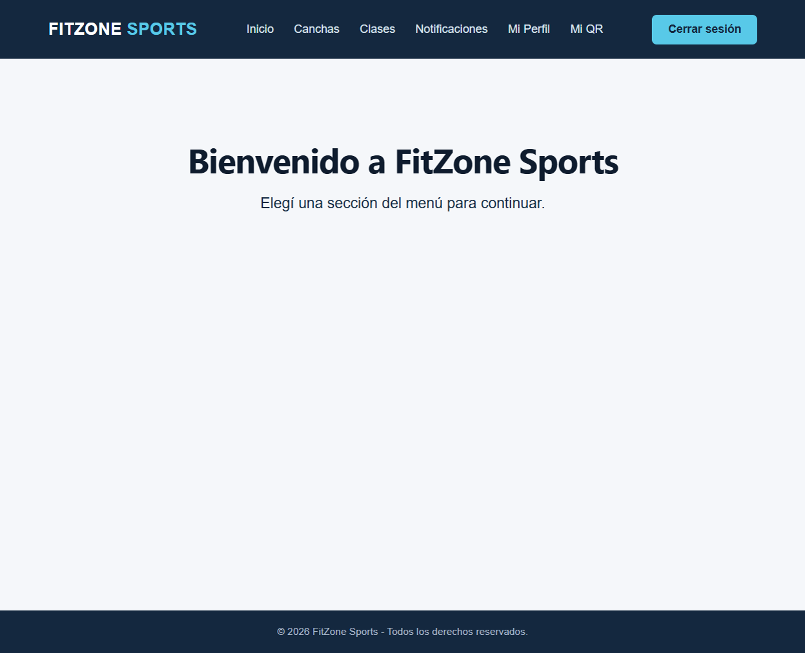

## 2. Cómo leer este manual

Cada sección sigue el orden de la pantalla: qué abrir, qué completar y qué mensaje esperar. La figura está debajo de los pasos que ilustra.

Hay dos nombres de sede repetidos en los datos de demostración. FitZone Central de San Martín 1234 y FitZone Central de Av. Demo 100 no son la misma sucursal. Para reservar la cancha de paddle del seed, elegí la de Av. Demo 100.

### 2.1 Usuarios de demostración

| Email | Para qué entra |
|-------|----------------|
| `socio@fitzone.com` | Portal del socio, con membresía activa |
| `externo@fitzone.com` | Cliente sin membresía: reserva canchas a precio externo |
| `admin.central@fitzone.com` | Recepción: acceso, aforo y canchas de la sede |
| `gerente@fitzone.com` | Gerencia: sedes, precios, agenda y también el acceso |

### 2.2 Glosario

| Término | En esta entrega |
|---------|-----------------|
| Socio | Usuario con rol `socio`. Con la membresía activa usa el QR, las clases y el precio socio de las canchas. |
| Cliente externo | Usuario sin membresía. El registro público crea este rol. Reserva canchas al precio externo. |
| Recepción | Rol `admin_sede`. Opera el ingreso de una sede. |
| Gerente | Rol `gerente`. Configura la cadena. |
| Sede | Sucursal, con dirección y aforo máximo. |
| Aforo | Personas que están dentro de la sede, sobre el máximo configurado. |
| QR | Código de ingreso del socio. Cambia cada 60 segundos. |
| Horario pico | Franja con recargo. En la captura, de 19:00 a 21:00. |
| Lista de espera | Fila de una clase sin cupo. Si se libera un lugar, el primero tiene 30 minutos para confirmarlo. |
| Pasarela simulada | Pantalla de pago de demostración. No guarda el número de tarjeta. |

## 3. Manual del socio

Entrá con `socio@fitzone.com` y la contraseña del seed.

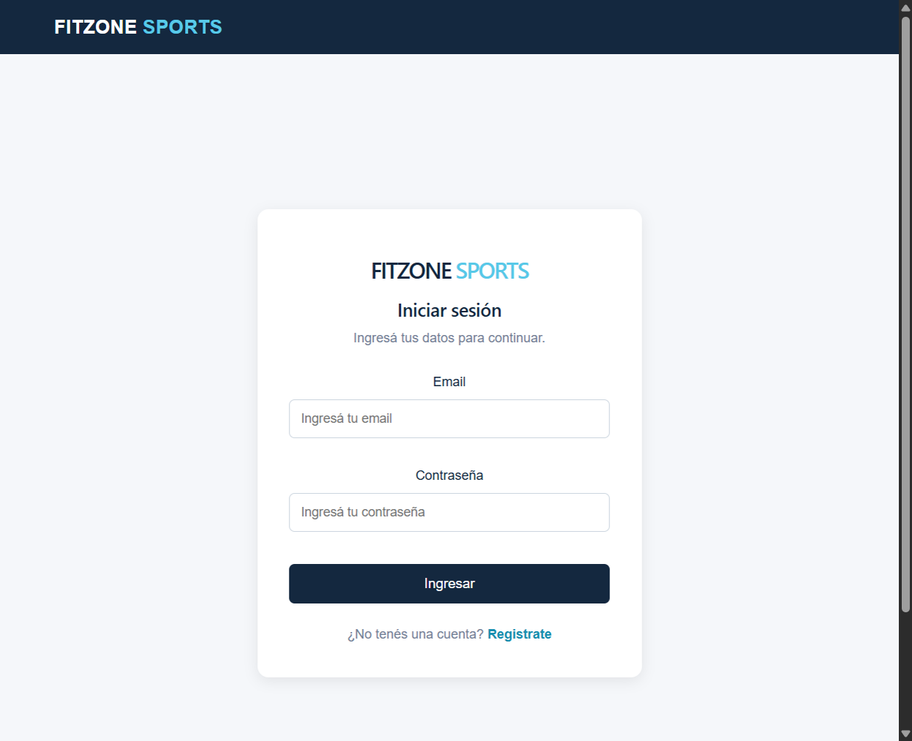

### 3.1 Registro y carga del perfil

El alta pública está en **Registrate**, desde el inicio de sesión, o en `/signup`.

1. Completá nombre, apellido, DNI, teléfono, correo y contraseña.
2. Repetí la contraseña. Si no coinciden, la pantalla avisa «Las contraseñas no coinciden.». La contraseña pide al menos 6 caracteres.
3. Pulsá **Registrarse**.

El alta crea un **cliente externo**, no un socio. El sistema pide confirmar el correo antes de poder entrar. Si el correo o el DNI ya existen, el registro se rechaza.

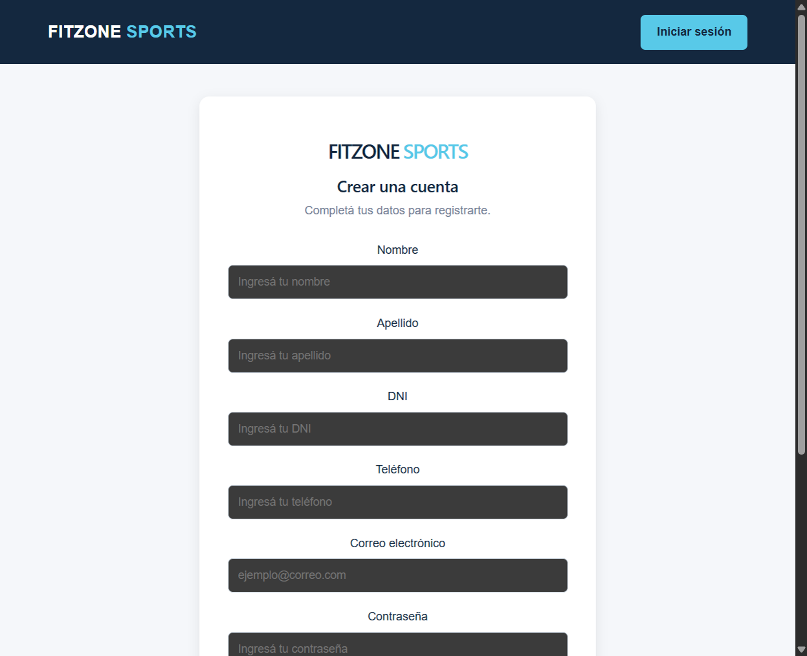

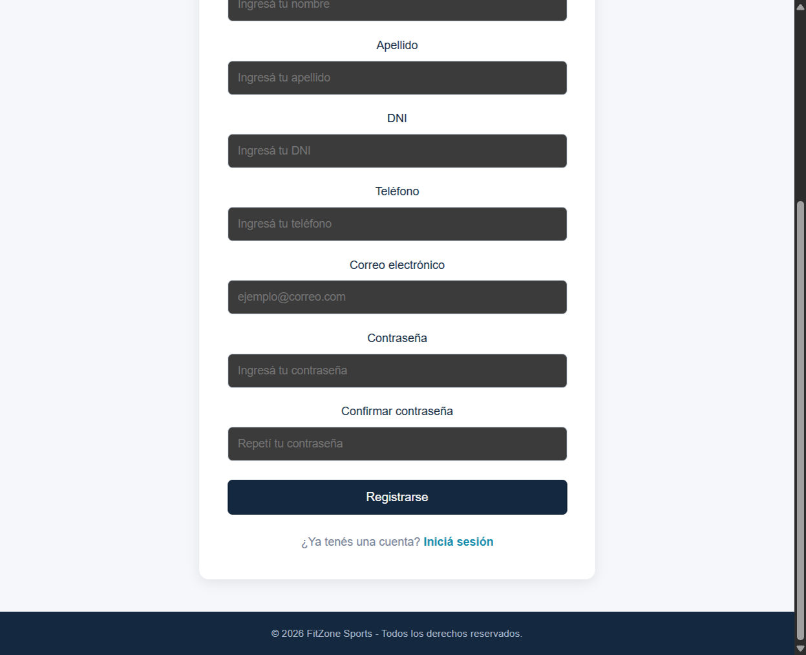

El perfil se carga en **Mi Perfil**. Ahí se editan nombre, apellido, DNI, teléfono y sede habitual. **Guardar cambios** persiste esos datos. El correo y el rol se ven en «Información de la cuenta» y no se cambian desde este formulario. El interruptor «Notificaciones por email» elige si querés avisos en el correo.

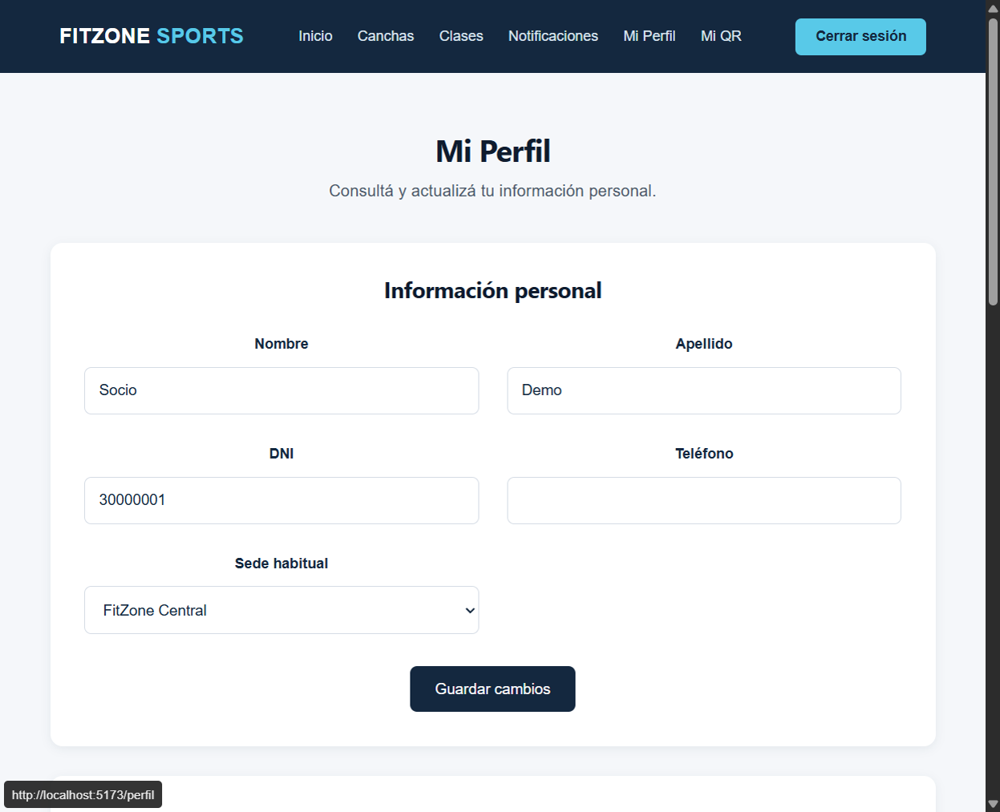

### 3.2 Contratación y renovación de la membresía

En **Mi Perfil**, el bloque **Mi membresía** muestra el plan, el estado y las fechas de vigencia. El socio del seed tiene un plan trimestral activo.

Para renovar, bajá a **Planes**. Hay mensual, trimestral y anual, con el precio de cada uno. **Pagar** abre la pasarela simulada. Si el pago se aprueba, el plan nuevo queda activo y el anterior se cierra. Si el pago se rechaza, la membresía vigente no cambia.

El cliente externo no ve este bloque: su rol no incluye planes. La pantalla de renovación es la del socio.

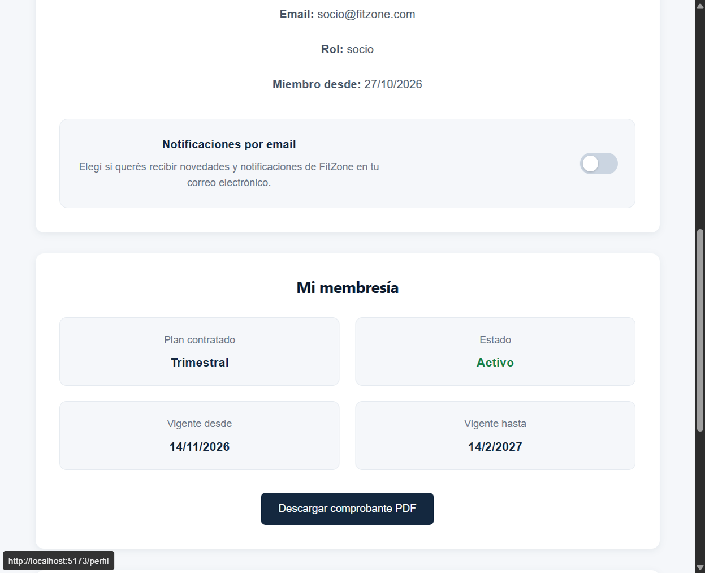

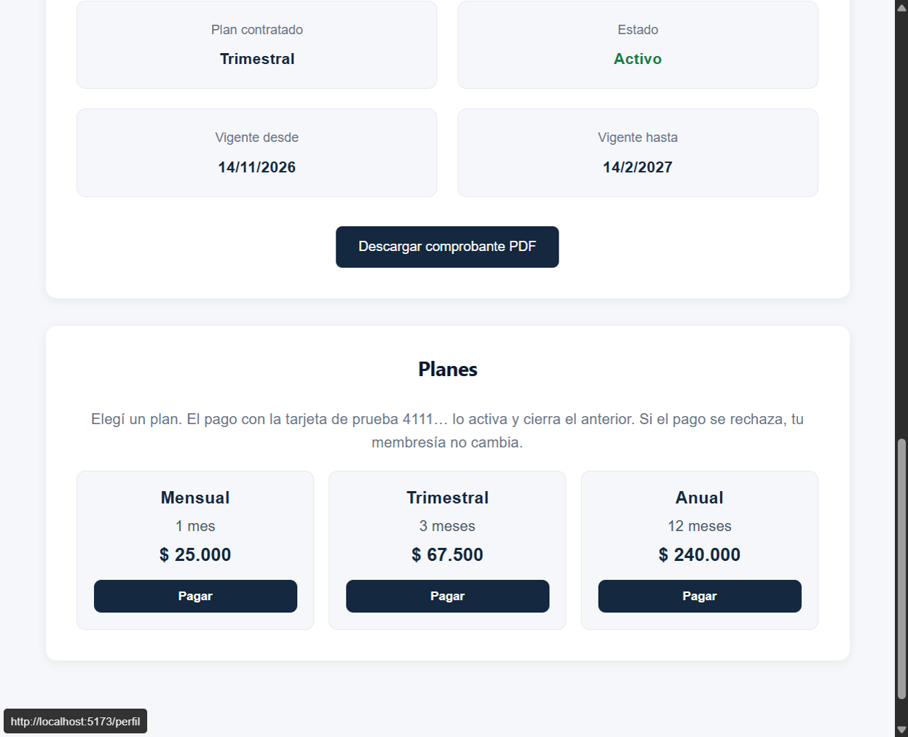

### 3.3 Obtención del código QR e ingreso al gimnasio

**Mi QR** está en el menú del socio. Mostrá el código en recepción, o dictá los seis dígitos que aparecen debajo. El código se regenera cada 60 segundos: si falta poco para renovarse, esperá el siguiente antes de que lo carguen.

La recepción lo pega en **Acceso** y pulsa **Registrar ingreso**. Con la membresía activa, el socio queda en «En la sede». El mismo código sirve en cualquier sede de la cadena. No se puede figurar dentro de dos sedes a la vez: para entrar a otra, primero hay que salir de la actual.

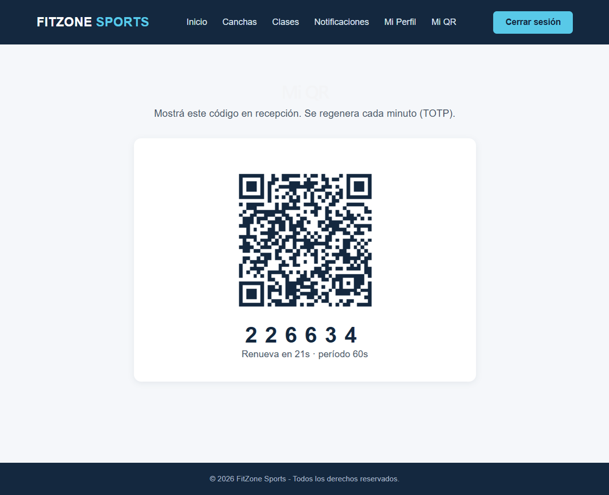

### 3.4 Si el QR no es aceptado o la sede está sin conexión

Del lado del socio, generá de nuevo el código en **Mi QR**. Un código vencido, o una membresía que no está activa, no ingresa. Si ya figurás dentro de otra sede, la recepción no puede volver a registrarte hasta que pulses **Salir** en la sede anterior.

Del lado de la recepción, la pantalla **Acceso** muestra el estado de red. Sin conexión, el ingreso se guarda en **Cola offline** y se envía con **Sincronizar** cuando la red vuelve. La salida también entra en esa cola si no hay servidor o si la base no responde. El detalle de esa pantalla está en la [sección 4.1](#41-validación-de-ingreso-y-lectura-del-aforo) y en la [sección 4.4](#44-problemas-frecuentes-del-mostrador).

### 3.5 Reserva de clases y lista de espera

Abrí **Clases**, elegí la sede y mirá **Clases disponibles**. Cada tarjeta muestra tipo, instructor, horario y cupos libres.

1. Con cupo libre, **Inscribirme**. La clase tiene que empezar al menos 48 horas después. Si falta menos, el sistema rechaza el alta y muestra «Solo se puede reservar una clase con al menos 48 horas de anticipación».
2. Sin cupo, **Lista de espera**. La tarjeta pasa a decir «Ya estás en la lista de espera.».
3. Tus altas quedan en **Mis inscripciones**. **Cancelar inscripción** libera el lugar.
4. En **Mi lista de espera**, **Retirarme** te saca de la fila. Si el estado es `notificado`, **Confirmar lugar** toma el cupo. El plazo es de 30 minutos. Si no confirmás, el lugar pasa al siguiente.

Hace falta una membresía activa. El cliente externo y el socio con la cuota vencida no se inscriben.

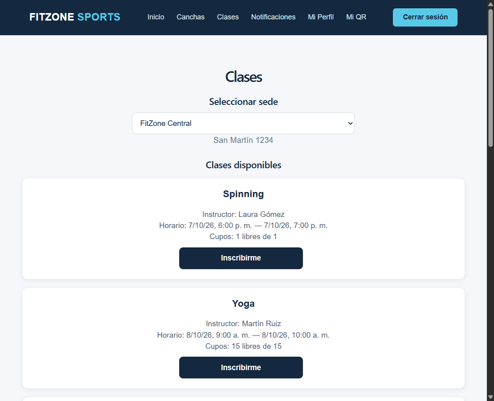

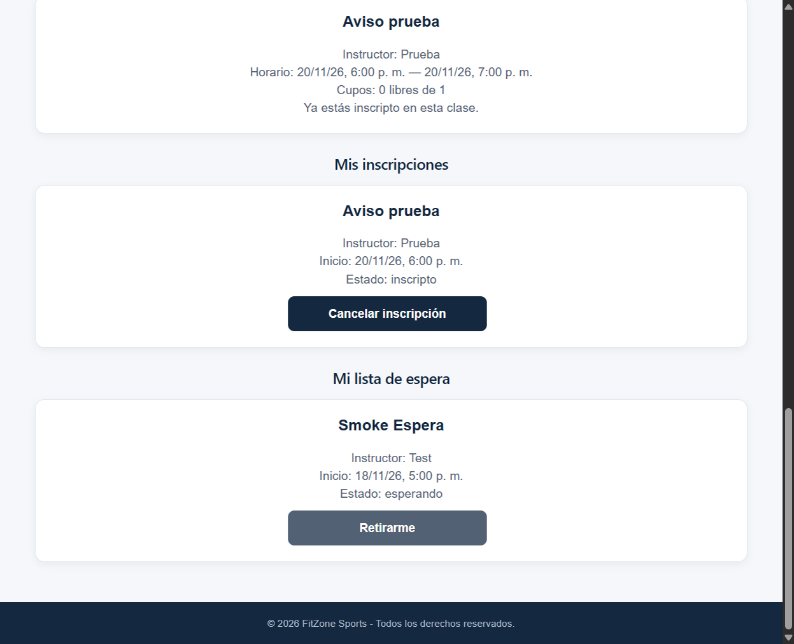

Cuando se libera un lugar, el aviso llega a **Notificaciones**. El título se lee sobre la tarjeta. **Marcar como leída** lo da por visto. **Actualizar** vuelve a pedir la lista.

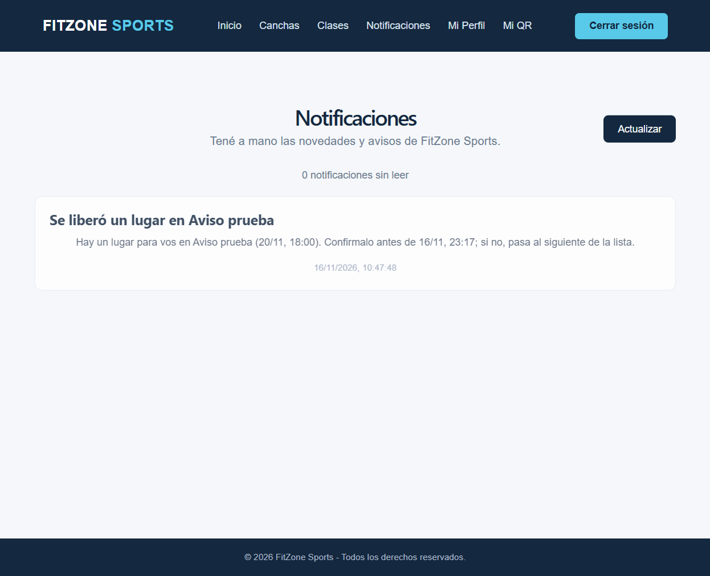

### 3.6 Reserva de canchas y cómo se calcula el precio

Abrí **Canchas**. Elegí la sede, la fecha y el horario. La tarjeta de la cancha muestra el estado, el **precio socio**, el **precio externo** y, si corresponde, la leyenda **Horario pico**.

El precio externo es la tarifa de la hora. El precio socio le aplica el descuento de la cadena (en la captura, 15 %). En horario pico se suma el recargo de la sede (en la captura, 20 % entre las 19:00 y las 21:00). Con membresía activa se cobra el precio socio. Sin membresía activa, o con la cuota vencida, se cobra el precio externo. El cliente externo usa esta misma pantalla y paga ese precio externo.

**Reservar** deja la reserva pendiente de pago. **Pagar reserva** abre la pasarela simulada. La tarjeta de prueba que empieza con 4111 aprueba. La que empieza con 4000 rechaza. El número no se guarda. Si otra persona confirma el mismo turno en el mismo instante, solo una reserva queda confirmada.

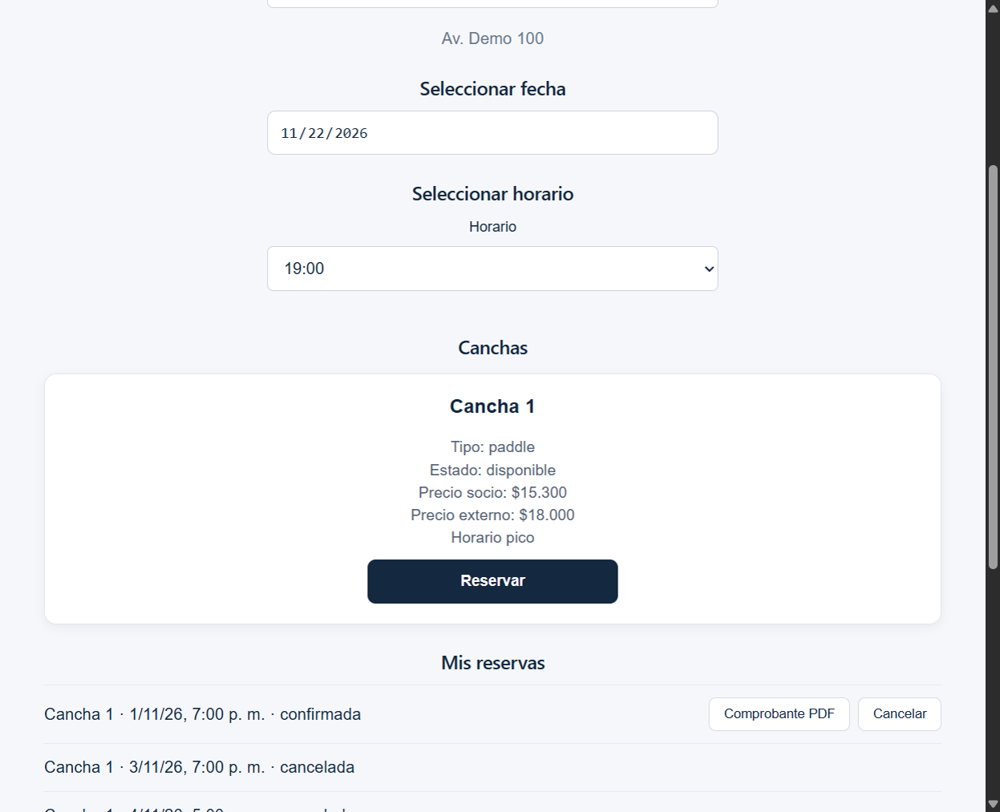

### 3.7 Cancelaciones, plazos y penalidades

En **Clases**, **Cancelar inscripción** está en la tarjeta de **Mis inscripciones**. Si faltan menos de 2 horas para el inicio, la cancelación queda marcada como tardía. Esta entrega no cobra un importe extra por esa marca. Al cancelar, el lugar se ofrece al primero de la lista de espera.

En **Canchas**, **Cancelar** está en **Mis reservas**, tanto si la reserva está pendiente como si ya está confirmada. Cancelar no devuelve el pago.

Una cancha en mantenimiento no ofrece turnos futuros. Las reservas ya tomadas no se cancelan solas.

### 3.8 Comprobantes de pago

El comprobante es un PDF de FitZone. No es una factura fiscal. Trae el número, la fecha, el estado **APROBADO**, el titular, el detalle y el total. No imprime datos de tarjeta.

- En **Mi Perfil**, con una membresía que tenga pago, **Descargar comprobante PDF**.
- En **Canchas**, cada reserva confirmada tiene **Comprobante PDF**.

En la pasarela, el checkout pide número, nombre, vencimiento y CVV, muestra el monto y aclara que los datos de la tarjeta no se guardan. Al aprobar, volvés al portal y el comprobante queda en el botón correspondiente.

Este es el PDF de la reserva de Cancha 1 en FitZone Central, el 9/11/2026 de 19:00 a 20:00. El total es $ 20.400, con tarifa base, horario pico y descuento de socio.

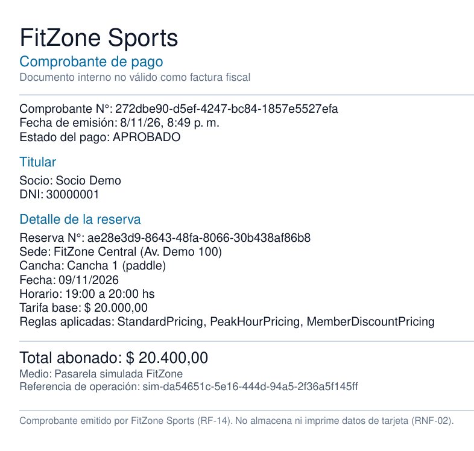

## 4. Manual del recepcionista

Entrá con `admin.central@fitzone.com`. El menú suma **Acceso** y **Administrar canchas**. No aparecen **Mi QR**, **Dashboard**, **Sedes** ni **Agenda**.

### 4.1 Validación de ingreso y lectura del aforo

Abrí **Acceso**.

1. Elegí la sede.
2. Pegá el contenido del QR en **Código del QR**, o completá **Socio** y **Código de acceso** con los seis dígitos de **Mi QR**.
3. Pulsá **Registrar ingreso**.

**En la sede** lista quién está dentro, desde qué hora, y el aforo en la forma `ocupación / máximo`. **Salir** registra la salida y no pide el código. Un socio no puede estar en dos sedes al mismo tiempo.

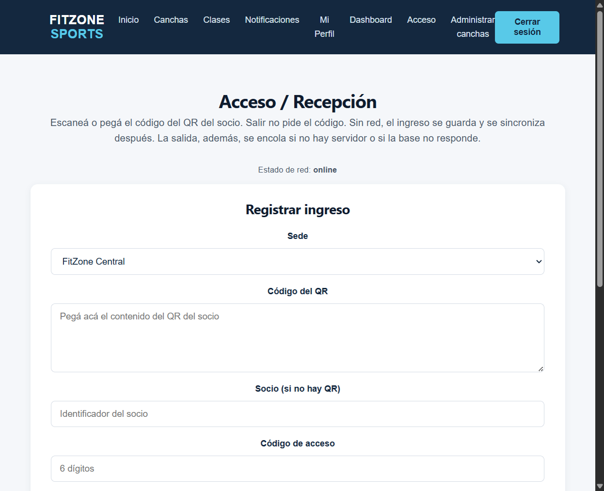

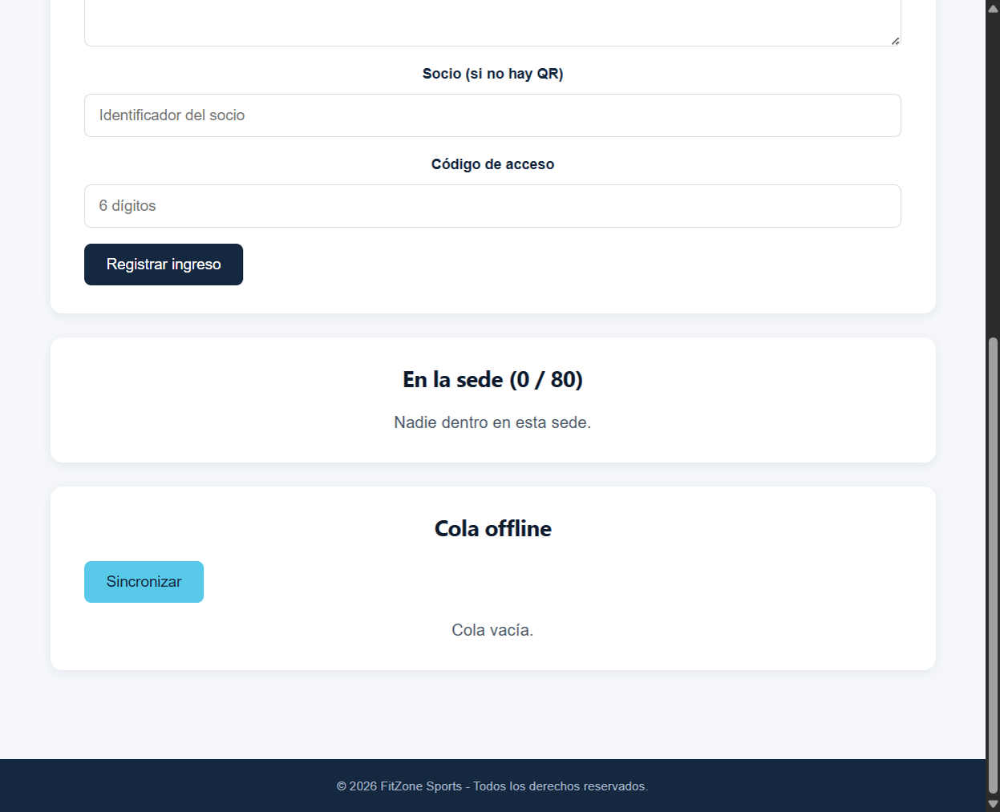

### 4.2 Gestión de la agenda de clases

En el sistema entregado, la agenda no es una pantalla de recepción. El enlace **Agenda** (`/clases/gestionar`) lo ve el gerente. La recepción no lo tiene en el menú.

El gerente abre **Agenda**, elige sede, tipo, instructor, inicio, fin y capacidad, y pulsa **Crear clase**. La clase queda programada. Para pasarla de sede hay que cancelarla y crear otra. Editar y pasar el estado a **Cancelada** no borra las inscripciones ni avisa a la lista de espera. Los horarios se leen en hora de Argentina.

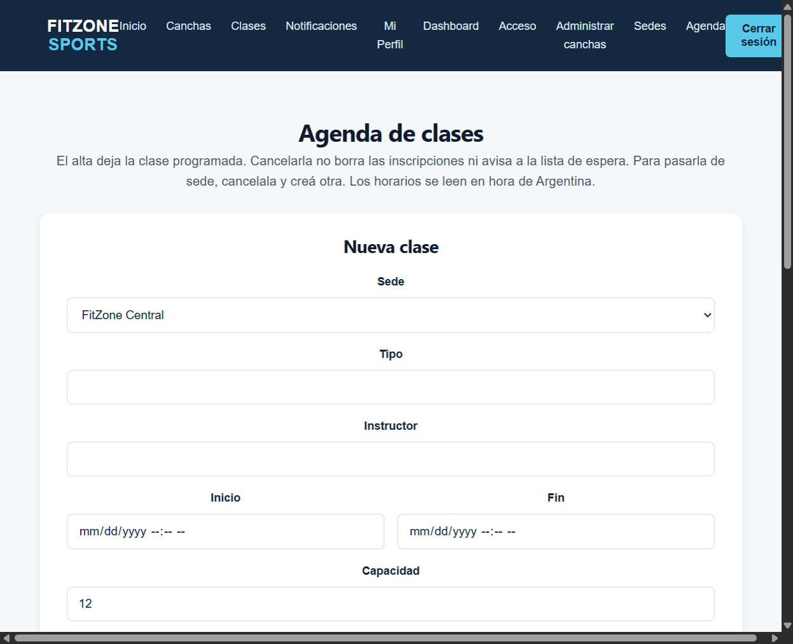

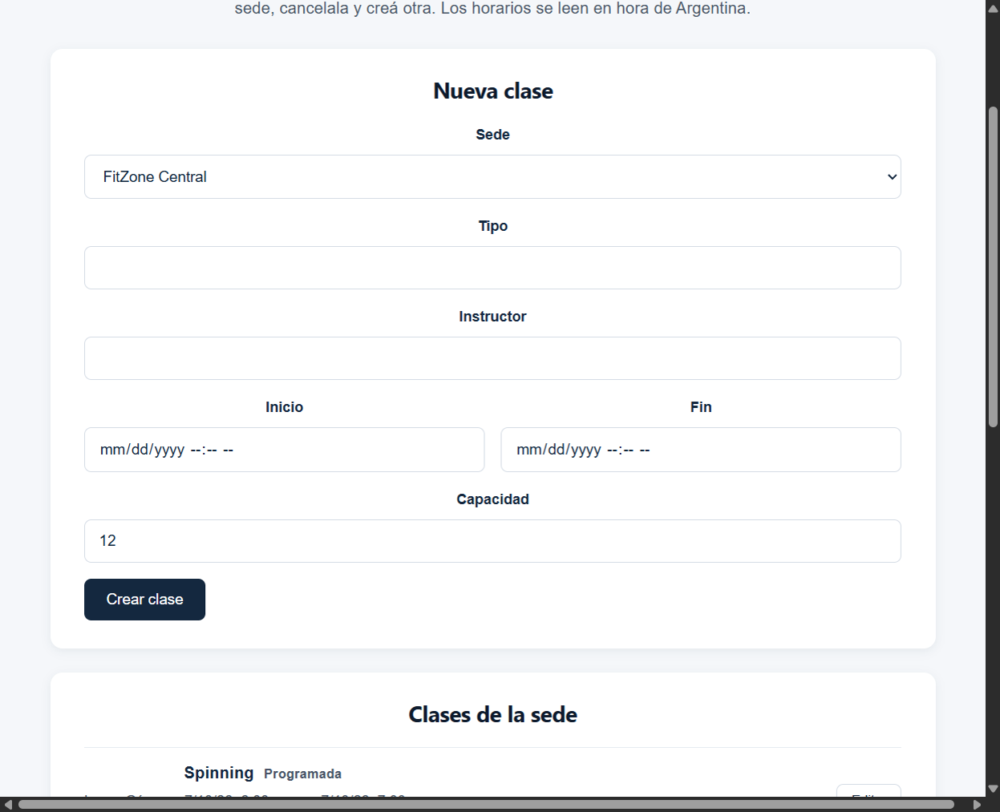

### 4.3 Inhabilitación de una cancha por mantenimiento

Abrí **Administrar canchas**. Elegí la sede y, en **Mantenimiento**, la cancha. Cargá desde, hasta y un motivo, y pulsá **Cargar mantenimiento**. El período bloquea turnos futuros. No cancela reservas ya tomadas. **Quitar** borra ese período.

Desmarcar **Activa** al editar la cancha la saca de la oferta. No borra el historial.

El horario pico de la sede (recargo, desde, hasta y días) también se guarda en esta pantalla. El descuento de socio se ve, pero el botón para cambiarlo es del gerente: la recepción lee «Solo el gerente puede cambiar este valor.».

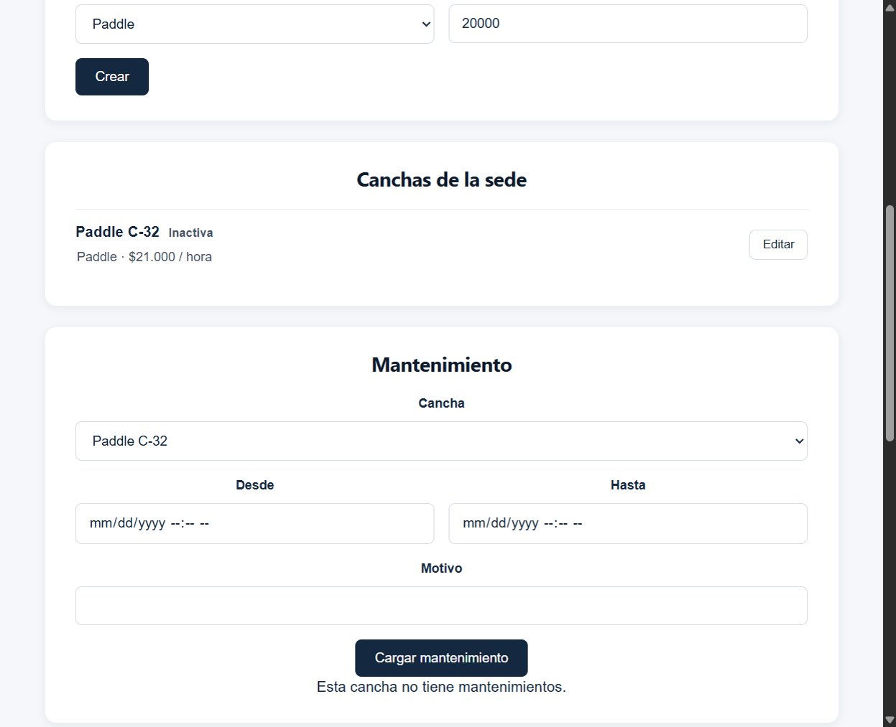

### 4.4 Problemas frecuentes del mostrador

| Qué ves | Qué hacer |
|---------|-----------|
| El estado de red dice **offline** | El ingreso se encola. Cuando vuelva la red, **Sincronizar** en **Cola offline**. |
| La cola tiene filas pendientes | Revisá el detalle de cada fila. **Sincronizar** las reenvía en orden. |
| El ingreso se rechaza y el socio ya está en otra sede | En la sede anterior, **Salir**. Después registrá el ingreso nuevo. |
| El código no coincide | Pedile al socio que abra **Mi QR** de nuevo. El código dura 60 segundos. |
| La membresía no está activa | El socio no ingresa como socio. Puede renovar desde **Mi Perfil** si su rol es socio. |
| No hay servidor o la base no responde al salir | La salida también queda en la cola. **Sincronizar** cuando el servicio vuelva. |

La captura con el estado **offline** está en la [sección 3.4](#34-si-el-qr-no-es-aceptado-o-la-sede-está-sin-conexión). La cola vacía, con **Sincronizar**, está en la [sección 4.1](#41-validación-de-ingreso-y-lectura-del-aforo).

## 5. Manual del gerente central

Entrá con `gerente@fitzone.com`. Además de las pantallas de recepción, el menú muestra **Dashboard**, **Sedes** y **Agenda**.

### 5.1 Alta y configuración de una sede

Abrí **Sedes**.

1. Completá nombre, dirección y aforo máximo.
2. Dejá **Activa** marcada para que la sede aparezca en las reservas.
3. Pulsá **Crear sede**. El horario pico de esa sede nace con los valores por defecto.

La lista **Cadena** muestra las sedes y **Editar**. Para dar de baja una sede, editala y desmarcá **Activa**. Eso la oculta en las reservas. No borra canchas ni turnos ya tomados. No hay un botón de borrado.

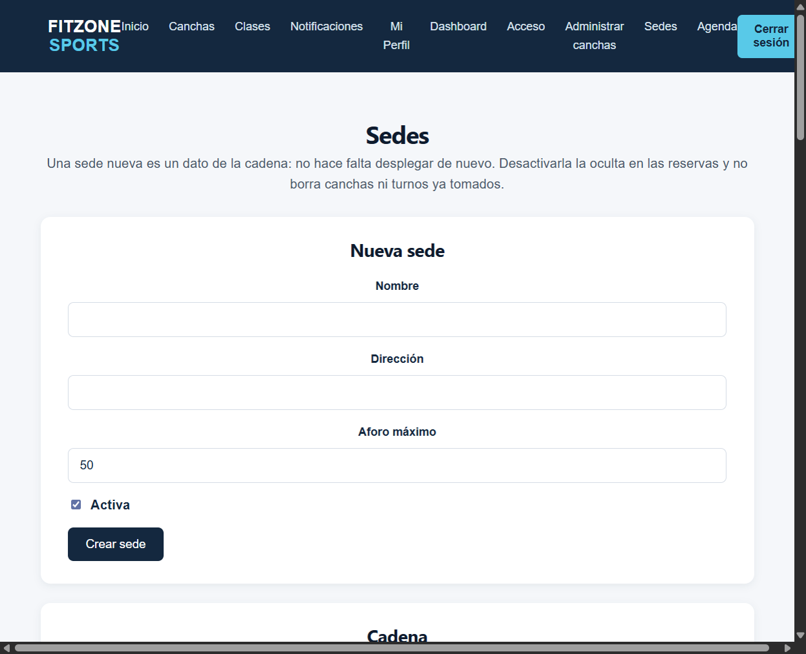

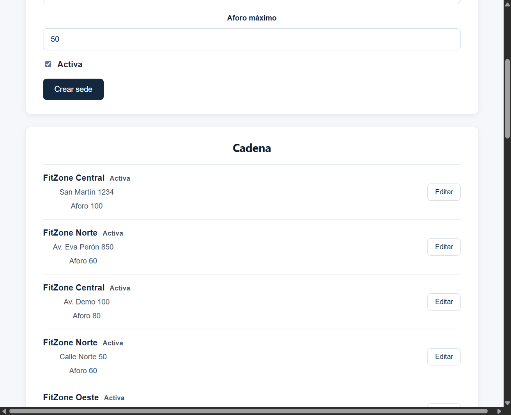

### 5.2 Definición de precios, descuentos y horario pico

Abrí **Administrar canchas**.

- **Nueva cancha** pide nombre, tipo (paddle, fútbol 5 u otro) y precio por hora. **Crear** la da de alta. **Editar** cambia el nombre, el precio y si está activa. El precio nuevo vale para reservas nuevas.
- **Horario pico** guarda el recargo, la franja y los días. En la captura, el recargo es 20 % de 19:00 a 21:00, todos los días. **Guardar pico** lo aplica a la sede elegida.
- **Descuento de socio** es un porcentaje único de la cadena. **Guardar descuento** lo cambia. En la captura está en 15 %. La recepción ve el número y no puede guardarlo.

El socio ve el resultado en **Canchas**: precio socio, precio externo y la leyenda de horario pico. Esa pantalla está en la [sección 3.6](#36-reserva-de-canchas-y-cómo-se-calcula-el-precio).

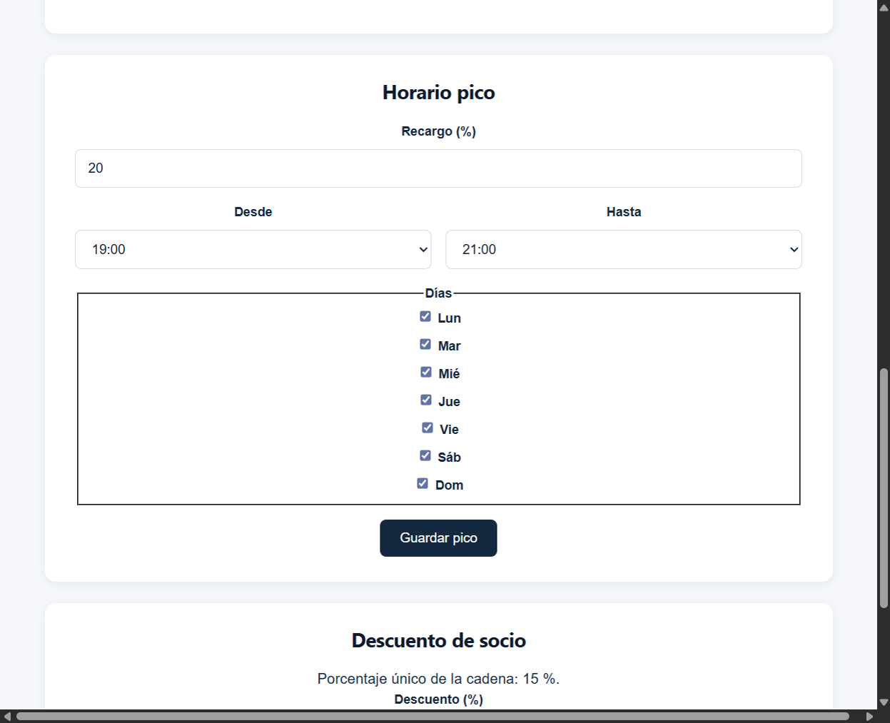

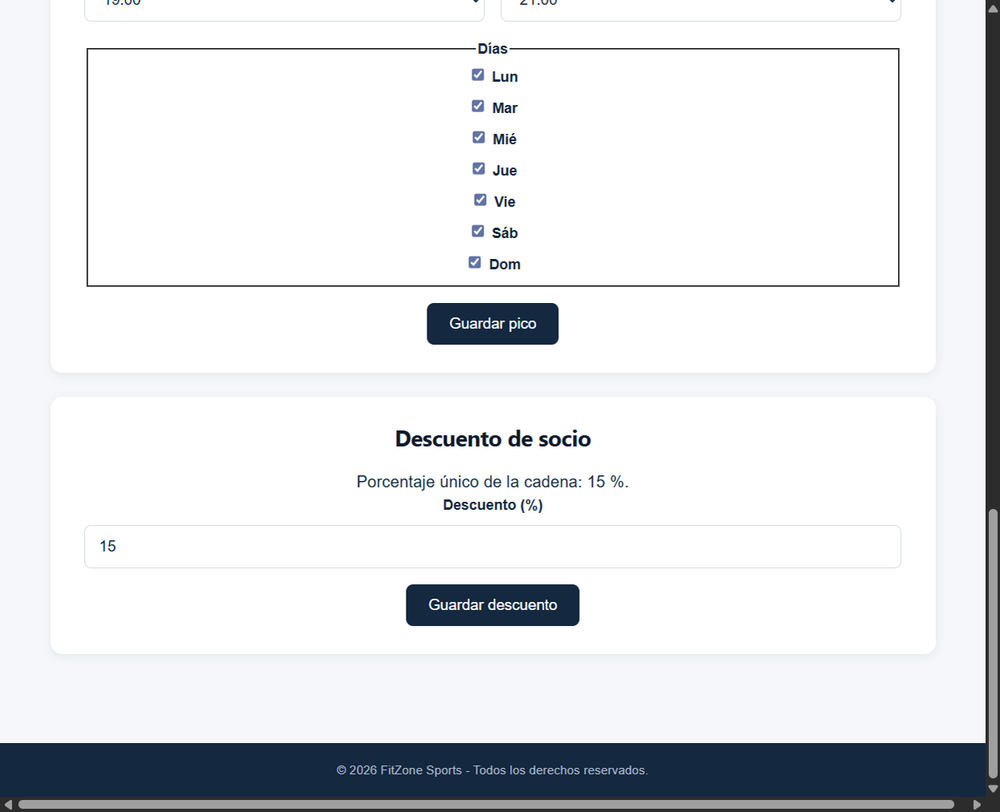

### 5.3 Lectura de los reportes consolidados

Abrí **Dashboard**. La pantalla es de solo lectura y muestra el día en hora de Argentina.

Arriba, el total de la cadena:

- **Ocupación:** personas que están adentro ahora, sobre la suma de los aforos.
- **Reservas del día:** turnos de cancha pendientes o confirmados que empiezan hoy.
- **Clases del día:** clases programadas que empiezan hoy.
- **Sedes:** cuántas sedes entran en la cuenta, incluidas las inactivas.

La tabla de abajo repite esas tres cifras sede por sede. Una sede dada de baja figura como **Inactiva**. El aforo de una sola sede, con la lista de quién está adentro, sigue en **Acceso** ([sección 4.1](#41-validación-de-ingreso-y-lectura-del-aforo)). La recepción no abre este panel.

En la captura del 18/11/2026 la cadena está en **0 / 1430**, sin reservas del día, con **26** clases y **27** sedes. Cada sede del seed tiene una clase programada para ese día, salvo una de las dos **FitZone Norte**.

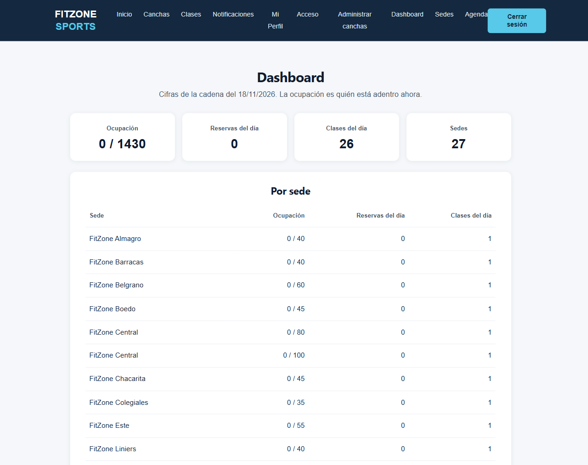

## 6. Preguntas frecuentes

**Me registré y no puedo ver Mi QR ni las clases.** El registro crea un cliente externo. El QR, las clases y los planes están en el rol socio. El usuario de demostración que ya es socio es `socio@fitzone.com`.

**La clase muestra Inscribirme y después rechaza el alta.** Faltan menos de 48 horas para el inicio. Elegí una clase más lejana.

**Cancelé una clase a último momento. ¿Me cobran algo?** Si faltan menos de 2 horas, la cancelación queda marcada como tardía. Esta entrega no suma un cargo por esa marca.

**Cancelé la cancha. ¿Me devuelven el pago?** No. Cancelar deja la reserva cancelada y no devuelve el pago.

**¿Qué tarjeta uso en el checkout?** La que empieza con 4111 aprueba. La que empieza con 4000 rechaza. El portal no guarda el número.

**El precio de socio no me coincidió.** Con la membresía activa se cobra el precio socio. Si la cuota está vencida, se cobra el precio externo, el mismo que ve el cliente externo.

**Hay dos FitZone Central.** Mirá la dirección. La cancha de paddle del seed de entrega está en Av. Demo 100.

**La recepción no encuentra Agenda.** La agenda la abre el gerente, en **Agenda**.

**¿Dónde están los reportes de toda la cadena?** En **Dashboard**, con el usuario `gerente@fitzone.com`. La recepción no ve ese enlace. El aforo de una sede, persona por persona, se consulta en **Acceso**.
