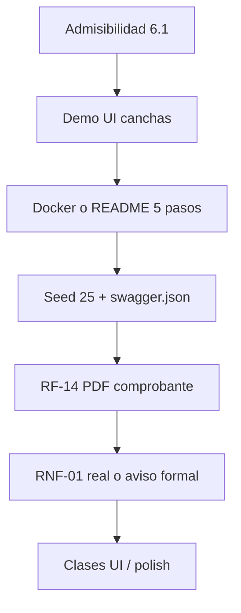

# Plan de cierre — entrega TIF (6 al 19 de noviembre 2026)

**Fecha del plan:** 2026-11-06  
**Última alineación con Trello:** 2026-11-11 (reunión de equipo; export `documentacion/eBn68vRC - programacion5 (2).json`)  
**Congelamiento / tag:** jueves **19/11/2026, 18:00** → `v1.0-entrega`  
**Demo Day:** semana 23–29/11 (sin desarrollo)  
**Fuente de orden:** [Lineamientos de Entrega](./Lineamientos_Entrega_TIF_FitZone_Sports_2do_Cuatrimestre_2026.pdf) · **Anexo G**  
**Estado de partida:** relevado el 2026-11-06 sobre `desarrollo` (API canchas/clases/acceso fuertes; entonces UI canchas mock; docs de entrega incompletas). **Actualización 2026-11-13:** C-01 y S7-T08 cerrados — canchas en UI y pase demo solo UI; C-24 (ensayo 5 min cronometrado) sigue sobre el guion ya pulido. **Misma fecha:** se agregó **C-28** (Strategy → Decorator + UML Nest), no listada en el plan original; entra en T2 antes del congelamiento T3.

**Estados** (lista Trello → este plan): `por hacer` → **Por hacer** · `tambien en desarrollo` → **En desarrollo** · `finalizado` → **Finalizado**. El 2026-11-11 las listas `en desarrollo` y `Blocked` estaban vacías.

Este plan **no reemplaza** S5–S7 ni el track M2. Es el plan de las **dos semanas finales** hasta el tag. Si algo no entra, se corta lo de la sección 7, no lo de admisibilidad (§6.1).

**Solapes con tarjetas S5–S7:** no se borran del tablero. Cada par tiene campo **Observación** (relacionada con…) en  
[`Relacion_Tarjetas_Trello_Observaciones.md`](./Relacion_Tarjetas_Trello_Observaciones.md) y  
[`Plan_Cierre_y_Solapes_Trello_Observaciones.xlsx`](./Plan_Cierre_y_Solapes_Trello_Observaciones.xlsx).

---

## 1. Objetivo

Un repositorio etiquetable el 19/11 que:

1. Levante (idealmente con Docker; si no, con README de 5 pasos a prueba de máquina limpia).
2. Demuestre en UI el guion de 5 min: login → membresía → reservar paddle + pagar → QR → check-in sede.
3. Cumpla la **admisibilidad formal**: 4 bitácoras, 10 ADR obligatorios, 14 diagramas, 3 manuales, planificación + tablero.
4. Tenga dossier PDF + nomenclatura Moodle listos.

---

## 2. Capacidad (techo)

| Integrante | Rol | h / semana | Total ~2 semanas |
|------------|-----|------------|------------------|
| Patricio (P1) | Arquitectura / docs / backend crítico | 8–10 h | 16–20 h |
| Lucas (P3) | Frontend demo + responsive | 8–10 h | 16–20 h |
| Bruno (P2) | Backend gaps RF + tests | 4–6 h | 8–12 h |
| Matias (P4) | Planificación, CI, seed, Docker, cobertura | 4–6 h | 8–12 h |
| **Equipo** | | ~24–32 h | **~48–64 h** |

Regla: **docs de admisibilidad y demo UI primero**; polish y stretch después.

---

## 3. Tres tramos (alineados a la cátedra)

| Tramo | Fechas | Foco |
|-------|--------|------|
| **T1 — Demo operable** | vie 6 – dom 8/11 | Grilla/reserva/pago en UI; membresía visible; responsive básico; decidir RNF-01 |
| **T2 — Entregables formales** | lun 9 – dom 15/11 | ADR ×10, diagramas ×14, 3 manuales, bitácoras ×4, planificación, Docker/seed, estructura `docs/` |
| **T3 — Congelamiento** | lun 16 – jue 19/11 | Defectos críticos, Anexo G en verde, tag, dossier Moodle |

Después del tag: solo ensayo Demo Day.

---

## 4. Backlog por tramo (con dueño)

### T1 — 6 al 8/11 · Demo operable (~18–22 h)

| ID | Tarea | Quién | h | Estado | Cierra cuando | Anexo G |
|----|-------|-------|---|--------|---------------|---------|
| C-01 | **S4-T13** — `/canchas` real: sede → `GET /disponibilidad` → reservar → `POST .../pagar` → checkout | Lucas | 6–8 | **Finalizado** | Paddle del seed se reserva y confirma desde la UI | Funcionalidad / portal teléfono |
| C-02 | Membresía en UI (`GET /membresias/mia` en Perfil o bloque propio) | Lucas | 1–2 | **En desarrollo** | Se ve plan/estado/vigencia del socio seed | RF-02 demostrable |
| C-03 | Lectura responsive: Login, Canchas, Mi QR usables en viewport móvil | Lucas | 2 | **Finalizado** | QR legible; reserva posible en teléfono | Portal desde teléfono |
| C-04 | RF-14: PDF **comprobante FitZone** post-pago (cancha, horario, monto); no factura fiscal | Bruno | 3–4 | **Por hacer** | Tras pagar se descarga/abre PDF con esos datos | RF-14 |
| C-05 | Decisión escrita RNF-01: reforzar offline real **o** documentar MVP cola+sync + mail a cátedra (§7.2) | Patricio | 1 | **Finalizado** | ADR alineado + si hace falta aviso formal | RNF-01 |
| C-06 | Ensayo corto API+UI del guion (sin cronómetro aún) | Todos 30–45 min | 1 | **Finalizado** | Lista de bugs del flujo | Defensa |

**Salida T1:** el Demo Day se puede ensayar en local sin Swagger para el paso de cancha.

---

### T2 — 9 al 15/11 · Admisibilidad + integración (~28–36 h)

#### 4.1 Código / operación

| ID | Tarea | Quién | h | Estado | Cierra cuando | Anexo G |
|----|-------|-------|---|--------|---------------|---------|
| C-07 | `docker-compose.yml` (+ Dockerfiles) que levante API + front; BD Supabase documentada o Postgres local | Matias | 6–8 | **Por hacer** | `docker compose up --build` o README de 5 pasos en máquina limpia | Código Docker |
| C-08 | Seed ≥ **25 sedes** + canchas/clases mínimas + 4 roles (o script aparte `seed:entrega`) | Matias | 4–5 | **Por hacer** | Cumple §5.4.1 carga de prueba | Seed 25 sedes |
| C-09 | Exportar `backend/swagger.json`; link en README | Bruno | 0,5 | **En desarrollo** | Archivo en repo + UI docs | swagger.json |
| C-10 | Suite verde: unit + e2e críticos; actualizar reporte cobertura; declarar umbral en ADR-008 (cátedra) | Matias | 3–4 | **Por hacer** | CI verde + reporte | Cobertura / tests |
| C-11 | Pantalla Clases mínima (listar + inscribir). **Cerrada 2026-11-13** por **Patricio** (tomó la tarjeta de Lucas; UI `/clases`; RF-07 + RF-08 lista espera) | Patricio (antes Lucas) | 3–4 | **Finalizado** | RF-07 demoable en UI | 14 RF |
| C-12 | Notificaciones in-app (lista + leída) stretch | Lucas | 1–2 | **Por hacer** | Si sobra | — |
| C-28 | Precios Strategy → Decorator GoF + UML Nest completo + docs (serie C-28.1…C-28.5) | Patricio | 5–7 | **Por hacer** | Suite precios verde; UML Nest (controllers/services/DTOs/repos + Decorator); secuencia + C4-3; manual §4.1/weekend; justificación Unidad III; defensa cita Decorator | Patrones / diagramas |

#### 4.2 Repositorio y docs (admisibilidad §6.1)

| ID | Tarea | Quién | h | Estado | Cierra cuando | Anexo G |
|----|-------|-------|---|--------|---------------|---------|
| C-13 | Reorganizar a `docs/` según la estructura del punto 4 | Patricio | 2–3 | **Finalizado** | Cátedra encuentra ADR/diagramas/manuales/bitácoras/plan | Estructura carpetas |
| C-14 | **10 ADR obligatorios** (§5.2.1): mapear existentes + crear faltantes (concurrencia, offline, pruebas/umbral, despliegue/Docker, tokenización, FE/estado, …). **Cerrada 2026-11-09**, rama `c-14`, índice `docs/adr/README.md` | Patricio | 5–6 | **Finalizado** | 10 archivos, ninguno «Propuesto», con alternativas | ADR ×10 |
| C-15 | **14 diagramas** + fuente editable + PNG/SVG (C4×4, UML, DER, despliegue, pipeline) | Patricio | 8–10 | **Finalizado** | Carpeta `docs/diagramas/` completa | Diagramas ×14 |
| C-16 | Manual usuario (Anexo D) + capturas del sistema **entregado** | Lucas | 4–5 | **Por hacer** | Secciones socio / recepción / gerente | Manuales |
| C-17 | Manual instalación/operación (Anexo E) | Matias | 3–4 | **Por hacer** | Incluye Docker/env/seed/rollback | Manuales |
| C-18 | Manual técnico (Anexo F) + casos extensión tenis y Strategy | Patricio | 3–4 | **Finalizado** | Dos casos resueltos | Manual técnico |
| C-19 | Bitácoras individuales `docs/bitacoras/LOG-<apellido>.md` ×4 (≥8 entradas c/u, commits, decisión, problema). En el tablero está partida en C-19a…d | **Cada uno** | 3–4 c/u | **Parcial** | Cuatro archivos distintos | Bitácoras |
| C-20 | Planificación completa (§5.6 + Anexo H): plan, EDT, cronograma visual, trazabilidad RF/RN/RNF, seguimiento, riesgos, desvíos | Matias | 6–8 | **Por hacer** | Paquete en `docs/planificacion/` | Planificación |
| C-21 | Exportar tablero (Trello/GitHub/xlsx) con fechas de creación/cierre reales | Matias | 1–2 | **Por hacer** | Archivo `PROGV-2026-TIF-EquipoNN-Registro.xlsx` | Tablero |

**C-19 en el tablero (2026-11-11):** C-19a Patricio **Finalizado** · C-19d Matias **En desarrollo** · C-19b Bruno y C-19c Lucas **Por hacer**.

**Salida T2:** checklist Anexo G de Documentación + Bitácoras + Planificación casi todo marcado.

---

### T3 — 16 al 19/11 · Congelamiento (~8–12 h)

| ID | Tarea | Quién | h | Estado | Cierra cuando | Anexo G |
|----|-------|-------|---|--------|---------------|---------|
| C-22 | Recorrer Anexo G casilla por casilla; bugs solo críticos del guion | Patricio | 3–4 | **En desarrollo** | Lista residual aceptada | Checklist |
| C-23 | README raíz según §4.1 (equipo, 5 pasos, seed users, links, cobertura) | Patricio | 2 | **Por hacer** | Máquina limpia sin preguntar | README |
| C-24 | Ensayo demo **5 min cronometrado** + plan B sin red | Patricio | 1–2 | **Por hacer** | Guion escrito + cronómetro OK | Defensa |
| C-25 | Dossier PDF (Anexo A) + hash `git rev-parse` | Patricio | 2 | **Por hacer** | `PROGV-2026-TIF-EquipoNN-Dossier.pdf` | Moodle |
| C-26 | Tag anotado y push **antes de las 18:00** | Patricio | 0,5 | **Por hacer** | `v1.0-entrega` en remoto | Tag |
| C-27 | Subida Moodle (dossier + URL + tag + hash + plan/xlsx) | Patricio | 0,5 | **Por hacer** | Constancia de fecha | Canal entrega |

**Prohibido en T3:** features nuevas, refactor cosmético, app móvil.

---

## 5. Orden de prioridad (si el tiempo aprieta)

1. **Bloquean nota / devolución:** bitácoras ×4, ADR ×10, diagramas ×14, 3 manuales, planificación + tablero, tag a tiempo.  
2. **Bloquean Demo Day:** C-01 + C-02 + ensayo.  
3. **Bloquean admisibilidad de código:** Docker **o** arranque impecable; seed 25; tests verdes; sin secretos.  
4. **Avisar antes del 19 si no entran:** RNF-01 offline “fuerte”, app móvil nativa (Equipo 03). RF-14 se entrega como PDF comprobante (no factura). Estructura `docs/` se reorganiza igual.

---

## 6. Guion Demo Day (5 min) — objetivo de producto

1. Login `socio@fitzone.com`.  
2. Mostrar membresía activa.  
3. Canchas → grilla → reservar paddle → checkout simulado → confirmada.  
4. Mi QR (código rotativo).  
5. Otra ventana: `admin.central@fitzone.com` → Acceso → check-in (y, si hay tiempo, cola offline).

Defensa técnica (5 min): Decorator precio, RN-02 lock, Facade/State, Observer lista espera, ADR offline.  
Situación (5 min): agregar canchas de tenis (manual técnico C-18).

---

## 7. Qué se corta (explícito)

| Tema | Motivo |
|------|--------|
| App móvil React Native / APK | Unidad VI; no entra en 13 días con docs |
| Acceso UX v2 (cámara, DNI) | Stretch; pegar JSON alcanza para demo |
| MercadoPago real / Circuit Breaker | Fuera de RF-13 simulado |
| Reportes gerente / ABM sedes completo | No bloquean tag si RNF-04 está documentado |
| Tests frontend / Storybook completo | Suficiente: componentes documentados en manual + README Atomic mínimo |
| Reescritura total de historia del repo | Solo mapear estructura y limpiar README |

---

## 8. Mapa rápido: Anexo G → este plan

| Bloque Anexo G | IDs principales |
|----------------|-----------------|
| Repositorio y entrega | C-13, C-23, C-25, C-26, C-27 |
| Código | C-07, C-08, C-09, C-10 |
| Funcionalidad | C-01…C-05, C-11, C-04 |
| Documentación | C-14…C-18 |
| Bitácoras | C-19 |
| Planificación | C-20, C-21 |
| Defensa | C-06, C-24 |

---

## 9. Rituales de equipo

- **Lun 9/11 (30 min):** cierre T1; repartir C-14…C-21; confirmar nº de equipo NN y responsable Moodle.  
- **Vie 13/11 (30 min):** estado diagramas/manuales/bitácoras; C-11 ya cerrada (2026-11-13); cortar solo C-12 si atrasa docs.  
- **Mar 17/11:** primer pase Anexo G completo.  
- **Jue 19/11 mañana:** tag dry-run; **tarde antes de 18:00:** tag + Moodle.

Cada integrante dedica **sesión fija a C-19** (bitácora propia) en T2: no se deja para el 18/11.

---

## 10. Criterio de éxito el 19/11

- [ ] Tag `v1.0-entrega` en remoto antes de las 18:00.  
- [ ] Moodle con dossier + plan/xlsx + URL + hash.  
- [ ] Anexo G sin casillas críticas vacías (admisibilidad §6.1 en verde).  
- [ ] Guion de 5 min corrido al menos **dos veces** en local.  
- [ ] README permite clonar → app sin preguntar al equipo.

---

*Plan de cierre · FitZone Sports · Programación V · UNER · estados alineados al tablero el 2026-11-11*
