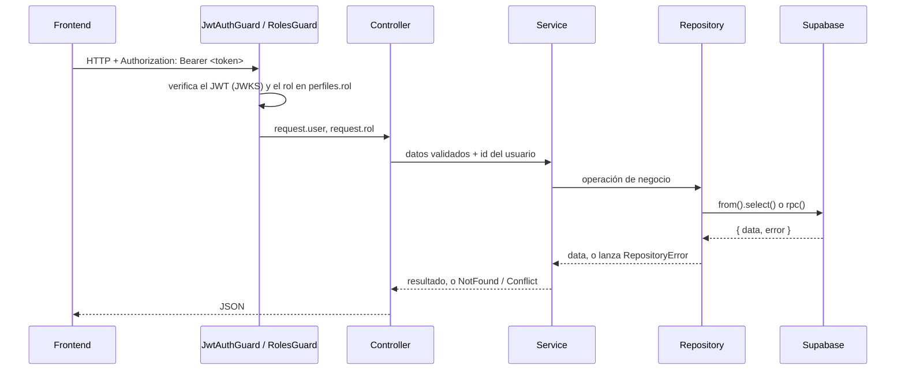
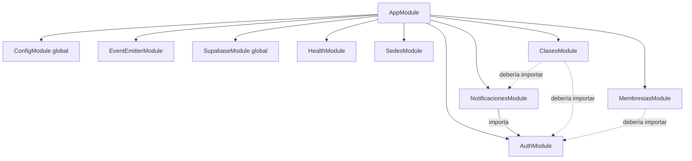

# Estructura del backend (NestJS)

**Fecha:** 2026-10-13 · **Autor:** Patricio Ramos (P1)  
**Estado relevado:** rama `desarrollo` en el commit `09ef4cf` (incluye PR #22, Membresías y Clases)

---

## 1. Resumen

El backend es una API **NestJS 12** en TypeScript que funciona como **BFF**: el frontend (React + Vite) solo habla con esta API, y la API es la única que accede a **Supabase** (PostgreSQL + Auth) con la clave secreta `service_role` (ADR-005). No usa ORM: lee y escribe con `@supabase/supabase-js` a través del patrón **Repository** (ADR-006).

| Tema | Elección |
|------|----------|
| Framework | NestJS 12 (módulos ESM, `module: nodenext`) |
| Lenguaje | TypeScript 6, `strict` |
| Datos | Supabase con `@supabase/supabase-js`, sin ORM; reglas con concurrencia en funciones SQL llamadas por RPC |
| Autenticación | JWT de Supabase Auth (ES256), verificado con `jose` contra el JWKS del proyecto |
| Autorización | Rol de FitZone en `perfiles.rol` (`socio`, `externo`, `recepcionista`, `gerente`) con `@RequiereRol` |
| Eventos | `@nestjs/event-emitter` (Observer de la lista de espera) |
| Documentación de la API | Swagger en `/api/docs` |
| Tests | Jest + `ts-jest`; e2e con `supertest` |
| Lint | `oxlint --type-aware` |

---

## 2. Árbol de carpetas

```text
backend/
├── src/
│   ├── main.ts                    Arranque: CORS, Swagger y puerto
│   ├── app.module.ts              Módulo raíz: importa todos los módulos
│   ├── app.controller.ts          GET / ("Hello World" del template)
│   ├── app.service.ts
│   ├── cors.ts                    Orígenes permitidos desde CORS_ORIGIN
│   ├── swagger.ts                 Configuración de Swagger (/api/docs)
│   │
│   ├── supabase/                  Infraestructura de datos (módulo global)
│   │   ├── supabase.service.ts        Cliente compartido + cliente por login
│   │   ├── supabase.repository.ts     Base abstracta SupabaseRepository<T>
│   │   ├── repository.error.ts        Error de acceso a datos
│   │   └── repository-error.filter.ts Filtro global: RepositoryError → 500
│   │
│   ├── auth/                      Login, verificación de token y roles
│   │   ├── auth.controller.ts         POST /auth/login
│   │   ├── me.controller.ts           GET /auth/me
│   │   ├── auth.service.ts            Login contra Supabase Auth
│   │   ├── supabase-jwt.service.ts    Verifica el JWT con el JWKS
│   │   ├── jwt-auth.guard.ts          Exige token válido
│   │   ├── roles.guard.ts             Exige uno de los roles de @Roles
│   │   ├── roles.decorator.ts         @Roles y @RequiereRol
│   │   ├── current-user.decorator.ts  @CurrentUser()
│   │   ├── rol-usuario.ts             Roles de FitZone
│   │   ├── perfiles-rol.repository.ts Lee perfiles.rol
│   │   └── *.dto.ts                   DTOs de Swagger
│   │
│   ├── health/                    GET /health
│   ├── sedes/                     GET /sedes
│   ├── perfiles/                  GET/PATCH /perfiles/me (S6-T01)
│   ├── notificaciones/            Notificaciones in-app + Observer de lista de espera
│   │   ├── lista-espera.publisher.ts  Publica LUGAR_LIBERADO
│   │   ├── lugar-liberado.event.ts    Evento y texto del aviso
│   │   ├── observers/                 InApp, Log, EmailSimulado (@OnEvent)
│   │   ├── notificaciones.repository.ts
│   │   └── preferencias.repository.ts
│   ├── membresias/                Membresías del socio (S3-T03)
│   └── clases/                    Clases, cupos e inscripciones (S3-T04)
│
├── test/                          Tests e2e (levantan la app completa)
│   ├── setup-env.ts                   Variables de entorno falsas para los tests
│   ├── support/supabase-jwt.ts        Firma tokens de prueba con un JWKS propio
│   └── *.e2e-spec.ts
│
├── .env.example                   Variables necesarias (sin valores secretos)
├── .oxlintrc.json                 Reglas de lint
├── jest.config.ts                 Tests unitarios (src/**/*.spec.ts)
├── nest-cli.json
├── tsconfig.json / tsconfig.build.json
└── package.json
```

Las migraciones de la base no están en `backend/`, sino en la raíz del repo: `supabase/migrations/`.

---

## 3. Capas y flujo de una petición

Cada módulo de negocio sigue la misma estructura en capas:

| Archivo | Responsabilidad |
|---------|-----------------|
| `*.controller.ts` | Rutas HTTP, guards, validación de parámetros, Swagger. Toma el usuario del token con `@CurrentUser()` |
| `*.service.ts` | Reglas de negocio. Traduce errores de la base (`P0001`) a errores HTTP (404, 409) |
| `*.repository.ts` | Consultas a Supabase. Extiende `SupabaseRepository<T>` |
| `*.model.ts` | Interfaz con la forma de la fila de la tabla |
| `*.dto.ts` | Clases con `@ApiProperty` para documentar entrada y salida en Swagger |
| `*.module.ts` | Registra controller, service y repositorios; importa lo que necesita |



**Manejo de errores:**

- El repositorio, con `unwrap`, registra en el log el error real de Supabase y lanza `RepositoryError` con su código.
- Si el servicio reconoce el código (`P0001` con mensajes como `CLASE_LLENA`), lo traduce a un error HTTP con mensaje en castellano.
- Si nadie lo trata, `RepositoryErrorFilter` (global) responde **500 "Error al acceder a los datos"** sin exponer detalles de la base.

---

## 4. Módulos



Las líneas punteadas son dependencias que faltan (ver [Correcciones S3-T03 / S3-T04](./Correcciones_S3-T03_S3-T04_Membresias_Clases.md)).

| Módulo | Qué hace | Exporta |
|--------|----------|---------|
| `SupabaseModule` (global) | `SupabaseService` (cliente compartido y cliente por login) y el filtro global de `RepositoryError` | `SupabaseService` |
| `AuthModule` | Login, `/auth/me`, verificación de JWT, guards de token y rol | `SupabaseJwtService`, `JwtAuthGuard`, `RolesGuard`, `PerfilesRolRepository` |
| `HealthModule` | Chequeo de vida para el deploy | — |
| `SedesModule` | Listado de sedes | — |
| `PerfilesModule` | Perfil propio (`GET/PATCH /perfiles/me`) desde el JWT | `PerfilesService` |
| `NotificacionesModule` | Notificaciones in-app, preferencias de email y Observer de lista de espera | `ListaEsperaPublisher` |
| `MembresiasModule` | Membresías: listado, activa por perfil, alta | `MembresiasService` |
| `ClasesModule` | Clases con cupo, inscripción y cancelación | `ClasesService` |

### 4.1 Infraestructura transversal

- **`SupabaseService`:** un cliente compartido para todas las consultas, sin sesión. El login usa `createAuthClient()`, un cliente descartable: si usara el compartido, el cliente quedaría con la sesión del usuario y RLS bloquearía las consultas siguientes (bug corregido en `fix-login-cliente-compartido`).
- **`SupabaseRepository<T>`:** base abstracta con `findAll`, `findById`, `from()`, `rpc()` y `unwrap()`. Cada repositorio define `table` y sus consultas propias. Guía: [Guia_Patron_Repository.md](./Guia_Patron_Repository.md).
- **Guards:** `JwtAuthGuard` verifica el token y deja el usuario en `request.user`. `RolesGuard` lee `perfiles.rol` y deja el rol en `request.rol`. `@RequiereRol(...)` aplica los dos y los documenta en Swagger.
- **Eventos:** `EventEmitterModule.forRoot()` en `AppModule`. Los observadores se registran con `@OnEvent(LUGAR_LIBERADO, { async: true })`. Detalle: [Diseno_Observer_S4-T02_Notificaciones.md](./Diseno_Observer_S4-T02_Notificaciones.md).
- **CORS:** `setupCors` habilita los orígenes de `CORS_ORIGIN` (por defecto `http://localhost:5173`).

---

## 5. Endpoints

| Método y ruta | Módulo | Acceso hoy | Descripción |
|---------------|--------|------------|-------------|
| `GET /` | App | Público | "Hello World" del template |
| `GET /health` | Health | Público | Estado, hora y uptime |
| `POST /auth/login` | Auth | Público | Email y contraseña → tokens de Supabase |
| `GET /auth/me` | Auth | Token | Usuario del token y su rol de FitZone |
| `GET /perfiles/me` | Perfiles | Token | Perfil propio (id del JWT) + email del token |
| `PATCH /perfiles/me` | Perfiles | Token | Actualiza contacto/foto/sede/DNI propios |
| `GET /sedes` | Sedes | Público | Lista de sedes |
| `GET /notificaciones` | Notificaciones | Token | Notificaciones del usuario |
| `PATCH /notificaciones/:id/leida` | Notificaciones | Token | Marca como leída (404 si no es suya) |
| `GET /notificaciones/preferencias` | Notificaciones | Token | Preferencia de aviso por email |
| `PATCH /notificaciones/preferencias` | Notificaciones | Token | Cambia la preferencia |
| `GET /clases?sedeId=` | Clases | **Público** ⚠ | Clases de una sede con cupos libres |
| `POST /clases/inscripciones` | Clases | **Público** ⚠ | Inscribe (el perfil viene en el body) |
| `DELETE /clases/inscripciones/:id` | Clases | **Público** ⚠ | Cancela (la hora de inicio viene en el body) |
| `GET /membresias` | Membresías | **Público** ⚠ | Todas las membresías |
| `GET /membresias/activas/:perfilId` | Membresías | **Público** ⚠ | Membresía activa de un perfil |
| `POST /membresias` | Membresías | **Público** ⚠ | Crea una membresía |

⚠ Pendientes de proteger: ver [Correcciones S3-T03 / S3-T04](./Correcciones_S3-T03_S3-T04_Membresias_Clases.md).

---

## 6. Configuración

Variables en `backend/.env` (plantilla en `.env.example`; el `.env` real no se commitea):

| Variable | Uso | Secreta |
|----------|-----|---------|
| `PORT` | Puerto de la API (por defecto 3000) | No |
| `SUPABASE_URL` | URL del proyecto; también define el emisor del JWT y el JWKS | No |
| `SUPABASE_SERVICE_ROLE_KEY` | Clave secreta del backend. **Nunca en el frontend** | **Sí** |
| `CORS_ORIGIN` | Orígenes del frontend, separados por coma | No |

Si faltan `SUPABASE_URL` o la clave, la API no arranca.

En redes con inspección SSL (como la del equipo de Patricio) hay que arrancar con `NODE_OPTIONS=--use-system-ca`.

---

## 7. Scripts y tests

| Script | Qué hace |
|--------|----------|
| `npm run start:dev` | API en modo watch |
| `npm run build` / `start:prod` | Compila a `dist/` y lo ejecuta |
| `npm run lint` | `oxlint` con chequeo de tipos |
| `npm test` | Tests unitarios (`src/**/*.spec.ts`) |
| `npm run test:e2e` | Tests e2e (`test/*.e2e-spec.ts`) |
| `npm run test:cov` | Cobertura |

**Estado al 2026-10-13:** lint sin errores, build OK, **43 tests unitarios** (18 archivos) y **20 e2e** (7 archivos), todos pasan.

| Módulo | Unitarios | e2e |
|--------|-----------|-----|
| supabase | repository, service, filtro de errores | (vía sedes) |
| auth | controller, service, guard JWT, guard de roles, repositorio de rol | `auth`, `roles` |
| sedes | controller, service, repository | `sedes` |
| notificaciones | evento, publicador (con la librería real), observadores, service | `notificaciones` |
| health, cors, app | sí | `health`, `cors`, `app` |
| **membresias** | **no** | **no** |
| **clases** | **no** | **no** |

Los e2e no tocan Supabase: los repositorios se reemplazan por mocks y los tokens se firman con un JWKS de prueba (`test/support/supabase-jwt.ts`).

---

## 8. Observaciones y mejoras sugeridas

| # | Observación | Sugerencia | Prioridad |
|---|-------------|------------|-----------|
| 1 | Clases y Membresías sin guards, sin tests y con datos del usuario tomados del body | Ver [Correcciones S3-T03 / S3-T04](./Correcciones_S3-T03_S3-T04_Membresias_Clases.md) | Alta |
| 2 | No hay validación automática de los DTOs: cada controller valida a mano (p. ej. `notificar_por_email` booleano) o no valida | Agregar `ValidationPipe` global con `class-validator` (`whitelist: true`), que además descarta campos de más en los body | Media |
| 3 | La regla `no-explicit-any` está apagada en `.oxlintrc.json`; por eso pasó el `as any` de `MembresiasService` | Activarla como `warn` | Media |
| 4 | `README.md` es el del template de Nest | Reemplazarlo por cómo levantar el backend: `.env`, scripts, Swagger, `--use-system-ca` | Media |
| 5 | `GET /` y `AppService` ("Hello World") son restos del template | Borrarlos (y su test) | Baja |
| 6 | Formato inconsistente: `supabase.module.ts` y `supabase.service.ts` no siguen Prettier (indentación de 4 espacios, imports sin espacios) | Correr `npm run format` | Baja |
| 7 | Las variables de entorno se validan solo en `SupabaseService` | Validarlas al arrancar con `ConfigModule.forRoot({ validate })` | Baja |
| 8 | Sin prefijo global de rutas (`/sedes`, no `/api/sedes`) | Decidirlo antes del deploy: cambiarlo después obliga a tocar el frontend | Baja |
