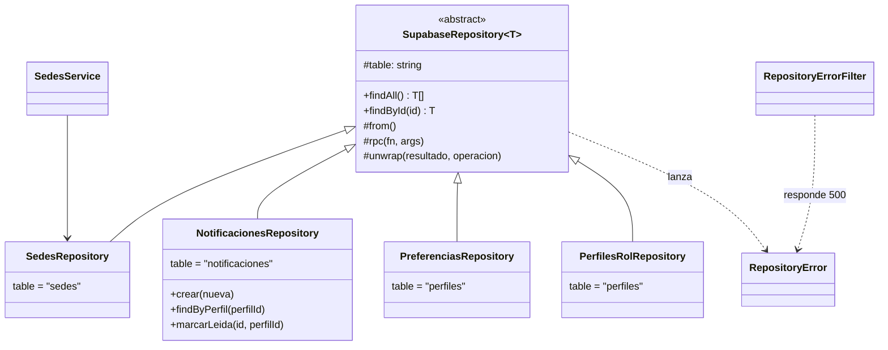
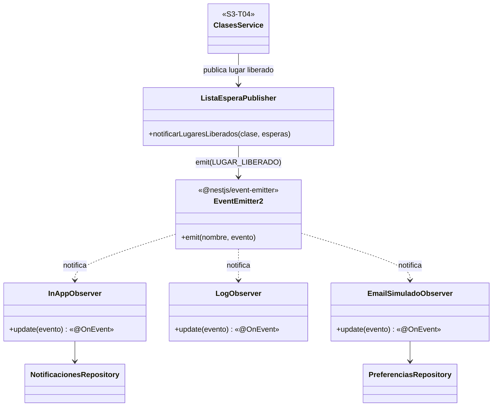
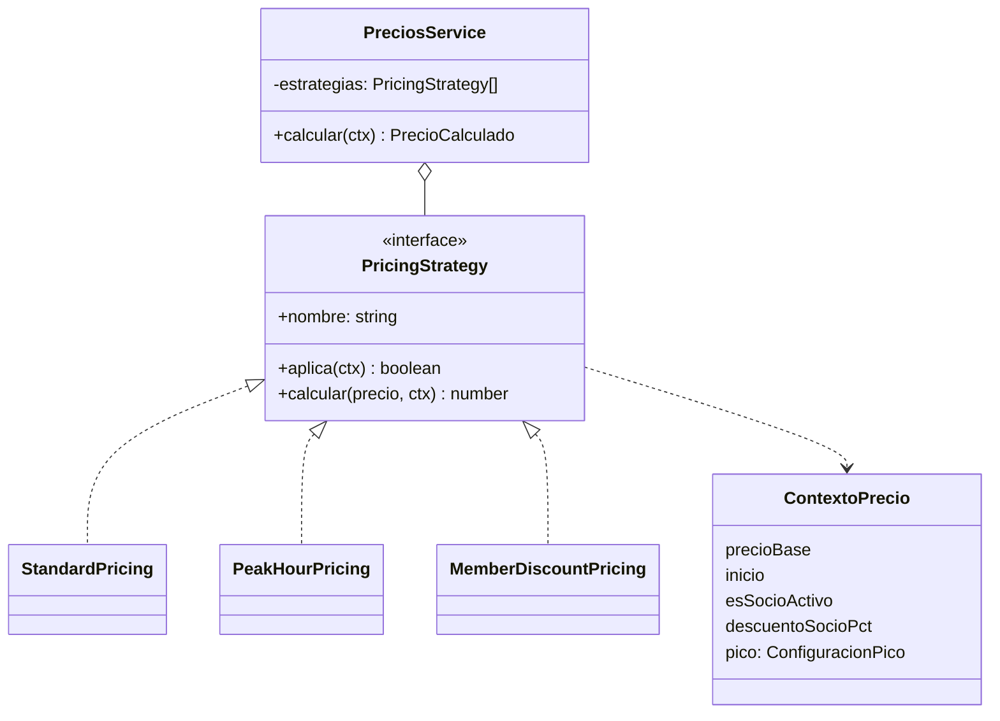
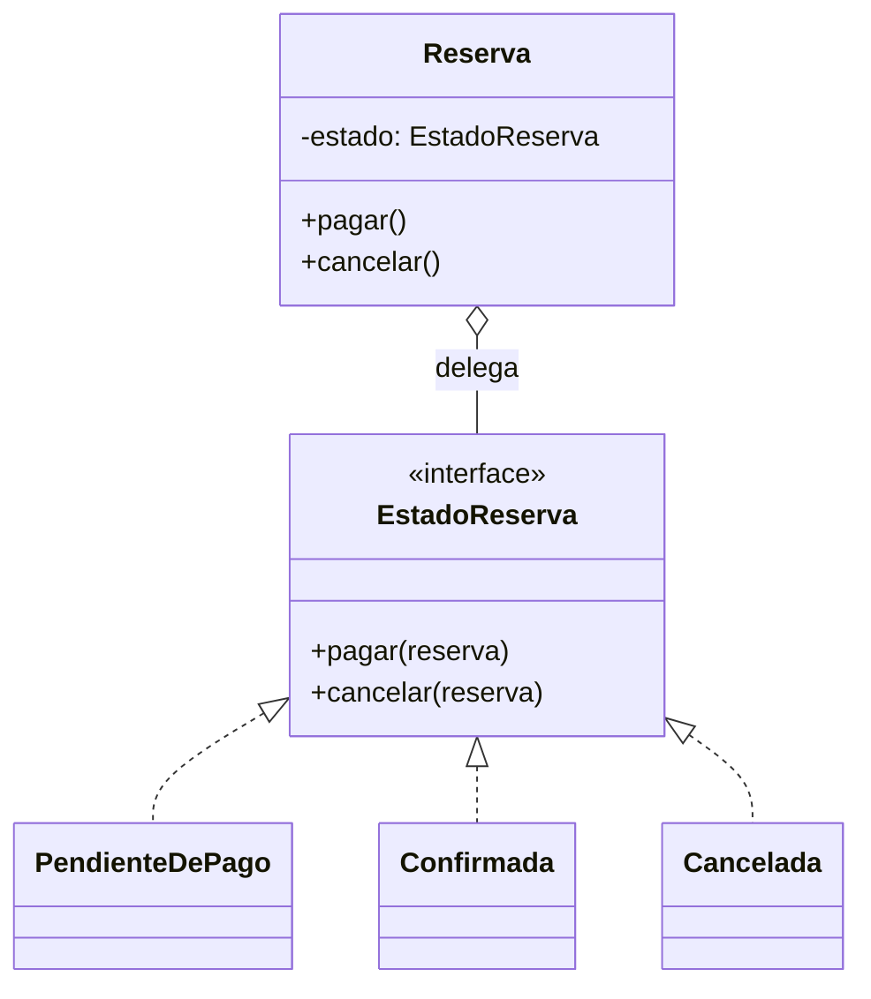
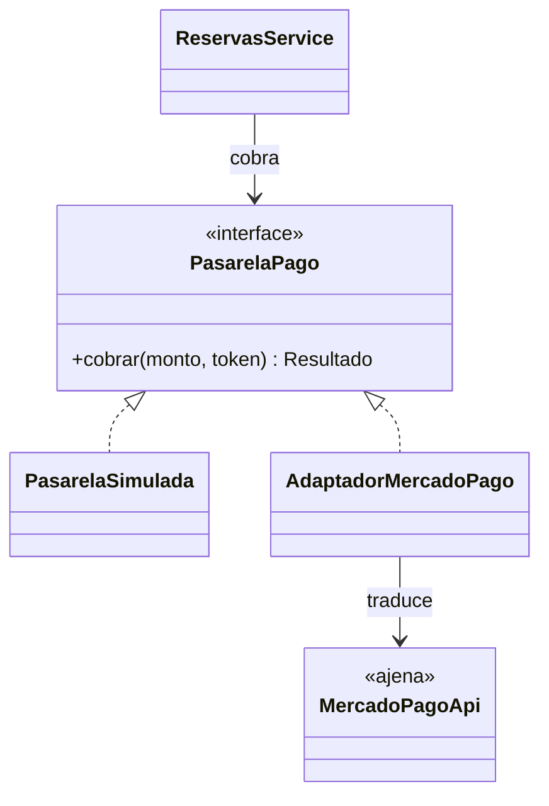
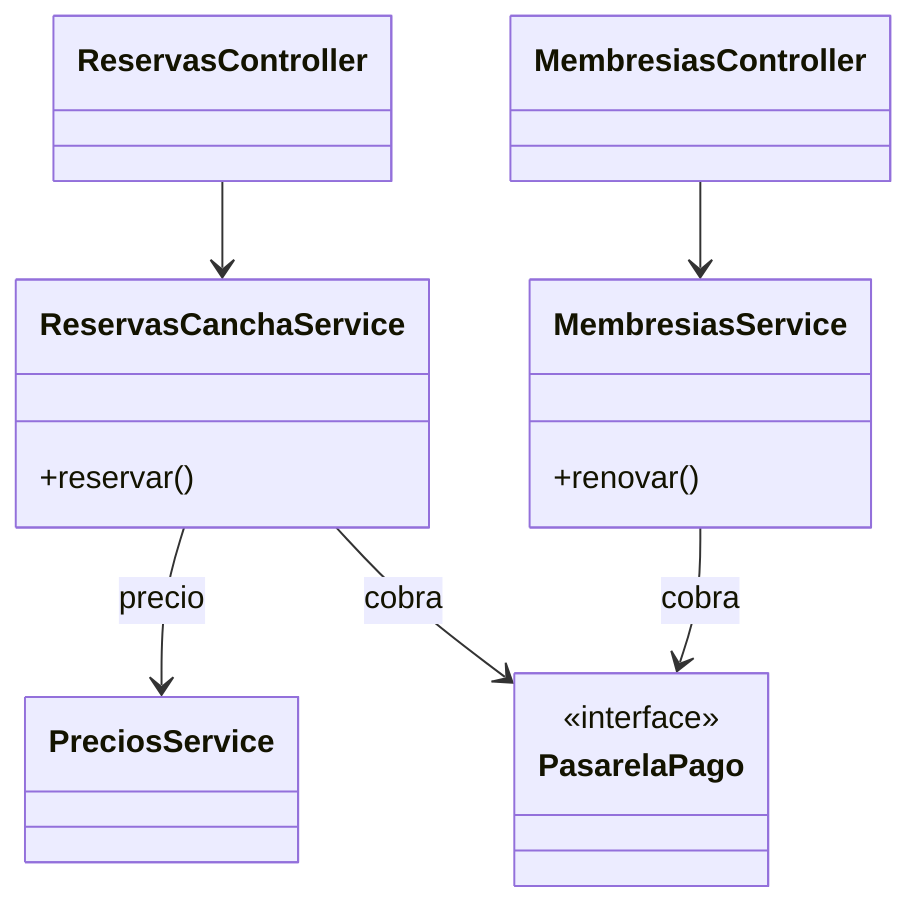

# Justificación de patrones de diseño — Unidad III (S4-T05)

**Proyecto:** FitZone Sports · Programación V · UNER  
**Responsable:** Patricio Ramos (P1)  
**Fecha:** 2026-10-06 (actualizado 2026-10-28)  
**Entregable:** Unidad III — código refactorizado con patrones + justificación

| Patrón | Dónde | Requisito | Estado |
|--------|-------|-----------|--------|
| [Repository](#1-repository--acceso-a-datos) | Toda la capa de datos del backend | ADR-006 | **Implementado** (S3-T11) |
| [Observer](#2-observer--lista-de-espera-de-clases) | Clases / lista de espera | RF-08 | **Implementado** (S4-T02) |
| [Strategy](#3-strategy--precio-de-canchas) | Canchas / precios | RF-11, RN-03 | **Implementado** (S4-T01) |
| [Factory Method](#4-factory-method--descartado) | Candidato del docente (canales de aviso) | — | **Descartado** (2026-10-15) |
| [State](#5-state--ciclo-de-la-reserva-de-cancha) | Reserva de cancha | RF-10, RF-12, RF-13 | **Diseñado** (2026-10-15); código con M4/M5 |
| [Chain of Responsibility](#6-chain-of-responsibility--descartado) | Candidato del docente (aprobaciones / validaciones) | — | **Descartado** (2026-10-15); los guards cubren el corte en cadena |
| [Adapter](#7-adapter--pasarela-de-pago) | Pasarela de pago | RF-13, RNF-02 | **Esquema listo** (S6-T03); código Adapter en S7 |
| [Facade](#8-facade--reservar-cancha-y-membresia) | Reservar cancha y alta o renovación de membresía | RF-10, RF-02, RF-13 | **Diseñado** (2026-10-15); código con M4/M5 |
| [Builder](#9-builder--descartado) | Candidato del docente (armar una reserva) | — | **Descartado** (2026-10-15); no se planifica |
| [Decorator](#10-decorator--descartado) | Candidato del docente (caché, log, reintentos) | — | **Descartado** (2026-10-15). Reintento de MercadoPago queda anotado para M5 |
| [Command](#11-command--no-implementado) | Cola de acciones sin conexión | RNF-01, Unidad VI | **No implementado** (2026-10-15). Candidato cuando existan offline y app móvil |
| [Singleton](#12-singleton--descartado) | Instancia única de servicios | — | **Descartado** (2026-10-15). Lo resuelve el contenedor de Nest |
| [Abstract Factory](#13-abstract-factory--descartado) | Familias de objetos (pasarela por país) | — | **Descartado** (2026-10-15). Una pasarela y un solo país |
| [Composite](#14-composite--descartado) | Árbol red, región, sede y cancha | Reportes | **Descartado** (2026-10-15). No hay árbol; el total es una consulta |
| [Circuit Breaker](#15-circuit-breaker--pasarela-real) | MercadoPago | RF-13, M5 | **Diseñado** (2026-10-15); código con M5. No aplica a Supabase ni al simulacro |
| [CQRS nivel 2](#16-cqrs-nivel-2--reportes-del-gerente) | Reportes consolidados del gerente | Consigna TI (reserva vs reportes) | **Pendiente** (2026-10-27). Hacerlo cuando existan reportes / M4 con datos de ocupación |

Cada sección de patrón aplicado sigue el mismo orden: problema, por qué este patrón, alternativas descartadas, estructura, dónde está en el código, consecuencias y cómo se prueba. Las secciones 4 y 6 justifican descartes (también puntúa en la defensa).

---

## 1. Repository — Acceso a datos

### Problema

El backend lee y escribe en Supabase (PostgreSQL) con el cliente `@supabase/supabase-js`, sin ORM (ADR-006). Si cada servicio usa el cliente directamente:

- La lógica de negocio queda mezclada con detalles de PostgREST (`.from().select().eq()`), nombres de tablas y formato de errores.
- Cada servicio maneja los errores de Supabase a su manera. Antes del refactor, `SedesService` los convertía en un 500 genérico y **se perdía la causa real**.
- Para testear un servicio hay que simular la API encadenada del cliente.
- Cambiar de motor o de cliente obliga a tocar toda la lógica de negocio.

### Por qué Repository

Repository pone una capa que se comporta como una colección de objetos del dominio (`findAll`, `findById`, `crear`, `marcarLeida`) y oculta cómo se obtienen. Los servicios dependen de esa capa, no de Supabase.

> Repository no es uno de los 23 patrones GoF: proviene de *Patterns of Enterprise Application Architecture* (Fowler) y de DDD. La cátedra lo incluye en la Unidad III y lo pide la consigna (`BookingRepository`).

### Alternativas descartadas

| Alternativa | Por qué no |
|-------------|------------|
| Cliente Supabase en cada servicio | Es el problema descripto arriba |
| ORM (TypeORM / Prisma) | Descartado en ADR-006: el equipo decidió usar la API de Supabase |
| Un repositorio por tabla sin base común | Repite el manejo de errores y el log en cada uno |

### Estructura

- `SupabaseRepository<T>` resuelve lo común: `findAll`, `findById`, llamadas RPC y `unwrap`, que registra el error real en el log y lanza `RepositoryError`.
- Cada repositorio concreto define su tabla y sus consultas propias. `findAll` está escrito una vez en la base y cada subclase solo aporta `table`, que es la idea del **Template Method** (GoF). Con eso alcanza por ahora. El comprobante PDF (RF-14) usaría el mismo patrón recién cuando existan dos documentos (cancha y membresía): mismo esqueleto, distinto contenido. Con un solo comprobante, una función alcanza.
- `RepositoryErrorFilter` convierte un `RepositoryError` no tratado en un 500 genérico, sin exponer detalles de la base al cliente.
- Los errores de negocio de las funciones SQL (`raise exception 'CLASE_LLENA'`) llegan como `RepositoryError` con su código, y el servicio los traduce a 404 o 409.

### La concurrencia no la resuelve el patrón

El ejemplo de la clase (biblioteca: 20 pedidos y 3 ejemplares) separa dos cosas. Repository ordena el código: el servicio no escribe SQL. La carrera la evita el almacenamiento (`UNIQUE`, versión o un lock), no la interfaz del repositorio (ejemplos Java, diapositiva 14).

En FitZone es igual:

| Regla | Quién la garantiza |
|-------|--------------------|
| Sin sobreventa de cupos de clase | La función SQL bloquea la fila de la clase (`FOR UPDATE`) antes de inscribir |
| Una inscripción vigente por socio y clase | Índice único parcial |
| Dos reservas del mismo turno de cancha (RN-02, decidido 2026-10-15) | Índice `UNIQUE (cancha_id, inicio)` **y** función SQL con `FOR UPDATE`, igual que las clases |
| Repository | El servicio llama `rpc` o `findById` y no conoce ese lock |

### Dónde está

- Base: `backend/src/supabase/supabase.repository.ts`, `repository.error.ts`, `repository-error.filter.ts`
- Concretos: `sedes/sedes.repository.ts`, `notificaciones/notificaciones.repository.ts`, `notificaciones/preferencias.repository.ts`, `auth/perfiles-rol.repository.ts`
- Guía para el equipo: [Guia_Patron_Repository.md](./Guia_Patron_Repository.md)

### Consecuencias

| Positivas | Negativas |
|-----------|-----------|
| Los servicios no conocen Supabase: un servicio de 3 líneas como `SedesService` | Una capa más para cada tabla nueva |
| Manejo de errores y log en un solo lugar | Las consultas complejas igual exigen conocer PostgREST dentro del repositorio |
| Servicios testeables con un mock simple del repositorio | `findAll`/`findById` heredados pueden no tener sentido en todas las tablas |
| Cambiar de cliente o de motor afecta solo a los repositorios | |

### Cómo se prueba

- `supabase.repository.spec.ts`: consulta la tabla correcta, `findById` devuelve `null` si no existe, `rpc` pasa los argumentos y un error de Supabase se convierte en `RepositoryError` y queda en el log.
- `sedes.service.spec.ts`: el servicio se prueba con el repositorio simulado.
- `test/sedes.e2e-spec.ts`: un error de Supabase responde 500 sin exponer el mensaje original.

---

## 2. Observer — Lista de espera de clases

### Problema

RF-08: si una clase está llena, el socio se anota en la lista de espera y, **cuando se libera un lugar, se le notifica**. La decisión D7 agrega que el socio tiene un plazo para confirmar, sin inscripciones automáticas, así que el aviso es indispensable.

El equipo decidió avisar por varios canales: in-app siempre, log, y email simulado si el socio lo activó. Si el módulo de Clases llamara a cada canal:

- Clases dependería de notificaciones, preferencias de perfil, email y log, que no son su responsabilidad.
- Agregar un canal (push, email real) obligaría a modificar Clases.
- Un canal que falla (p. ej. Supabase no responde al guardar la notificación) podría romper la cancelación que liberó el lugar.

### Por qué Observer

Observer define una relación uno a muchos: cuando el **sujeto** cambia de estado, avisa a todos sus **observadores** sin conocer qué hace cada uno. Clases solo publica "se liberó un lugar"; los canales se suscriben.

NestJS ya trae este mecanismo: **`@nestjs/event-emitter`**, el equivalente al `ApplicationEventPublisher` de Spring que usa la clase como ejemplo de Observer (diapositiva 36). Lo usamos en lugar de escribir el patrón a mano.

### Alternativas descartadas

| Alternativa | Por qué no |
|-------------|------------|
| Llamar a cada canal desde `ClasesService` | Acoplamiento descripto arriba |
| Observer GoF escrito a mano (interfaces propias `Subject` / `Observer`) | Fue la **primera versión**. Se reemplazó porque la clase marca como mala práctica "un Observer a mano habiendo eventos de dominio" en el framework (diapositiva 46): la versión propia no aportaba nada que la librería no diera, y obligaba a suscribir los observadores a mano |
| **Factory Method** para canales (`crear("EMAIL")`, etc.) | Resuelve otro problema: elegir **un** canal por un texto. Nosotros avisamos por **varios a la vez**. Detalle en [§4](#4-factory-method--descartado) |
| Trigger en la base que inserte la notificación | Sirve para in-app, pero no para log ni email, y saca lógica de negocio del backend |
| Cola de mensajes (Redis, RabbitMQ) | Sobredimensionado para el alcance del proyecto |

### Estructura

| Rol GoF | En el código |
|---------|--------------|
| Subject / ConcreteSubject (lista de observadores y `notify`) | `EventEmitter2`, provisto por la librería |
| `attach` | El decorador `@OnEvent(LUGAR_LIBERADO)`: la librería registra el método al arrancar la app |
| `notify` | `ListaEsperaPublisher.notificarLugaresLiberados()`, que hace un `emit` por cada espera |
| ConcreteObserver | `InAppObserver`, `LogObserver`, `EmailSimuladoObserver` |
| Estado notificado | `LugarLiberadoEvent` (espera, socio, plazo, clase), publicado con el nombre `LUGAR_LIBERADO` |

- La base decide **a quién** notificar: las funciones `cancelar_inscripcion` y `procesar_lista_espera` devuelven las esperas que pasaron a `notificado`. El backend decide **cómo**: eso es el Observer.
- El nombre del evento es la constante `LUGAR_LIBERADO`: un texto mal escrito compila igual y nadie recibe el evento.

### Decisiones de la diapositiva 37

| Decisión | Qué hacemos |
|----------|-------------|
| ¿Antes o después del commit? | **Después.** El evento se publica cuando la función SQL ya terminó, así que nunca se avisa de un lugar que no quedó reservado. |
| ¿Mismo hilo o asíncrono? | **Asíncrono** (`@OnEvent(..., { async: true })`). `notificarLugaresLiberados` vuelve enseguida: la respuesta al socio que canceló no espera a Supabase ni al email. |
| ¿Qué pasa si se cae a mitad? | **Se acepta perder el aviso** (sin outbox, fuera de alcance). El lugar igual queda reservado en `lista_espera`; si el socio no confirma, vence el plazo y pasa al siguiente. Si un observador falla, la librería registra el error (`suppressErrors`, activo por defecto) y los demás se ejecutan igual. |

### Dónde está

- `backend/src/notificaciones/`: `lista-espera.publisher.ts`, `lugar-liberado.event.ts`, `observers/`, `notificaciones.module.ts`
- `EventEmitterModule.forRoot()` en `backend/src/app.module.ts`
- Diseño completo e integración con Clases: [Diseno_Observer_S4-T02_Notificaciones.md](./Diseno_Observer_S4-T02_Notificaciones.md)

### Consecuencias

| Positivas | Negativas |
|-----------|-----------|
| Agregar un canal = una clase nueva con `@OnEvent`; ni el publicador ni Clases cambian (principio abierto/cerrado) | El orden entre observadores no está garantizado |
| Clases no depende de notificaciones ni de preferencias, ni de una lista de observadores | El flujo es menos directo de seguir: hay que buscar quién escucha `LUGAR_LIBERADO` |
| Un canal que falla no afecta a los demás ni a la operación de negocio | Una falla de notificación queda solo en el log (no hay reintentos) |
| Código de infraestructura mantenido por NestJS, no por el equipo | El evento se identifica con un texto: el compilador no detecta un nombre mal escrito (se mitiga con la constante) |
| Cada observador se prueba por separado | Los tests tienen que esperar a que terminen los observadores asíncronos |

### Cómo se prueba

- `lista-espera.publisher.spec.ts`: con la librería real, cada espera llega como evento a los tres observadores; si uno falla, los demás se ejecutan, el error queda en el log y el publicador no falla.
- `observers/observers.spec.ts`: in-app guarda la notificación con los datos para confirmar; el email simulado respeta la preferencia del perfil.
- `test/notificaciones.e2e-spec.ts`: en la app completa, los observadores registrados con `@OnEvent` guardan la notificación.
- Prueba de punta a punta contra Supabase (2026-10-06, con la primera versión): clase llena, lista de espera, cancelación, notificación in-app y por email simulado, y confirmación del lugar.

---

## 3. Strategy — Precio de canchas

### Problema

RF-11: el precio de una cancha es el precio estándar, con **descuento de socio** y **recargo en horario pico**. Según [S4-T09](./Propuesta_Reglas_Negocio_S4-T09.md):

- El descuento de socio (15% por defecto) lo configura el Gerente Central para toda la cadena.
- El recargo, el horario y los días pico los configura cada sede.
- Un socio con cuota vencida paga como externo (RN-03).
- Descuento y recargo se combinan (P4).

Resolverlo con condicionales en el servicio de reservas (`if (esSocio) … if (esPico) …`) concentra todas las reglas en un método que crece con cada regla nueva (p. ej. feriados o promociones) y es difícil de testear por partes.

### Por qué Strategy (y su relación con Decorator)

Strategy encapsula cada algoritmo de cálculo en una clase con una interfaz común (`PricingStrategy`), y el contexto los usa sin conocer sus detalles. La consigna lo pide explícitamente: `StandardPricing`, `MemberDiscountPricing` y `PeakHourPricing`.

Como las reglas se combinan (P4), el servicio de precios no elige **una** estrategia excluyente: aplica en orden **todas las que corresponden** (`filter` + `reduce`), y cada una recibe el precio que dejó la anterior. Tal como se vio en la Clase 1 de la Unidad III (diapositivas 26 y 35), cuando las reglas se acumulan sobre el mismo precio, la estructura funciona conceptualmente como una cadena de modificadores (**Decorator**) armada por el contenedor de inyección de dependencias (`PRICING_STRATEGIES` con `useFactory`).

### Aclaración: no es el Strategy de “elegir una”

El ejemplo clásico (envío estándar, express o retiro) guarda **una** estrategia y la cambia: las opciones se excluyen. Acá descuento y recargo se **acumulan** sobre el mismo precio. Elegir una sola habría sido usar mal el patrón para esta regla; por eso esa alternativa está descartada abajo.

La clase lo dice así (ejemplos Java, diapositiva 12, y clase 1, diapositivas 26 y 35): si las reglas se combinan, la composición es una **lista de políticas en orden**, que en rigor también se puede llamar **cadena de decoradores**. Acepta el nombre Strategy si la justificación lo explica. En FitZone quedan las dos piezas:

| Pieza | Qué es |
|-------|--------|
| Cada fórmula (`StandardPricing`, `MemberDiscountPricing`, `PeakHourPricing`) | Strategy: algoritmo intercambiable, como pide la consigna |
| Aplicarlas en orden sobre el precio anterior | Cadena de políticas (el profesor también la llama Decorator) |

No anidamos decoradores GoF (`new Recargo(new Descuento(base))`). El mismo efecto lo hace `PreciosService` recorriendo la lista: cada estrategia que `aplica` recibe el precio que dejó la anterior. Una regla nueva es una clase más en esa lista.

### Alternativas descartadas

| Alternativa | Por qué no |
|-------------|------------|
| Condicionales en el servicio | Descripto arriba |
| Elegir una sola estrategia por reserva | No permite combinar descuento y recargo (P4) |
| Precio calculado en SQL | Las reglas de negocio quedarían fuera del backend y del patrón pedido |

### Estructura

| Rol GoF | Clase |
|---------|-------|
| Strategy | `PricingStrategy` |
| ConcreteStrategy | `StandardPricing`, `PeakHourPricing`, `MemberDiscountPricing` |
| Context | `PreciosService` |

### Dónde está

- Interfaz y tipos del contexto: `backend/src/canchas/precios/pricing.strategy.ts`
- Estrategias concretas:
  - `backend/src/canchas/precios/strategies/standard-pricing.strategy.ts` (`StandardPricing`)
  - `backend/src/canchas/precios/strategies/peak-hour-pricing.strategy.ts` (`PeakHourPricing`)
  - `backend/src/canchas/precios/strategies/member-discount-pricing.strategy.ts` (`MemberDiscountPricing`)
- Contexto y módulo NestJS: `backend/src/canchas/precios/precios.service.ts`, `backend/src/canchas/precios/precios.module.ts`

### Consecuencias

| Positivas | Negativas |
|-----------|-----------|
| Una regla nueva (p. ej. feriados) es una clase nueva, sin tocar las demás (principio abierto/cerrado) | Más clases que un método con condicionales |
| Cada regla se prueba sola con los casos de S4-T09 | El orden de aplicación importa si se suman reglas no multiplicativas |
| Los parámetros (porcentajes, horarios) vienen de la base, no del código | En NestJS hay que declarar el token de colección (`PRICING_STRATEGIES`) con `useFactory` |

### Cómo se prueba

- `backend/src/canchas/precios/precios.service.spec.ts`:
  - Pruebas unitarias aisladas de `StandardPricing`, `PeakHourPricing` (límites de franja `[desde, hasta)` y días de la semana en hora Argentina) y `MemberDiscountPricing` (socio activo vs. cuota vencida RN-03).
  - Pruebas integradas con `PreciosModule` verificando las tres tablas de casos acordadas en [S4-T09](./Propuesta_Reglas_Negocio_S4-T09.md) (base $20.000 con valores por defecto, sede con pico personalizado 30% lun–vie 18–22 hs, cambio de descuento de cadena a 10%) y el redondeo al peso entero (`Math.round`, P7):

| Cliente | Turno | Precio |
|---------|-------|--------|
| Externo | 17:00 | $20.000 |
| Externo | 19:00 | $24.000 |
| Socio activo | 17:00 | $17.000 |
| Socio activo | 20:00 | $20.400 |
| Socio con cuota vencida | 19:00 | $24.000 |

- Tests de **caracterización** del laboratorio (consigna 1): mismo archivo, bloque `Caracterización del cálculo actual`, incluida la rareza de ISO sin zona horaria → Argentina. Ver [LOG 2026-10-27](./LOG.md).

### Laboratorio Unidad III · consigna 3 (seis commits de refactor) — no aplica

**Decisión:** 2026-10-27 · No se reproduce un historial de seis pasos *Replace Conditional with Polymorphism* sobre precios.

La consigna 3 del laboratorio (clase 2) asume un cálculo previo con `if`/`switch` y un camino de refactor (Extract Method → interfaz → clases → lista → DI), **un commit por paso**. En FitZone **no hubo ese código previo**:

- RF-11 y la rúbrica de Unidad III **ya pedían Strategy** (`StandardPricing`, `MemberDiscountPricing`, `PeakHourPricing`).
- El equipo lo implementó **de entrada** en S4-T01 (`71c993d`): lista ordenada de reglas, `filter`/`reduce` y `PRICING_STRATEGIES` en el módulo. El destino del paso 5–6 de la diapositiva es el diseño inicial, no el resultado de un refactor.
- Inventar un monolito con `if` solo para deshacerlo en seis commits sería teatro de git, no evidencia de olores reales empujando al patrón.

Lo que sí acredita el eje: el **código** con lista de reglas, los **tests** (negocio + caracterización), la **planilla de olores** (donde el `switch` de precios **no** aparece porque nunca existió) y esta **justificación** (por qué Strategy; por qué no el camino de refactor de la consigna 3). Criterio de la cátedra: a veces el patrón no nace de un olor en el repo, sino del requerimiento; justificar “por qué no el otro camino” también cuenta.

---

## 4. Factory Method — Descartado

**Decisión:** 2026-10-15 · No se aplica Factory Method en FitZone por ahora.  
**Referencia de clase:** ejemplos Java, diapositivas 5–6 ([Patrones_Ejemplos_Java.md](./Patrones_Ejemplos_Java.md)).

### Qué problema plantea el docente

Factory Method crea objetos sin que el servicio conozca las clases concretas. El ejemplo de la clase es un sistema de avisos: el canal llega como texto (`EMAIL`, `SMS`, `PUSH`) y mañana piden WhatsApp. Sin el patrón, un `switch` se copia y crece; con él, `fabrica.crear(canal).enviar(...)` y registrar un canal nuevo es una clase + una línea.

### Por qué no encaja en RF-08

Nuestro problema no es “elegir **un** canal e instanciarlo”. Al liberarse un lugar hay que avisar por **varios canales a la vez**: in-app siempre, log, y email simulado si el socio lo activó. Eso es una relación uno a muchos sobre un evento de dominio: lo resuelve **Observer** ([§2](#2-observer--lista-de-espera-de-clases)), no Factory.

| Pregunta | Factory Method | Observer (lo nuestro) |
|----------|----------------|------------------------|
| ¿Qué resuelve? | Crear **un** notificador según un tipo | Varios interesados reaccionan al mismo hecho |
| Uso típico | `crear(preferencia).enviar(...)` | `emit(LUGAR_LIBERADO)` → in-app + log + email |
| Agregar WhatsApp | Registrar en la fábrica | Una clase nueva con `@OnEvent` |

La diapositiva 6 marca cuándo **no** usarlo: un solo canal (o pocos fijos) a la vista, y si solo cambian datos y no comportamiento. Hoy no hay SMS ni WhatsApp reales; el email es simulado. Meter una fábrica sería una capa más sin un `crear(canal)` que el negocio necesite.

### ¿Aparece en otra parte del sistema?

Tampoco hoy:

| Área | ¿Parece Factory? | Por qué no |
|------|------------------|------------|
| Planes de membresía (`mensual` / `trimestral` / `anual`) | Un `switch` por plan | Solo cambia duración/precio (datos en `planes_membresia`). La clase: si solo cambian datos, es una columna, no una subclase |
| Roles de usuario | Crear algo distinto por rol | Son autorización (guards), no creación de objetos con comportamiento distinto |
| Strategy de precios | Crear la estrategia por nombre | El diseño aplica una **lista** de políticas (descuento + pico); Nest las inyecta |
| Pasarela de pago | Varios proveedores | Hay una sola pasarela simulada → candidato a **Adapter**, no a Factory |
| Comprobantes / reportes | Elegir CSV vs PDF | Aún no existen; cuando existan, encaja más **Template Method** |

Si más adelante el socio eligiera **un** canal externo principal por texto, o hubiera varios formatos de comprobante/adaptadores de pago elegidos por config, se reevalúa. El fan-out de “varios canales escuchan el mismo evento” seguiría siendo Observer; Factory, si aparece, viviría **dentro** de un observador o de otro caso de uso, no en lugar de Observer.

### Alternativa descartada al descartar Factory

Forzar Factory “para tener el patrón del catálogo” sin un problema de creación por tipo. La clase pide poder decir **dónde no lo aplicaron y por qué**: eso también es diseño.

---

## 5. State — Ciclo de la reserva de cancha

**Decisión:** 2026-10-15 · Se usa State para el ciclo de vida de la **reserva** de cancha.  
**Referencia de clase:** ejemplos Java, diapositivas 7–8 ([Patrones_Ejemplos_Java.md](./Patrones_Ejemplos_Java.md)).  
**Estado:** diseño. El código llega con M4 (reservas) y M5 (pago).

### Problema

Una reserva no se comporta igual en cada momento: se puede pagar o cancelar mientras está pendiente; confirmada ya no se vuelve a pagar; cancelada no admite más acciones. Resolverlo con `if (estado === …)` en el servicio concentra las reglas y crece con cada transición.

Aparte, la grilla muestra horarios **disponibles**, **reservados** o en **mantenimiento**. Eso no es el ciclo de la reserva.

### Por qué State

State hace que el comportamiento cambie con el estado interno: el contexto (`Reserva`) delega y el estado actual acepta o rechaza la acción (como el documento Borrador / Publicado de la clase).

Ciclo previsto:

| Estado | Puede | No puede |
|--------|-------|----------|
| Pendiente de pago | Pagar, cancelar | Usarse como turno confirmado |
| Confirmada | Cancelar (con las reglas de plazo que defina el equipo) | Volver a pagar |
| Cancelada | — | Cualquier otra acción |

El nombre del estado se persiste en una columna y se reconstruye al leer (diapositiva 21).

### Qué no es State

| Idea | Decisión |
|------|----------|
| Cancha en mantenimiento (RF-12) | **Período** sobre la cancha (desde–hasta), en una tabla. Bloquea reservas futuras de ese tramo y no toca las ya tomadas. La diapositiva 8: si el tramo se define en runtime, va en datos, no en clases. Un flag sin fechas sería un booleano, no State |
| Disponible / reservada / mantenimiento en la grilla | **Consulta** que cruza reservas confirmadas y bloqueos de mantenimiento para esa hora. No es un objeto con transiciones |
| Membresía activa / vencida / suspendida | “Vencido” se calcula por fecha (D3). Pocos estados: no justifica State |
| Lista de espera | El ciclo lo resuelven las funciones SQL (`procesar_lista_espera`, `confirmar_lugar_espera`), no clases de estado en Nest |

### Alternativas descartadas

| Alternativa | Por qué no |
|-------------|------------|
| `if` por estado en el servicio de reservas | El problema de arriba: cada acción nueva toca el mismo método |
| Poner “mantenimiento” como estado de la reserva | Mezcla el recurso (cancha) con el turno (reserva) y contradice RF-12 |
| State en la cancha (disponible / mantenimiento) | El mantenimiento es un intervalo configurable, no un cambio de comportamiento de la cancha en sí |

### Estructura (propuesta)

| Rol GoF | Clase |
|---------|-------|
| Context | `Reserva` |
| State | `EstadoReserva` |
| ConcreteState | `PendienteDePago`, `Confirmada`, `Cancelada` |

### Dónde va a estar

Todavía no hay módulo de canchas. Al implementarlo: junto al servicio de reservas (M4/M5), persistiendo el nombre del estado en `reservas_cancha`.

### Consecuencias esperadas

| Positivas | Negativas |
|-----------|-----------|
| Una transición nueva es un estado (o un método), sin un `if` gigante | Más clases que un enum con condicionales |
| Cada estado se prueba solo: qué acepta y qué rechaza | Hay que reconstruir el objeto de estado al leer la fila |
| La grilla y el mantenimiento quedan fuera de esta máquina y no se mezclan | |

### Cómo se va a probar

- Unitarios por estado: pendiente acepta pagar y cancelar; confirmada rechaza pagar; cancelada rechaza todo.
- Al reservar un horario dentro de un bloqueo de mantenimiento, no se crea la reserva (regla de la cancha, no de State).
- Dos reservas del mismo slot: lo garantiza la base (RN-02), no el patrón.

---

## 6. Chain of Responsibility — Descartado

**Decisión:** 2026-10-15 · No se implementa una cadena de manejadores propia.  
**Referencia de clase:** ejemplos Java, diapositivas 9–10 ([Patrones_Ejemplos_Java.md](./Patrones_Ejemplos_Java.md)).

### Qué problema plantea el docente

Chain pasa una solicitud por manejadores: el primero que puede, la resuelve y corta. El ejemplo es una compra que aprueba el Supervisor hasta un monto, el Gerente hasta otro y el Directorio hasta un tope mayor, solo si viene justificada.

### Por qué no lo implementamos

FitZone no tiene aprobaciones por nivel ni por monto. Los casos que se parecen resuelven otra cosa:

| Caso | Por qué no es Chain |
|------|---------------------|
| Precio de cancha | Strategy: se aplican las reglas que correspondan (descuento y recargo), no “la primera que pueda” |
| Validar una reserva (membresía, horario libre, mantenimiento, ventana de 48 h) | Hay que pasar por **todas**. La diapositiva 10 lo llama **pipeline**, no Chain. Si se devuelven todos los errores juntos, ningún eslabón puede cortar al primero |
| Aprobación de compras | No existe en el caso |

### Qué sí usamos: guards

La autorización HTTP ya corta en cadena, con los guards de Nest:

1. `JwtAuthGuard` exige un token válido. Si falla, responde 401 y no sigue.
2. `RolesGuard` (vía `@RequiereRol`) exige uno de los roles de FitZone. Si falla, responde 403.

Eso tiene el espíritu de Chain (el primero que no puede, corta), pero lo da el framework. No armamos clases `Aprobador` ni una cadena propia: sería una capa más sobre algo que Nest ya resuelve. El detalle está en `backend/src/auth/jwt-auth.guard.ts`, `roles.guard.ts` y `roles.decorator.ts`.

### Alternativa descartada

Escribir una Chain de validaciones de reserva “para tener el patrón”. La clase pide decir dónde no se aplicó y por qué. Las validaciones de negocio, cuando existan, quedan como pasos del servicio (o un pipeline si hace falta listar todos los errores), no como Chain of Responsibility.

---

## 7. Adapter — Pasarela de pago

**Decisión:** 2026-10-15 · Se usa Adapter al implementar M5, para poder entregar el proyecto con la pasarela simulada y poder cambiarla por MercadoPago sin tocar reservas ni membresías.  
**Referencia de clase:** ejemplos Java, diapositivas 15–16 ([Patrones_Ejemplos_Java.md](./Patrones_Ejemplos_Java.md)).  
**Estado:** esquema listo (S6-T03). Existe la tabla `pagos` ([`supabase/migrations/20261028210000_pagos_m5.sql`](../supabase/migrations/20261028210000_pagos_m5.sql)) con `monto`, `token_pasarela` (RNF-02) y vínculo a reserva o membresía. Todavía no hay módulo Nest de pagos ni implementación de `PasarelaPago` / `PasarelaSimulada` / `AdaptadorMercadoPago`: eso llega con el pago mock de S7.

### Problema

RF-13 pide una pasarela simulada (estilo MercadoPago o Modo). RNF-02: no se guardan datos de tarjeta, solo el token que devuelve la pasarela. El proyecto tiene que poder cobrarse con el simulacro y, sin reescribir el caso de uso, con MercadoPago real. Esa API no la controlamos: otro nombre de métodos, otro formato de respuesta.

Si `ReservasService` llama al simulacro directo, cambiar a MercadoPago obliga a tocar la reserva, el pago de la membresía y los tests.

### Por qué Adapter

Adapter traduce una interfaz ajena a la que el sistema espera. El cambio futuro que absorbe es “sacar el simulacro y poner MercadoPago”. La clase pide poder nombrar ese cambio; si no se puede, el patrón sobra (diapositiva 23).

| Pieza | Rol |
|-------|-----|
| `PasarelaPago.cobrar(monto, token)` | Idioma nuestro. La reserva y la renovación de membresía solo conocen esto |
| `PasarelaSimulada` | Implementa `PasarelaPago` directo. La escribimos nosotros, así que ya habla nuestro idioma. Envolverla en otra clase que solo reenvía la llamada es la capa vacía que la diapositiva 16 dice que no hay que escribir |
| `AdaptadorMercadoPago` | El Adapter: traduce la API real a `cobrar`. Es la clase que justifica el patrón |
| Falsa en los tests | Otra implementación de `PasarelaPago`, sin red: la reserva se prueba con aprobado y rechazado sin levantar ni el simulacro ni MercadoPago |

En el adaptador solo se traduce (token, montos, aprobado o rechazado). Si el pago falla, no se confirma la reserva: esa regla queda en el servicio, junto con State (pendiente de pago hasta que `cobrar` apruebe).

### Alternativas descartadas

| Alternativa | Por qué no |
|-------------|------------|
| Llamar al simulacro desde el servicio de reservas | No se puede cambiar a MercadoPago sin tocar el caso de uso |
| Adapter también alrededor del simulacro | El simulacro ya implementa `cobrar`. Sería la capa vacía de la diapositiva 16 |
| Abstract Factory de pasarelas por país | Hay una sola pasarela real prevista y un solo país |

### Estructura (propuesta)

| Rol GoF | Clase |
|---------|-------|
| Target (interfaz que esperamos) | `PasarelaPago` |
| Adapter | `AdaptadorMercadoPago` |
| Adaptee (código ajeno) | API de MercadoPago |
| Cliente | `ReservasService` (y el alta o la renovación de membresía) |

### Dónde va a estar

- **BD (hecho, S6-T03):** `public.pagos` — enums `concepto_pago` / `estado_pago`; FKs a `reservas_cancha` o `membresias` según concepto.
- **Nest (pendiente, S7):** interfaz `PasarelaPago`, `PasarelaSimulada` y (cuando corresponda) `AdaptadorMercadoPago` junto al servicio que cobra e inserta en `pagos`. Cuál implementación está activa sale de la configuración, no de un `if` en la reserva.

### Consecuencias esperadas

| Positivas | Negativas |
|-----------|-----------|
| Cambiar de simulacro a MercadoPago no toca la reserva ni la membresía | Una clase más (el adaptador) que hoy no se puede probar contra MercadoPago real |
| Los tests de la reserva usan una pasarela falsa | Hay que mantener la traducción el día que MercadoPago cambie su API |
| El simulacro se prueba solo, sin canchas ni precios | |

### Cómo se va a probar

- Reserva con pasarela falsa: aprobado confirma; rechazado no confirma y no guarda datos de tarjeta.
- Simulacro: un token de prueba aprueba, otro rechaza.
- Adaptador: se prueba con la API de MercadoPago simulada en el test (respuesta ajena entra, `Resultado` nuestro sale), sin llamar a la reserva.

---

## 8. Facade — Reservar cancha y membresía

**Decisión:** 2026-10-15 · Dos fachadas, una por caso de uso: `reservar` una cancha y dar de alta o `renovar` una membresía. La inscripción a una clase no lleva Facade.  
**Referencia de clase:** ejemplos Java, diapositivas 19–20 ([Patrones_Ejemplos_Java.md](./Patrones_Ejemplos_Java.md)).  
**Estado:** diseño. El código llega con M4 (canchas) y M5 (pagos).

### Problema

Reservar una cancha no es una sola consulta. Hay que bloquear el turno, calcular el precio, cobrar y confirmar solo si el pago aprueba, en ese orden. Dar de alta o renovar una membresía repite la idea: cerrar la anterior si existe, cobrar el plan y activar la nueva solo si el pago aprueba. Si eso vive en el controller, el mismo orden se copia en cada cliente (web hoy, móvil después).

### Por qué Facade

Facade ofrece una operación simple delante de varios subsistemas. El controller llama `reservar()` o `renovar()` y no conoce el lock, el precio ni la pasarela. La clase lo muestra con `comprar()`: stock, envío, cobro, compensación si el pago falla y aviso.

Son dos casos de uso, así que son dos clases. La diapositiva 20 pide una fachada por caso de uso: si una sola clase reserva canchas, renueva membresías y además inscribe a clases, se vuelve un God object.

### Qué no es Facade

Inscribirse a una clase es una llamada a `inscribir_en_clase`. Una fachada que solo reenvía a esa función es la capa de más que la diapositiva 20 descarta. El cupo y la lista de espera ya están en la base.

### Las dos fachadas

**`ReservasCanchaService.reservar()`**

1. La función SQL bloquea la cancha (`FOR UPDATE`) y rechaza el turno si está tomado o en mantenimiento (RN-02).
2. Calcula el precio (Strategy: estándar, descuento de socio y recargo de pico, en orden).
3. Cobra con `PasarelaPago` (simulacro o `AdaptadorMercadoPago`).
4. Si el pago falla, la reserva no queda confirmada (State).
5. Si aprueba, pasa a confirmada.

**`MembresiasService` (alta o `renovar()`)**

1. Si ya hay una membresía activa, la cierra (D1: una sola activa por socio).
2. Arma la vigencia según el plan.
3. Cobra el plan con la misma `PasarelaPago`.
4. Si el pago falla, no queda una membresía nueva activa y la anterior, si se cerró, tiene que poder restaurarse en la misma transacción (lo más seguro: una función SQL, como en las correcciones de M1).
5. Si aprueba, la nueva queda activa.

El controller de cada uno solo delega. No comparten clase.

### Alternativas descartadas

| Alternativa | Por qué no |
|-------------|------------|
| Orquestar lock, precio y pago en el controller | Se copia en cada cliente y el controller conoce subsistemas que no le corresponden |
| Una sola fachada para todo FitZone | God object (diapositiva 20) |
| Facade para inscribir a una clase | Solo reenvía a una función SQL |

### Estructura (propuesta)

| Rol GoF | Clase |
|---------|-------|
| Facade | `ReservasCanchaService.reservar()` |
| Facade | Alta o `MembresiasService.renovar()` |
| Subsistemas | Función SQL del turno, `PreciosService`, `PasarelaPago`, State de la reserva |
| Cliente | El controller de canchas o el de membresías |

### Dónde va a estar

Todavía no hay módulo de canchas ni de pagos. `MembresiasService.crear` existe, pero hoy inserta directo y no cobra: al hacer M5 pasa a ser la fachada de alta o renovación. `reservar()` nace con M4/M5.

### Consecuencias esperadas

| Positivas | Negativas |
|-----------|-----------|
| Cada caso de uso tiene un solo orden, testeable sin el controller | Una clase que conoce varios subsistemas: hay que mantenerla chica |
| Cambiar Strategy o la pasarela no cambia la firma de `reservar()` ni de `renovar()` | La compensación si el pago falla (no confirmar, no dejar la membresía a medias) hay que probarla explícitamente |
| La inscripción a clase sigue siendo una llamada simple | |

### Cómo se va a probar

- `reservar` con pasarela falsa aprobada: queda confirmada y el precio es el de Strategy.
- `reservar` con pago rechazado: no queda confirmada.
- Dos reservas del mismo turno: la segunda falla por la base (RN-02), no por la fachada.
- `renovar` con pago rechazado: no queda una membresía activa nueva.
- Inscribir a una clase no pasa por estas clases.

---

## 9. Builder — Descartado

**Decisión:** 2026-10-15 · No se usa Builder ni se deja planificado.  
**Referencia de clase:** ejemplos Java, diapositiva 22; en la clase 1 figuraba como candidato para armar una reserva ([Patrones_Ejemplos_Java.md](./Patrones_Ejemplos_Java.md)).

### Qué problema plantea el docente

Builder arma un objeto con muchos campos opcionales (un pedido, un DTO de reporte, un filtro) sin un constructor enorme. La clase 1 lo mencionó para la reserva, porque junta varios datos.

### Por qué no

Esta clase afina el criterio: Builder sirve cuando hay muchas combinaciones válidas de campos opcionales. La reserva de cancha no es ese caso. `reservar()` la arma de una vez con datos obligatorios que ya salieron del lock, de Strategy y de la pasarela: cancha, horario, socio, precio y el resultado del pago. O el pago aprueba y la reserva se confirma, o no se confirma. No hay variantes opcionales.

Lo mismo el filtro de la grilla (sede, fecha, tipo) y el comprobante (cancha, horario, monto): pocos campos, una sola forma.

La fachada ya es el único lugar que junta esas piezas. Un builder al lado repetiría ese armado. Sumarlo después, si algún objeto llegara a tener muchas combinaciones opcionales, es un refactor de ese único armado: no hace falta dejar la clase escrita ahora.

### Alternativa descartada

Escribir `ReservaBuilder` “porque la reserva tiene varios campos”. El costo es una clase y más indirección sin un cambio futuro que lo justifique hoy.

---

## 10. Decorator — Descartado

**Decisión:** 2026-10-15 · No se implementa Decorator (GoF).  
**Referencia de clase:** ejemplos Java, diapositiva 22 ([Patrones_Ejemplos_Java.md](./Patrones_Ejemplos_Java.md)).

### Qué problema plantea el docente

Decorator envuelve un objeto con la misma interfaz para sumarle comportamiento (caché, log, reintentos) sin modificar la clase de adentro. Los envoltorios se apilan y el orden importa.

### Por qué no

| Caso | Decisión |
|------|----------|
| Precio (descuento + recargo) | Ya está en Strategy (§3): `PreciosService` aplica la lista en orden. No anidamos `new Recargo(new Descuento(base))` |
| Caché de consultas | No hay requisito |
| Log de Supabase | `unwrap` del repositorio ya registra el error |
| Reintentos de la pasarela | Ver abajo: se anota, no se escribe ahora |

Los decoradores de TypeScript (`@RequiereRol`, `@CurrentUser`, `@OnEvent`) no son este patrón: anotan métodos. No envuelven un objeto de dominio.

### Anotado para M5, sin implementar

Si MercadoPago falla por red, un envoltorio de reintentos alrededor de `PasarelaPago` (misma interfaz `cobrar`, adentro el `AdaptadorMercadoPago`) es el lugar natural. El simulacro no lo necesita. Sumarlo después es una clase en ese único punto, sin tocar la reserva ni la membresía. No se deja la clase escrita ahora.

### Alternativa descartada

Envolver el simulacro o el repositorio “por si acaso”. La diapositiva 16, en Adapter, ya marca como capa vacía lo que solo reenvía. Acá es el mismo costo.

---

## 11. Command — No implementado

**Decisión:** 2026-10-15 · No se implementa. Queda como candidato a futuro.  
**Referencia de clase:** ejemplos Java, diapositiva 22 ([Patrones_Ejemplos_Java.md](./Patrones_Ejemplos_Java.md)).

### Qué problema plantea el docente

Command encapsula una acción para deshacerla o para guardarla en una cola y ejecutarla o reintentarla más tarde. El ejemplo es una tarea sin conexión.

### Por qué no ahora

No llegamos a definir el offline ni la app móvil (Unidad VI). Sin eso no hay una cola de acciones que persistir ni un proceso que las ejecute al volver la red. Cancelar una reserva o una inscripción no es una pila de deshacer: es un caso de uso. El reintento de MercadoPago, si hace falta, quedó anotado como envoltorio de `PasarelaPago` (§10), no como comandos encolados.

### Candidato a futuro

Cuando existan el control de acceso sin internet (RNF-01) y la app móvil, el ingreso en la sede se puede encolar ("registrar este check-in") y sincronizar después. Ahí Command es el patrón. No se diseña la clase ahora, porque el flujo offline sigue sin cerrarse.

---

## 12. Singleton — Descartado

**Decisión:** 2026-10-15 · No se escribe un Singleton a mano.  
**Referencia de clase:** ejemplos Java, diapositiva 22 ([Patrones_Ejemplos_Java.md](./Patrones_Ejemplos_Java.md)).

### Qué dice el docente

No lo escriban. Lo resuelve el contenedor: en Spring todo bean es singleton por defecto. Un `getInstance()` estático complica los tests, porque esa instancia no se puede reemplazar.

### Por qué no en FitZone

Nest ya registra una sola instancia de cada provider. `SupabaseService`, los repositorios, `ListaEsperaPublisher` y los guards se inyectan. En los tests se reemplazan con un mock o con `overrideProvider`. Un `getInstance()` propio no aporta nada que el contenedor no dé, y cierra la puerta a esos reemplazos. Es el mismo criterio que al usar `@nestjs/event-emitter` en lugar de un Observer escrito a mano: si el framework ya lo resuelve, no lo reimplementamos.

---

## 13. Abstract Factory — Descartado

**Decisión:** 2026-10-15 · No se usa.  
**Referencia de clase:** ejemplos Java, diapositiva 22; la clase 1 pide descartarlo y escribir por qué ([Patrones_Ejemplos_Java.md](./Patrones_Ejemplos_Java.md)).

### Qué dice el docente

Sirve solo si hay familias de objetos que tienen que ir juntas (un proveedor distinto por país, o un tema de interfaz completo). Sin familias, Factory Method alcanza. En FitZone hay que poder decir por qué no: una sola pasarela y un solo país.

### Por qué no

No hay dos familias coherentes que crear juntas.

| Supuesta familia | Qué usamos en cambio |
|------------------|----------------------|
| Pasarela por país | Una sola. El simulacro implementa `PasarelaPago` y MercadoPago entra por Adapter (§7) |
| Canales de aviso según la región | No se elige un juego de notificadores. Varios canales escuchan el mismo evento (Observer, §2) |
| Precio distinto por país | Un descuento para toda la cadena y un pico por sede. Son datos y Strategy (§3) |

Factory Method ya está descartado (§4): no hay un `crear(tipo)` que el negocio necesite. Abstract Factory exige además varias familias. No las hay.

---

## 14. Composite — Descartado

**Decisión:** 2026-10-15 · No se usa.  
**Referencia de clase:** clase 1, diapositiva 30 ([UnidadIII_Clase1_Patrones_de_Diseno.md](./UnidadIII_Clase1_Patrones_de_Diseno.md)).

### Qué dice el docente

Composite arma un árbol y trata igual a la hoja y a la rama. El ejemplo para FitZone es una `UnidadOrganizativa` con ocupación y aforo: cancha (hoja), sede, región y red (ramas). `porcentajeUso()` responde lo mismo en cualquier nivel, y desaparece el `if (es sede) … else if (es cancha)` al recorrer. En la diapositiva 44 lo combina con Visitor para varios informes sobre ese árbol.

### Por qué no

Ese árbol no existe. Las sedes son una lista plana: no hay región ni un nodo "red". Una cancha pertenece a una sede. El reporte del gerente, cuando exista, es ocupación por sede y un total de la cadena: un `GROUP BY`, no un objeto que se recorre recursivamente. Inventar nodos solo para poder sumar es el costo que el patrón no paga. Además, si cada nodo consultara la base, el recorrido sería un N+1. Ese reporte se resuelve con **CQRS nivel 2** (§16), no con Composite.

Si más adelante el negocio agrega regiones de verdad, se reabre. Hoy no hay un `instanceof` que eliminar.

---

## 15. Circuit Breaker — Pasarela real

**Decisión:** 2026-10-15 · Se usa al implementar M5, solo alrededor de MercadoPago.  
**Referencia:** lo mencionó el docente el 2026-08-28 como resiliencia del BFF. No está en las clases de patrones. Resumen previo en [Decisiones pendientes §3.6](./Decisiones_Pendientes_y_Cosas_a_Definir.md).

### Problema

MercadoPago es un servicio externo: puede estar caído o lento. Reintentar siempre, o esperar el timeout en cada reserva, cuelga Nest y sigue golpeando a una API que no responde. El simulacro no tiene ese problema: lo escribimos nosotros. Supabase es la base del sistema: si no responde, no hay un modo degradado útil.

### Por qué Circuit Breaker

Después de varios fallos seguidos se deja de llamar un rato y se responde enseguida. Los estados son cerrado (llama normal), abierto (no llama; la reserva no se confirma) y semiabierto (una prueba; si responde, vuelve a cerrado).

| Destino | Decisión |
|---------|----------|
| `AdaptadorMercadoPago` | Sí. El breaker envuelve `PasarelaPago` cuando la implementación es la real |
| Simulacro | No. No es un servicio ajeno inestable |
| Supabase (datos y login) | No. Sin la base la API no puede operar; el circuito solo cambiaría el mensaje de error |

El reintento anotado en Decorator (§10) va **antes**: unos pocos reintentos y, si sigue fallando, se abre el circuito. No son lo mismo: el reintento vuelve a llamar; el breaker corta.

La reserva y la membresía no conocen estos estados. Siguen llamando a `cobrar`. Si el circuito está abierto, el resultado es un rechazo y la reserva no queda confirmada (State).

### Dónde va a estar

En M5, junto al adaptador. Umbrales (cuántos fallos, cuánto tiempo abierto) se definen al implementarlo. No se escribe la clase ahora.

### Cómo se va a probar

- Con la pasarela falsa no interviene.
- Con un adaptador que falla N veces: la llamada siguiente no llega a MercadoPago y `cobrar` rechaza.
- Cuando el circuito pasa a semiabierto y la prueba responde, las llamadas vuelven a salir.

---

## 16. CQRS nivel 2 — Reportes del gerente

**Decisión:** 2026-10-27 · **Pendiente de implementar** cuando existan reportes del gerente (ocupación / consolidados entre sedes) y datos de reservas (M4).  
**Referencia de clase:** Unidad III clase 2, bloque CQRS ([UnidadIII_Clase2_Aplicacion_y_Refactoring.pdf](./UnidadIII_Clase2_Aplicacion_y_Refactoring.pdf)). También en [Decisiones pendientes §3.7](./Decisiones_Pendientes_y_Cosas_a_Definir.md).

### Problema

La consigna del TI opone dos necesidades: *transaccionalidad en la reserva de canchas (evitar sobreventa)* vs *reportes centralizados entre sedes*. Es el conflicto central de CQRS.

| | Reservar cancha (comando) | Tablero / reportes del gerente (consulta) |
|--|---------------------------|------------------------------------------|
| Quién | Un socio, una vez | El gerente, sobre varias sedes |
| Necesita | Consistencia fuerte (RN-02) | Velocidad; totales listos para dibujar |
| Forma | Agregado chico y normalizado | Proyección ancha / agregada (`GROUP BY`) |
| Tolera retraso | No | Sí (segundos; acordar con el negocio si aplica) |

Forzar un solo camino (p. ej. cargar entidades de reserva vía el repositorio de dominio para armar el reporte) empeora lectura y escritura.

### Tres niveles (cátedra) y dónde apuntamos

| Nivel | Qué separa | FitZone |
|------:|------------|---------|
| 1 | Solo en código (comandos vs queries), misma base y modelo | Alcance general del proyecto |
| **2** | Modelo de **lectura** aparte: SQL propio, proyecciones a DTO o **vistas** (misma base; consistencia fuerte) | **Reportes del gerente** |
| 3 | Dos almacenes + sync por eventos (consistencia eventual) | Fuera del TI |

### Qué hay que hacer cuando toque

1. Interfaz de lectura aparte del repositorio de dominio, p. ej. `OcupacionQuery.porMes(...)` → DTOs planos (`OcupacionPorSede`), no entidades `Reserva`.
2. Vista SQL (o consulta con `GROUP BY`) en Postgres; Nest la lee vía un query/repo de solo lectura (Supabase `.from('vista…')` o RPC de lectura). Referencia cercana ya en el repo: la vista `clases_con_cupo` (lectura optimizada, write path de inscripción aparte).
3. Endpoint solo para `gerente` (`@RequiereRol`); **no** reutilizar `ReservasRepository` / Facade de `reservar()`.
4. Pregunta de defensa: *«¿Por qué el reporte no usa el ReservaRepository?»* — porque leer y escribir tienen requisitos opuestos; en nivel 2 eso cuesta una interfaz y una consulta/vista.

### Qué no hacer

- Nivel 3 (otra base, eventos, eventual) salvo acuerdo explícito de negocio.
- Composite de sedes/regiones ([§14](#14-composite--descartado)): el total es un `GROUP BY`.

---

## 17. Otros patrones presentes en el código

No son el foco de la Unidad III, pero aparecen y conviene nombrarlos en la defensa:

| Patrón | Dónde |
|--------|-------|
| **Template Method** (GoF) | Ya aplicado en `SupabaseRepository<T>`: `findAll`/`findById` en la base, cada subclase aporta la tabla. Comprobante PDF: anotado para cuando haya cancha y membresía; no se diseña aparte ahora |
| **Inyección de dependencias** | Todo el backend (NestJS): servicios, repositorios, observadores. La instancia única la da el contenedor; no escribimos Singleton ([§12](#12-singleton--descartado)) |
| **Guards** | `JwtAuthGuard` → `RolesGuard` (`@RequiereRol`). Cortan la petición si falla el token o el rol. Ver [§6](#6-chain-of-responsibility--descartado): no implementamos Chain of Responsibility aparte |
| **Decorator de TypeScript** (no el GoF) | `@RequiereRol`, `@CurrentUser`, `@OnEvent`. El Decorator GoF está descartado en [§10](#10-decorator--descartado) |
| **BFF** (arquitectura) | El frontend solo habla con Nest; Nest es la única puerta a Supabase (ADR-005) |

**Circuit Breaker** quedó diseñado para MercadoPago en [§15](#15-circuit-breaker--pasarela-real). No se usa sobre Supabase ni sobre el simulacro.
