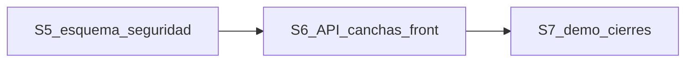

# Propuesta: plan de 3 semanas para llegar (rúbrica + Demo)

**Fecha:** 2026-10-26  
**Estado:** propuesta para que Matias la baje al plan de trabajo  
**De dónde sale:** [panorama](./Panorama_Desarrollo_2026-10-13.md), [rúbrica del integrador](./Trabajo_Integrador_FitZone_Sports.md), reunión del 2026-10-21 y atraso actual del equipo

Con 3 semanas de desarrollo restantes, el objetivo es un **demo demostrable** (login → socio con membresía → reservar cancha con precio) más los entregables pesados de la rúbrica. Pagos mock mínimos si alcanza. QR/móvil es stretch de la última semana, no bloqueante.

---

## 1. Rúbrica: qué proteger

| Unidad | Peso | Implicancia en estas 3 semanas |
|--------|------|--------------------------------|
| II Frameworks (backend + Swagger) | 25% | API de canchas, seguridad de Clases/Membresías, perfil, Swagger al día |
| III Patrones + justificación | 15% | Strategy conectado a la reserva real; State/Facade en canchas; justificación al día |
| IV Frontend documentado | 15% | Login real, cliente API, sesión, Canchas/Clases reales; componentes documentados |
| V CI/CD + cobertura | 15% | Pipeline lint/test/build + reporte de cobertura (Docker solo si sobra) |
| VI Móvil + QR | 10% | Stretch semana 3; si no entra, defer documentado |
| I Arquitectura | 10% | Ya hecho; tocar ADR/C4 solo si cambia el esquema |
| Demo Day | 10% | Login → membresía (seed o alta) → reservar paddle → QR si hay |

---

## 2. Carga

| Integrante | Horas / semana | Total 3 semanas |
|------------|----------------|-----------------|
| Patricio (P1) | 8 h | 24 h |
| Lucas (P3) | 8 h | 24 h |
| Bruno (P2) | 4 h | 12 h |
| Matias (P4) | 4 h | 12 h |
| **Equipo** | 24 h | **72 h** |

Lucas concentra la Unidad IV: cliente API, estado, rutas, pantallas reales y componentes documentados. Con el front al ~5%, las 8 h van al guion demo, no a polish opcional.

---

## 3. Calendario

| Semana | Fechas | Meta |
|--------|--------|------|
| **S5** | 27 oct – 2 nov | Esquema M4 + seguridad + login + shell del front |
| **S6** | 3 – 9 nov | API canchas + front canchas/perfil/notificaciones + CI |
| **S7** | 10 – 16 nov | Demo E2E, clases en front, docs IV, cierres de rúbrica, stretch QR |

Cada tarea tiene entregable, dependencia y criterio de cierre. Las horas son techo: si algo no entra, se corta lo stretch, no lo bloqueante.

---

## 4. S5 — 27 oct al 2 nov (desbloquear)

**Meta:** tablas de canchas en `desarrollo`, Clases/Membresías con guards, login real + layout/rutas/átomos, plan adoptado por Matias.

### Patricio (8 h)

1. **Migración Fase A al repo (2 h) — Finalizado (S5-T01, 2026-10-27)**  
   - Entregado: [`supabase/migrations/20260915000000_fase_a_nucleo.sql`](../supabase/migrations/20260915000000_fase_a_nucleo.sql) con `sedes`, `perfiles`, `membresias` y enums. El stub local (`00_fase_a_simulada.sql`) solo arma `auth` y roles.  
   - Cierre: un Postgres vacío puede recrear el núcleo antes de las migraciones de clases y notificaciones.

2. **Migración M4 (5 h)**  
   - Entregar: `canchas` (`precio_hora`, tipo, sede), `reservas_cancha` (inicio, fin, precio, detalle de reglas, estado pendiente/confirmada/cancelada), `configuracion_pico`, `configuracion_cadena`, `admins_sede`, períodos de mantenimiento (desde–hasta), renombre `recepcionista` → `admin_sede`.  
   - Incluir: índice único / RPC de reserva sin sobreventa (RN-02); defaults pico 20% 19–21 y descuento socio 15%.  
   - Depende de: [Propuesta_Reglas_Negocio_S4-T09.md](./Propuesta_Reglas_Negocio_S4-T09.md).  
   - Cierra cuando: migración aplicada en Supabase de desarrollo y mergeada a `desarrollo`.

3. **Seed mínimo de demo (1 h)**  
   - Entregar: 2–3 sedes; 1 cancha paddle y 1 fútbol 5 con precio; 1 socio con membresía activa; 1 externo; 1 admin_sede; 1 gerente.  
   - Cierra cuando: Bruno puede probar la API de canchas sin inventar datos a mano.

### Bruno (4 h)

1. **Guards en Clases y Membresías (2.5 h)**  
   - Entregar: JWT / `@RequiereRol` en rutas; `perfilId` del token; cancelar solo la propia inscripción; fecha de clase desde la base. Guía: [Correcciones S3-T03/S3-T04](./Correcciones_S3-T03_S3-T04_Membresias_Clases.md).  
   - Cierra cuando: sin token → 401; otro usuario → 403.

2. **Ventana 48 h en `inscribir` (1.5 h)**  
   - Entregar: rechazo si faltan menos de 48 h para el inicio (D5).  
   - Cierra cuando: prueba “más de 48 h ok / menos de 48 h no”.

### Lucas (8 h)

1. **Login real (2.5 h)**  
   - Entregar: `POST /auth/login`; guarda token; redirige; saca password/token de `console.log`.  
   - Cierra cuando: credencial válida entra; inválida muestra error.

2. **Cliente HTTP base + sesión (2 h)**  
   - Entregar: módulo `api/` con `VITE_API_URL`; header `Authorization`; store/Context (token, usuario, rol).  
   - Cierra cuando: `GET /auth/me` post-login llena el store.

3. **Layout post-login y rutas protegidas (2 h)**  
   - Entregar: menú (Inicio, Perfil, Canchas, Clases, Notificaciones); sin token → login.  
   - Cierra cuando: `/canchas` sin sesión manda a login.

4. **Átomos de UI (1.5 h)**  
   - Entregar: Botón, Input, Spinner usados en Login.  
   - Cierra cuando: hay carpeta `components/` (o Atomic Design) con esos tres.

### Matias (4 h)

1. **Adoptar el plan (2 h)**  
   - Entregar: actualizar el plan de trabajo con IDs, responsables y estados de esta propuesta; entrada en [LOG.md](./LOG.md).  
   - Cierra cuando: “trabajo en curso” coincide con S5.

2. **Checklist de cuentas (2 h)**  
   - Entregar: quién administra GitHub / Supabase / Vercel, documentado.  
   - Cierra cuando: el equipo sabe a quién pedir acceso.

**Bloqueo hacia S6:** sin migración M4 mergeada, Bruno no arranca la API de canchas.

---

## 5. S6 — 3 al 9 nov (camino crítico del Demo)

**Meta:** reservar cancha por API con Strategy; grilla + perfil + notificaciones en el front; CI backend verde.

### Patricio (8 h)

1. **Perfil propio (3 h) — Finalizado (S6-T01, 2026-10-28)**  
   - Entregado: `GET /perfiles/me` y `PATCH /perfiles/me` en `backend/src/perfiles/` + Swagger.  
   - Cierre: Lucas puede reemplazar el mock de Mi Perfil (id solo desde el JWT).

2. **Registro mínimo o seed documentado (2 h)**  
   - Entregar: `POST /auth/register` básico **o** documentar que la demo usa solo el seed de S5 (preferir seed si aprieta el tiempo).  
   - Cierra cuando: hay un camino escrito para “tener un socio demo”.

3. **Esquema de pagos (3 h) — Finalizado (S6-T03, 2026-10-28)**  
   - Entregado: [`supabase/migrations/20261028210000_pagos_m5.sql`](../supabase/migrations/20261028210000_pagos_m5.sql); nota Adapter en [Justificación §7](./Justificacion_Patrones_Unidad_III.md#7-adapter--pasarela-de-pago).  
   - Cierre: la tabla existe para el pago mock de S7 (pasarela Nest pendiente).

### Bruno (4 h)

1. **API Canchas — lectura (1.5 h)**  
   - Entregar: listar canchas por sede; grilla (turnos 60 min; reservas + mantenimiento); config pico pública.  
   - Depende de: migración M4 en `desarrollo`.  
   - Cierra cuando: los GET responden con datos del seed en Swagger.

2. **API Canchas — reserva (2.5 h)**  
   - Entregar: `POST` vía RPC (RN-02); `PreciosService` (Strategy); guarda precio + reglas; `Math.ceil`; tope 1 mes; socio vencido paga como externo y avisa.  
   - Cierra cuando: dos reservas del mismo turno → una ok y una conflicto; precios alineados a S4-T09.

### Lucas (8 h)

1. **Cliente API completo (1.5 h)**  
   - Entregar: 401 limpia sesión y manda a login; tipado mínimo; sedes desde `GET /sedes`.  
   - Cierra cuando: el selector de sede usa la API.

2. **Pantalla Canchas real (3 h)**  
   - Entregar: grilla desde API; precio y reglas; reservar; carga y error. Si el POST aún no está: grilla real y botón deshabilitado.  
   - Cierra cuando: se ve disponibilidad del seed; si hay POST, el turno queda ocupado.

3. **Mi Perfil con datos reales (2 h)**  
   - Entregar: `GET /perfiles/me`, o mientras tanto `/auth/me` sin inventar DNI.  
   - Cierra cuando: no quedan datos hardcodeados.

4. **Notificaciones in-app (1.5 h)**  
   - Entregar: listar, marcar leída, aviso en el layout.  
   - Cierra cuando: lista real (aunque vacía), no mock.

### Matias (4 h)

1. **CI GitHub Actions (3 h)**  
   - Entregar: workflow en PR a `desarrollo`: lint + test + build del backend.  
   - Cierra cuando: un PR de prueba queda verde (o falla por un test real).

2. **Postman Canchas (1 h)**  
   - Entregar: login → listar → reservar → conflicto de sobreventa.  
   - Cierra cuando: la colección corre contra el entorno documentado.

**Bloqueo hacia S7:** sin reserva por API + pantalla de canchas, el Demo Day no tiene el paso central.

---

## 6. S7 — 10 al 16 nov (cierres de rúbrica + demo)

**Meta:** ensayo del guion Demo Day; Unidades III y V cerradas lo suficiente; IV con varias pantallas reales; VI solo si sobra.

### Patricio (8 h)

1. **Patrones en la reserva (4 h)**  
   - Entregar: Facade `reservar`; State pendiente/confirmada/cancelada; actualizar [Justificacion_Patrones_Unidad_III.md](./Justificacion_Patrones_Unidad_III.md).  
   - Cierra cuando: la justificación marca Strategy (en uso), Facade y State con rutas de código.

2. **Pago mock mínimo (2 h)**  
   - Entregar: servicio/endpoint que guarda token falso en `pagos` (Adapter stub). Sin PDF.  
   - Cierra cuando: el guion puede decir “pagué” sin pasarela real.

3. **Ensayo demo + docs (2 h)**  
   - Entregar: checklist del guion; C4/ADR solo si el esquema cambió.  
   - Cierra cuando: el equipo hizo un pase completo una vez.

### Bruno (4 h)

1. **Lista de espera + Observer (3 h)**  
   - Entregar: anotarse / confirmar; al cancelar se llama al publisher; aviso in-app.  
   - Cierra cuando: cancelar una inscripción llena notifica al primero de la lista.

2. **Swagger al día (1 h)**  
   - Entregar: canchas, perfil y lista de espera documentados.  
   - Cierra cuando: no quedan endpoints nuevos sin `@Api…` básico.

### Lucas (8 h)

1. **Pantalla Clases (3 h)**  
   - Entregar: listar con cupo; inscribir; cancelar; lista de espera si Bruno la terminó.  
   - Cierra cuando: el socio seed hace listar → inscribir → ver cupo actualizado.

2. **Membresía en UI (1.5 h)**  
   - Entregar: plan/estado/vigencia desde la API.  
   - Cierra cuando: el demo muestra “socio activo” en pantalla.

3. **Pulido del flujo demo (1.5 h)**  
   - Entregar: menú alineado al guion; errores legibles; sin mock.  
   - Cierra cuando: un pase de 5 minutos se hace solo con la UI.

4. **Componentes documentados (2 h) — entregable IV**  
   - Entregar: 5+ componentes + README Atomic Design o Storybook mínimo; responsive básico de Login y Canchas.  
   - Cierra cuando: hay evidencia clara para la Unidad IV (15%).

### Matias (4 h)

1. **Cobertura (2 h) — entregable V**  
   - Entregar: artifact/doc de `npm run test:cov` del backend.  
   - Cierra cuando: Unidad V tiene pipeline + cobertura (aunque no haya Docker).

2. **Smoke del guion demo (1 h)**  
   - Entregar: pasos en el LOG (login → membresía → reservar) ok/fail.  
   - Cierra cuando: al menos un pase registrado.

3. **Stretch VI — QR/móvil (1 h, solo si lo anterior está verde)**  
   - Entregar: scaffold RN o pantalla web “mi QR” estática.  
   - No bloquea: si no entra, defer escrito a Unidad VI.

---

## 7. Resumen de carga

| Quién | S5 | S6 | S7 | Total |
|-------|----|----|----|-------|
| Patricio | 8 h esquema+seed | 8 h perfil+pagos | 8 h patrones+demo | 24 h |
| Lucas | 8 h login+shell+átomos | 8 h canchas+perfil+notif | 8 h clases+demo+docs IV | 24 h |
| Bruno | 4 h seguridad | 4 h API canchas | 4 h lista espera | 12 h |
| Matias | 4 h plan+cuentas | 4 h CI+Postman | 4 h cov+smoke (+stretch) | 12 h |
| **Equipo** | 24 h | 24 h | 24 h | **72 h** |

---

## 8. Testing: qué entra y qué no

**No es la prioridad de estas 3 semanas.** El camino crítico es demo + Unidades II/III/IV. La Unidad V (15%) se cubre sin TDD ni tests de frontend.

| Qué sí | Quién | Cuándo |
|--------|-------|--------|
| Correr los tests unitarios/e2e que ya tiene el backend en CI | Matias | S6 |
| Ampliar Postman (login, canchas, sobreventa, 401) | Matias | S6 |
| Reporte de cobertura (`test:cov`) | Matias | S7 |
| Smoke manual del guion en el LOG | Matias | S7 |
| Tests mínimos del módulo nuevo si Bruno llega | Bruno | S6, solo si la API ya responde |

| Qué no entra (salvo que sobre tiempo) | Motivo |
|--------------------------------------|--------|
| TDD formal en cada endpoint | Come las 4 h de Bruno |
| Tests del frontend | IV prioriza pantallas y componentes documentados |
| Suite e2e automatizada del guion | Alcanza Postman + smoke manual |
| Umbral alto de cobertura | El entregable V pide pipeline + reporte |

Regla: **un PR no se mergea si rompe los tests que ya existen.** Agregar tests nuevos no bloquea canchas/login.

---

## 9. Qué se corta

- M2 completo (tornos, aforo, offline sede), salvo consulta al docente
- Reportes A4 y ABM fino de sedes
- Docker / deploy Render-Vercel completo (solo si sobra en S7)
- Pasarela realista y PDF: pago mock con token o membresía seed
- App móvil instalable: stretch
- Tests de frontend y TDD general

---

## 10. Criterio de éxito al cerrar S7

- Demo web: login → membresía activa → grilla → reservar cancha sin sobreventa con precio Strategy
- Backend canchas + Clases/Membresías con guards
- Front con cliente API, rutas protegidas, Login + Perfil + Canchas + Clases reales, y componentes documentados (Unidad IV)
- CI verde con tests backend y reporte de cobertura
- Justificación de patrones actualizada (Strategy en uso real + State/Facade nombrados)

---

## 11. Qué le toca a Matias con este documento

1. Bajar estas tareas al plan de trabajo (IDs, estados, “trabajo en curso”).
2. Registrar en el LOG que se adoptó esta propuesta.
3. No hace falta reescribir este archivo: es la fuente de la propuesta.

---

*Propuesta · 2026-10-26 · FitZone Sports · Programación V · UNER*
