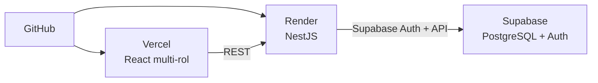

# Modelado C4 — FitZone Sports (propuesta)

Propuesta de arquitectura con el modelo **C4** (Context, Containers, Components). Documento **vivo** hasta el cierre del curso (C4 + ADR se entregan con la demo; ver [LOG 2026-09-04](../../docs/bitacoras/LOG.md)).

**Estado:** actualizado 2026-09-04 (offline sede; feedback 2026-08-28; reunión 2026-09-02)  
**Arquitectura:** monolito modular Nest  
**Canal principal:** aplicación **web multi-rol** (A1–A4)  
**Móvil:** React Native · diferido a Unidad VI  
**Datos:** PostgreSQL en Supabase vía **API de Supabase** (sin ORM) — [ADR-006](../../docs/adr/ADR-006-supabase-api-sin-orm.md)  
**Auth:** Supabase Auth vía pasarela Nest (BFF) — [ADR-005](../../docs/adr/ADR-005-bff-supabase-auth.md)  
**Stack de referencia:** Stack tecnológico y herramientas  
**Decisiones formales:** Índice de ADR

| Nivel C4      | Pregunta                                           | ¿Incluido?                     |
| ------------- | -------------------------------------------------- | ------------------------------ |
| 1. Context    | ¿Quién usa el sistema y qué sistemas externos hay? | Sí                             |
| 2. Containers | ¿Qué aplicaciones / BD / apps se despliegan?       | Sí                             |
| 3. Components | ¿Cómo se parte el monolito NestJS?                 | Sí (propuesta)                 |
| 4. Code       | Clases / interfaces concretas                      | No (queda para implementación) |

---

## 1. Nivel Context (sistema en su entorno)

### Descripción

**FitZone Sports** es una plataforma integral de gestión para una cadena de gimnasios (25+ sedes). Unifica horarios de gimnasio, clases grupales y alquiler de canchas.

El canal de esta entrega es la **aplicación web**: socio, cliente externo, recepcionista y gerente operan por web. La app móvil no entra en este diagrama. Las notificaciones de lista de espera son internas al sistema; no hay un proveedor de correo.

### Personas (actores)

| ID  | Actor                                 | Relación con el sistema                                                                                                      |
| --- | ------------------------------------- | ---------------------------------------------------------------------------------------------------------------------------- |
| A1  | Socio activo                          | Gestiona su membresía, reserva clases y canchas con descuento, obtiene el QR y paga                                         |
| A2  | Cliente externo                       | Reserva canchas a tarifa plena y paga                                                                                       |
| A3  | Recepcionista / administrador de sede | Registra ingresos y consulta el aforo de su sede. En el código el rol es `admin_sede`                                       |
| A4  | Gerente central                       | Configura precios, el descuento de socio, el horario pico y las canchas. No hay alta de sedes ni reportes en el código entregado |

### Sistemas externos

| Sistema          | Rol                                                                                                                                                                                                 |
| ---------------- | --------------------------------------------------------------------------------------------------------------------------------------------------------------------------------------------------- |
| Pasarela de pago | Límite del puerto `PasarelaPago`. En esta entrega el adaptador es `PasarelaSimulada`, dentro de la API: autoriza el cobro y devuelve un token, sin llamar a Mercado Pago ([ADR-010](../../docs/adr/ADR-010-tokenizacion-medios-de-pago.md), RNF-02) |

### Diagrama — Context

Fuente editable: [fuentes/c4-1-contexto.mmd](../../docs/diagramas/fuentes/c4-1-contexto.mmd).

Autor: Patricio Ramos. Fecha: 2026-11-10. Versión: 1.0.

La pasarela de esta entrega no es un proveedor externo real; ver [ADR-010](../../docs/adr/ADR-010-tokenizacion-medios-de-pago.md). Supabase, la API y el terminal de sede son contenedores y no aparecen en este nivel.

---

## 2. Nivel Containers (aplicaciones y datos)

### Contenedores propuestos

| Contenedor | Tecnología | Dónde | Responsabilidad |
| --- | --- | --- | --- |
| Aplicación web | React + Vite | Vercel | Portal del socio y consola de administración. Un solo build |
| Terminal de sede | La misma SPA | Navegador de recepción | Check-in. Sin red, la cola queda en `localStorage` |
| API | NestJS | Render | Monolito modular y BFF. La pasarela simulada corre en este proceso |
| Base de datos | PostgreSQL y Supabase Auth | Supabase | Dominio e identidad. No entra en el Compose |

La app móvil no entra en este diagrama. El Compose de la entrega (C-07, [ADR-009](../../docs/adr/ADR-009-despliegue-contenedores-reversion.md)) empaqueta solo la web y la API.

### Diagrama — Containers

Fuente editable: [fuentes/c4-2-contenedores.mmd](../../docs/diagramas/fuentes/c4-2-contenedores.mmd).

Autor: Patricio Ramos. Fecha: 2026-11-10. Versión: 1.0.

Las cuatro personas quedan en una columna, fuera del límite. FitZone está a su derecha, en una grilla de dos por dos: arriba la web y la API, abajo el terminal y la base. La pasarela queda a la derecha de FitZone. La leyenda está debajo del diagrama.

### Flujos principales entre contenedores

| Flujo                               | Origen → Destino                                        | Notas                                                                 |
| ----------------------------------- | ------------------------------------------------------- | --------------------------------------------------------------------- |
| Login / roles                       | Web → Nest BFF → Supabase Auth (+ perfil/rol en tablas) | Front no llama Supabase directo; guards A1–A4 en Nest                 |
| Reserva de cancha (socio o externo) | Web → Nest → Supabase API                               | Evitar sobreventa (RN-02); preferir RPC/transacción SQL si hace falta |
| Precio dinámico                     | Nest (Strategy)                                         | Socio −15%, externo tarifa plena, pico 19–21 hs                       |
| Pago                                | Nest → Pasarela mock → Nest → Supabase API              | Sin datos de tarjeta (RNF-02)                                         |
| Validación de acceso / aforo        | Web (A3) → Nest → Supabase API                          | Membresía activa; RN-01                                               |
| QR del socio | Portal web → API | `GET /acceso/totp/me`. El terminal valida al sincronizar, no en el navegador |
| Lista de espera                     | Nest (Observer)                                         | Notifica al liberar cupo                                              |
| Nueva sede                          | Web (A4) → Nest → Supabase API                          | Sin redeploy (RNF-04)                                                 |

### Decisiones de contenedores (resumen)

- **Un solo backend:** monolito modular Nest (no microservicios), como **BFF**.
- **Persistencia:** PostgreSQL en Supabase; acceso por **API de Supabase** (no ORM).
- **Auth:** Supabase Auth vía pasarela Nest.
- **Web y terminal:** el mismo build React. El terminal es el navegador de recepción.
- **Móvil:** no entra en este diagrama.
- **Hosting:** Vercel (web) · Render (API) · Supabase (BD + Auth).

---

## 3. Nivel Components — Backend API (NestJS)

Propuesta de módulos internos del monolito. Cada módulo agrupa controllers, services y repositorios del dominio.

### Componentes

| Componente            | Módulo funcional | Responsabilidad                                          |
| --------------------- | ---------------- | -------------------------------------------------------- |
| Auth / Seguridad      | transversal      | BFF: pasarela Supabase Auth, JWT, guards por rol (A1–A4) |
| Usuarios y Membresías | M1               | Perfiles, planes, estados Activo/Vencido/Suspendido      |
| Gimnasio y Acceso     | M2               | Validación QR, presencia en sede, aforo                  |
| Clases Grupales       | M3               | Agenda, cupos, lista de espera (Observer)                |
| Canchas Deportivas    | M4               | Recursos, grilla, mantenimiento, precios (Strategy)      |
| Pagos y Facturación   | M5               | Mock pasarela, tokens, PDF comprobante                   |
| Sedes / Configuración | transversal / A4 | Alta de sedes, parámetros globales                       |
| Capa Repository       | transversal      | Acceso a datos vía **cliente Supabase API** (sin ORM)    |

### Diagramas — Components

El panorama de módulos de arriba no es uno de los 14 diagramas. Los dos C4-3 obligatorios son Canchas y Acceso.

#### Canchas (M4)

Fuente editable: [fuentes/c4-3-canchas.mmd](../../docs/diagramas/fuentes/c4-3-canchas.mmd).

Autor: Patricio Ramos. Fecha: 2026-11-10. Versión: 1.0.

El gestor de bloqueos no es una clase. Es la RPC `reservar_cancha` y el índice único parcial `reservas_cancha_sin_sobreventa`. El socio y el cliente externo quedan en una columna, fuera del límite. FitZone está a su derecha: PreciosService arriba a la izquierda y ReservasCanchaService a su derecha, junto a la pasarela. El repositorio y el gestor de bloqueos quedan debajo del servicio de reservas. La leyenda está debajo.

#### Acceso (M2)

Fuente editable: [fuentes/c4-3-acceso.mmd](../../docs/diagramas/fuentes/c4-3-acceso.mmd).

Autor: Patricio Ramos. Fecha: 2026-11-10. Versión: 1.0.

Sin red, el terminal guarda el check-in en `localStorage` y lo manda con `POST /acceso/check-ins/sync`. El código TOTP se verifica en la API, no en el navegador ([ADR-003](../../docs/adr/ADR-003-estrategia-offline-acceso.md), [ADR-007](../../docs/adr/ADR-007-acceso-totp-cola-offline.md)). El socio y la recepcionista quedan en una columna, fuera del límite. FitZone está a su derecha: el portal arriba del terminal, y dentro de M2 el servicio de acceso a la izquierda de TOTP, membresías y el repositorio. La leyenda está debajo.

### Patrones GoF ubicados en components

| Patrón         | Dónde                    | Para qué                                                      |
| -------------- | ------------------------ | ------------------------------------------------------------- |
| **Strategy**   | Canchas / precios        | `StandardPricing`, `MemberDiscountPricing`, `PeakHourPricing` |
| **Observer**   | Clases / lista de espera | Notificar al liberar cupo                                     |
| **Repository** | Capa de datos            | Desacoplar servicios del cliente **Supabase API** (sin ORM) |

---

## 4. Vista de despliegue (complementaria al C4)

No es un nivel C4 formal, pero aclara el entorno de demo/producción del **camino crítico** (web + API + BD).

| Entorno     | Front              | API                | BD             |
| ----------- | ------------------ | ------------------ | -------------- |
| Local       | `localhost` (Vite) | `localhost` (Nest) | Supabase (dev) |
| Demo / prod | Vercel             | Render             | Supabase       |

---

## 5. Alcance offline (RNF-01) en el modelo

Hay **dos offlines distintos** (acordado en documentación; enfoque técnico a validar con el docente):

| Lado | Qué debe funcionar sin internet | Prioridad | Contenedor C4 |
|------|----------------------------------|-----------|---------------|
| **Sede (A3 / recepción / tornos)** | Validar ingreso y registrar check-in | **Alta — RNF-01** | Web de recepción + material local por sede (propuesto) |
| **Socio (app móvil)** | Mostrar QR dinámico sin red | Media — Unidad VI | App Móvil React Native |

| Contenedor | Comportamiento propuesto |
|------------|--------------------------|
| Frontend Web (resto de roles / flujos) | Online-first (reservas, pagos, reportes, login JWT) |
| Backend Nest | Online; requiere conectividad hacia Supabase |
| Acceso en sede (RNF-01) | **MVP (2026-11-01):** cola local de check-ins en la web de recepción → sync a Nest con errores tipados ([ADR-007](../../docs/adr/ADR-007-acceso-totp-cola-offline.md)). Validación definitiva (membresía, TOTP, RN-01) al sincronizar |
| App Móvil (Unidad VI) | Cache del **seed / QR** del socio (no sustituye el offline de sede) |
| BD (Supabase) | Centralizada en la nube; la sede no escribe ahí mientras está offline |

**MVP adoptado (ADR-007 Propuesto):** QR **TOTP** + check-in online en Nest + **cola + sync** en sede. El enfoque “fuerte” (nodo por sede + paquete de seeds para validar TOTP sin API) queda **diferido**. Detalle: Decisiones §8 · Plan M2 · [Acta 2026-09-02](../../docs/planificacion/Acta_Reunion_2026-09-02_Semana1.md).  
**RN-01:** como RN-02 — unique en `presencias`; Nest solo mapea el error de BD. Offline = consistencia eventual al sync (conflicto → error anotado, sin auto-resolver).

Reservas, clases, pagos y reportes **no** se piden offline.

---

## 6. Trazabilidad a requisitos

| Requisito / regla                | Nivel C4 donde se ve                           |
| -------------------------------- | ---------------------------------------------- |
| Actores A1–A4 vía web            | Context + Container Frontend Web               |
| RF-01…RF-14 (módulos M1–M5)      | Components del backend + pantallas web por rol |
| RN-01 (una sede a la vez)        | Component Acceso + DB (online); eventual en offline |
| RN-02 (sin sobreventa)           | Component Canchas + PostgreSQL / Supabase API  |
| RN-03 (mora)                     | Membresías + Strategy de precios               |
| RNF-01 (offline acceso)          | **Sede** (check-in local + cola); móvil solo QR del socio (Unidad VI) |
| RNF-02 (sin tarjeta local)       | Container API ↔ Pasarela mock                  |
| RNF-04 (nueva sede sin downtime) | Component Sedes + datos en DB                  |

---

## 7. Próximos pasos sugeridos

1. ~~Confirmar canal web vs móvil para A1/A2~~ — **cerrado:** web multi-rol; móvil en Unidad VI.
2. Diseñar pantallas web por rol (A1–A4) en Unidad IV.
3. Revisar ADR ya redactados — Índice de ADR.
4. ~~React Native vs Flutter~~ — **cerrado:** React Native.
5. ~~Actualizar alcance offline (RNF-01 sede vs móvil)~~ — **hecho 2026-09-04** (§5); ~~borrador ADR TOTP + cola~~ — **ADR-007 Propuesto (2026-11-01)**; validación docente del nodo/paquete fuerte sigue abierta.
6. Al implementar M2 (Fases 1–4 del Plan): pasar ADR-007 a Aceptado; opcional diagrama D5 de cola + sync.
7. A medida que se desarrolle: ir sumando **ER** y **diagrama de clases** al paquete de arquitectura (entrega formal al cierre).
8. Exportar diagramas a imagen/PDF cuando se arme el entregable final.

---

## Referencias

- Trabajo Integrador — FitZone Sports
- Funcionalidades por actor
- Stack tecnológico y herramientas
- Índice de ADR
- Decisiones pendientes
- [C4 Model — Simon Brown](https://c4model.com/)

---

*Propuesta C4 · FitZone Sports · Programación V · UNER*